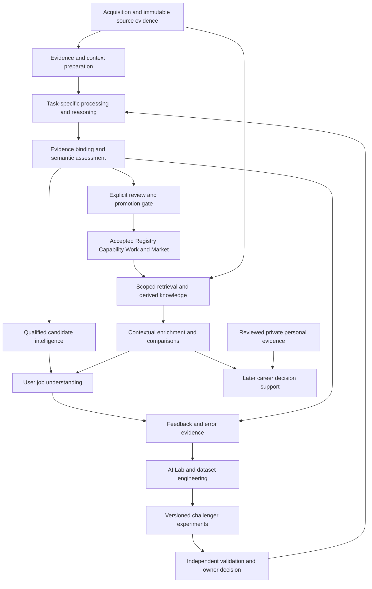
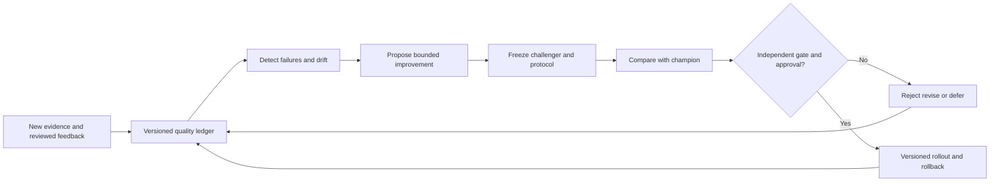

# JobHunter AI Architecture, Research and Evolution Plan

**Adopted:** 2026-11-25 — owner approved the research directions discussed after E1.9.
**Revision anchor:** main at `44181746a58002889440eccb254526cf8b1d183a`.
**Status:** ACTIVE strategic research companion; planning approved, implementation and promotion individually gated.
**Next execution:** E2.5 in [P1.6 semantic architecture evolution](P16_SEMANTIC_ARCHITECTURE_EVOLUTION_PLAN.md). This document does not create a new immediate implementation phase.

## 1. Mission, authority and relationship to existing work

JobHunter should become an adaptive, evidence-centered, local-first personal career and labor-market intelligence system. Its success is better real career decisions with less manual reading and rechecking, not the number of AI components, calls, passing schemas, or models trained.

This plan consolidates the owner's approved interests in RAG, multi-agent reasoning, specialized models, training and continual improvement, together with model evaluation, adaptive routing, a professional knowledge graph, dataset engineering, personal evidence and temporal market intelligence. It modernizes the earlier [August 2 AI Intelligence, RAG, Agents, and Continual-Learning Proposal](AI_INTELLIGENCE_RAG_CONTINUAL_LEARNING_PROPOSAL.md) using the implemented system and recent P1.6 evidence. Keep that proposal intact as historical design material, including its detailed worker/UI ideas. Its external-provider examples, illustrative configurations, and AI-A/AI-B-first execution sequence are not current approvals. Evaluation and causal diagnosis come before broad provider/routing infrastructure.

**Authority order:** [Product](PRODUCT_SPECIFICATION.md), [domain](DOMAIN_AND_ANALYSIS_MODEL.md), [source](SOURCE_POLICY.md), [architecture](ARCHITECTURE.md), [reasoning/promotion policy](UTILITY_EPISTEMIC_AUTHORITY_AND_REASONING_POLICY.md), [roadmap](ROADMAP.md), [implementation plan](IMPLEMENTATION_PLAN.md), status overlay, focused decisions/plans, TODO/memory and implementation evidence. This research plan is subordinate to those authorities and does not change them. The [Stage B focused plan](P16_STAGE_B_SOURCE_GROUNDED_BILINGUAL_IMPLEMENTATION_PLAN.md) and its [45-item execution tracker](P16_SEMANTIC_ARCHITECTURE_EVOLUTION_PLAN.md) remain the single operational route for the active semantic evolution. P2.3 remains deferred. The research portfolio below records future opportunities, not a second active execution checklist. Add approved future slices to their controlling execution plan when eligible; never count the same work twice.

**Owner approval here:** record and evaluate these research directions; preserve a future path for all of them. Not approval to deploy RAG, agents, external providers, train models, acquire new cohorts, or change production routes. No new model downloads, inference, indexing, data export or training required to adopt this document. Local-only inference remains the active constraint. Research that requires external model metadata or downloads can be considered separately; external inference/data transfer requires explicit separate approval and source/privacy review. No silent cloud fallback.

## 2. Starting point: use evidence rather than start over

The current application is a Python modular monolith with SQLite and separate original source, derived English projection, semantic artifacts, review and downstream intelligence. Retain the existing architecture where it works. [Current runtime and versioned code](CURRENT_RUNTIME_AND_VERSIONED_CODE.md) and forthcoming DOC.2 verified maps are the as-built references; the diagram here is prospective.

| Existing foundation | What it enables / what remains unknown |
| --- | --- |
| Original source versions, hashes, lifecycle and parsed metadata | Reproducible evidence, time-scoped retrieval; semantic completeness not guaranteed |
| English v2 translation and original v9 / English v30 analysis | Existing comparison baseline; failures and review-state risks documented, not a universal gold standard |
| B1/B2/B3/B4 source-bound candidates, B4v6 and source-brief | Candidate evidence, bilingual alignment, partial display experiments; B5/B6 remain closed |
| Canonical Registry, Capability and Work Intelligence | Reviewed correspondences and accepted source-linked organization; not a full knowledge graph or personal assessment |
| Market membership, immutable snapshots, aggregates and reports | Scope/denominator-aware market intelligence; cannot infer whole-market prevalence from selected corpus |
| Prior review packets, frozen baselines, test fixtures and failed attempts | Evaluation seed material; exposed data not independent holdout or automatically fit for training |
| Local LM Studio and bounded transport experiment | Local inference control; exact installed model artifacts, quantization, runtime configuration and resource envelope to be inventoried E1.10 |

Evidence driving the new design: [E1 investigation](working-memory/2026-11-24_P16_EVOLUTION_E1_ROOT_CAUSE_INVESTIGATION.md) establishes prompt/validator contradictions, false coverage obligations, heading-sensitive misclassification, translation drift and all-or-nothing delivery. Three November 23 source-distinct v30 attempts failed, including two native-English descriptions; original v9 historical acceptance also included known errors. Seven checked v2 translation pairs passed integrity even though meaning drift existed. B3 exact alignment does not certify linguistic fidelity; B4 reference filtering does not prove entailment. Source-brief exposed 82 extracted items despite three failed analyses, but labels and coverage remain provisional. Four previous B5 cohorts are exposed and cannot become a fresh success set. [Research status index](working-memory/2026-11-13_JOBHUNTER_RESEARCH_PROMOTION_AND_MANUAL_REVIEW_INDEX.md) records bounds.

Do not confuse engineering regression passes, semantic accuracy, useful delivery, or promotion. No architecture or model is selected by these observations alone.

## 3. Prospective architecture and engineering principles



Conceptual flow only: the feedback path is a gated version change, not autonomous mutation; retrieval may assist original-source interpretation only through a separate explicitly tested mode. Personal evidence and future career decisions are separately gated. Keep one modular monolith and SQLite-first unless measured needs justify another process/store. Reuse tested seams instead of creating a universal orchestration framework, vector database, graph database or provider abstraction in anticipation.

1. Preserve exact original evidence, its version and origin; summaries, translation, retrieved text and embeddings are derived aids.
2. Prefer the smallest *effective* reasoning workflow, not necessarily the smallest model. LLMs own contextual interpretation; deterministic code owns state, identity, math, bookkeeping and enforceable safety boundaries. Avoid forcing correlated duties/capabilities into disjoint meanings or making every policy clause a prompt requirement.
3. Source facts, normalized correspondences, analytical interpretations and recommendations are different authority classes. Model confidence, critic agreement, retrieval rank, schema pass or repeated appearance do not certify a claim.
4. Keep explicit employer obligation, inferred work-implied capability, proficiency, prior paid experience, eligibility alternatives and personal evidence distinct; support overlap and uncertainty without fabricated requirements.
5. Deliver qualified partial information where useful; withhold invalid or dependent unsafe claims. Keep accepted-only consumers fenced until a separate compatible promotion decision.
6. Benchmark before selecting complexity. Compare with no-change and simple baselines, including non-LLM baselines. Any additional model, retrieval, agent, adapter or store must earn its cost.
7. Preserve versioned lineage, measured budgets, rollback and privacy. No automatic reclassification of historical accepted artifacts. No autonomous job application submission.
8. Evaluate user benefit under representative tasks, not only machine metrics. Avoid excessive review burden; require review at authority transitions and for consequential uncertain claims.

## 4. Research portfolio

Each ID below denotes a future research question or capability family. **REGISTERED** means approved for consideration only. **ROUTED** means its bounded first work belongs to an existing E item; it is not done. Specific implementations require a scoped proposal, reproducible evidence and the applicable product gate. AR.0 is adoption of this plan only.

| ID | Direction | Status / first eligible window |
| --- | --- | --- |
| AR.0 | Record and reconcile research strategy | DONE (planning only), this document |
| AR.1 | Comparative model inventory and resource profile | INVESTIGATED E1.10 (read-only); no qualification/selection |
| AR.2 | JobHunter AI Lab and benchmark/data foundation | ROUTED E2.3–E2.4 design; E3 bounded runner |
| AR.3 | Specialized models and task-specific routing | ROUTED E2/E3 model screening; routing later if justified |
| AR.4 | Original-first / translation / bilingual semantic architecture | ROUTED existing E1.8/E2/E3 |
| AR.5 | Retrieval and RAG | REGISTERED; design comparison E2, bounded experiment only if selected, broader feature after relevant gates |
| AR.6 | Bounded multi-worker / agentic reasoning | REGISTERED; E2 alternative, E3 only if selected, broader workflows later |
| AR.7 | Dataset engineering, feedback and review quality | ROUTED E2 dataset protocol; ongoing approved slices |
| AR.8 | Classical ML and small specialized trained models | REGISTERED; after sufficient lawful reviewed data and task-specific baseline |
| AR.9 | LLM adaptation / LoRA / QLoRA | REGISTERED; after stable target, sufficient reviewed data and baseline feasibility |
| AR.10 | Continual improvement and learning loops | REGISTERED; start with feedback/evaluation, advanced training gated |
| AR.11 | Professional knowledge graph / Graph-RAG | REGISTERED; after reviewed Registry semantics and demonstrated query need |
| AR.12 | Temporal market intelligence, novelty and coverage | REGISTERED; extend accepted Market scope through roadmap |
| AR.13 | Personal capability evidence and career decisions | REGISTERED; Phase 3 and separately approved P2.3 prerequisites |
| AR.14 | Runtime operations, observability, security and documentation | ROUTED existing E1.10/DOC/E2/E3 bounds; later system-wide slices |

The following sections define the minimum useful experiment and acceptance logic, not a mandatory software decomposition.

## 5. Model research and specialization (AR.1, AR.3, AR.4)

### 5.1 Inventory before experimentation

E1.10 must reconcile configured versus actually installed/loadable models, prior receipts, exact names, model family/revision where known, artifact/hash or immutable identity where possible, quantization/format, tokenizer/template, license and data-use constraints, runtime/backend versions, supported context and actual configured context, reasoning/structured-output capabilities, model placement and hardware. Record unknowns; a server alias is not proof of exact weights. Inventory read-only; do not load, download or benchmark new models in E1.

Owner-reported environment: RTX 3070 8 GB VRAM, 64 GB RAM, LM Studio local endpoint; verify usable runtime and free-memory constraints rather than assuming all weights fit. Prior receipts refer to Gemma E2B translation, Gemma E4B analysis, and a Qwen-derived distill model. Check exact variants and availability in E1.10. Nominal parameter counts (especially MoE active vs total) do not predict memory footprint alone: weight quantization, context/KV cache, output length, batch size and offload matter. Do not promise a 12–14B or larger MoE fits GPU, or that CPU offload is fast enough. Screen local viability before expensive trials. Model cards and external benchmarks are hypotheses, not JobHunter task evidence.

Candidate families to investigate, not endorsements or downloads: existing small/medium Gemma variants; suitable Qwen-family or other multilingual instruction models; a stronger model if the hardware budget permits; dedicated multilingual translation and embedding models; small classifiers/rerankers where a generative LLM is unnecessary. Check Persian/mixed script, technical entities, context handling, format constraints and license. Translation model output quality is independent of analysis quality.

**2026-11-26 discovery/qualification update:** [Model research register](working-memory/2026-11-26_AI_MODEL_DISCOVERY_AND_QUALIFICATION_REGISTER.md) records the owner's planned manual downloads, exact candidate repositories/quantization leads, runtime/rights and task-specific screening. New artifacts are REGISTERED only. AR.1/AR.3/AR.4/AR.5 use the staged qualification process; optional bounded screening requires a separate manifest and implemented guard. E2.3's 47 cells/M0/M1/M2 policy unchanged; no automatic expansion, loading, training or production routing. E2.5 assesses whether an explicit amendment is justified before outputs.

### 5.2 Controlled model versus architecture evaluation

E2.3 must explicitly design a bounded comparison of at least two distinct viable local semantic model artifacts, unless E1.10 documents a concrete resource/availability blocker and E2 records a smaller design and unresolved model hypothesis. Compare the incumbent unchanged v30 with selected targeted repair and/or simpler source-local/original-first/hybrid candidate as planned. Do not mandate a full cross-product; preregister staged screening and finalist comparisons. Exposed cases only in E3; fresh B5 separate.

| Experiment | Hold fixed | Change | Question |
| --- | --- | --- | --- |
| A: model-only | Architecture/contract/task, same source versions, equivalent decoding/context budget as feasible | Model artifact (one factor; record unavoidable template/quantization/runtime differences) | Is the model a limiting factor? |
| B: architecture-only | Model artifact and equivalent runtime, source versions, user task | Representation, prompt/validation, source/translation/hybrid or partial-delivery design | Does the system design improve outcomes? |
| C: interaction | Frozen paired cases and rubric | Selected feasible model × architecture pairs | Is a particular combination better, and under which conditions? |
| D: task specialization | Same task and evidence | Dedicated translation/embedding/classifier or LLM baseline | Does specialization improve fidelity, latency or cost? |
| E: selective escalation | Same primary baseline and cases | Triggered stronger model/critic vs primary only, optional fixed pipeline control | Does additional reasoning reduce consequential errors enough to justify overhead? |

Predeclare stage sizes, repeat policy/seeds and sampling settings (or nondeterminism), order/warmup controls, hardware profile, cold vs warm loads, failure and timeout treatment, maximum physical attempts including retries/recovery and preflights separately, tokens and wall deadline per job/session, memory ceiling, stopping conditions and budget for all arms. Use comparable model-specific chat templates as required; disclose confounds instead of treating different tokenizers as identical. Preserve every attempt, including no artifact, partial and rejected. No cherry-picking best seed. Record actual wall latency including translation, model loading, verification, retries and user workflow; report missing usage as unknown, not zero.

**Selection:** freeze thresholds in E2.4 before outputs; critical unsupported facts, false required/experience claims, wrong identity/attribution and unsafe authority remain hard gates. Compare semantic coverage, correct qualification of uncertainty, translation/alternative fidelity, useful delivery, source-first user task accuracy/time and resource/maintenance burden. Report per case, language and sparse/dense strata, denominators, paired differences and uncertainty (small exposed samples are diagnostic). A larger/slower model is not automatically better. If no feasible model satisfies requirements, keep existing protected baseline and revise design or defer. Model changes create distinct artifact/experiment identity; no hidden fallback.

### 5.3 Task specialization and routing

| Task | Minimal baseline to compare | Candidate if justified |
| --- | --- | --- |
| Semantic understanding | One configured LLM with coherent context | Stronger multilingual model, selected original/bilingual input |
| Translation / terminology | Native identity, current v2, existing B3 | Dedicated local translation, contextual batch or selected translation, terminology constraints only if validated |
| Duplicate detection | Exact original description SHA, normalized lexical similarity | Local embeddings / near-duplicate classifier; do not merge distinct job versions automatically |
| Retrieval | SQL / lexical search | Multilingual embeddings and reranker |
| Relevance/role candidate | Title/search metadata rules, simple supervised classifier | Small transformer/LLM; role family remains candidate until reviewed |
| Concept mapping | Existing Registry exact/alias and reviewed mappings | Semantic candidate retrieval/ranking |
| Quality investigation | Deterministic failures and source review | Bounded independent critic or targeted model |
| Aggregation | SQL/Python exact counts and grouping | LLM synthesis over calculated values only |

Keep one model where sufficient. Prototype task/model registry and route receipts in AI Lab before extracting generic provider interfaces. Store actual executing model and route, fallback reason, input versions, config/prompt/contract, output/review status, resource usage; avoid secrets. Adaptive routing may use pre-model observable complexity (language, density, alternative structure, known error/unknown states), not uncalibrated self-reported confidence as sole trigger. Learn routing only from reviewed outcomes; compare unconditional strongest/smallest and simple heuristic route. Budgeted escalation must preserve context and stop after cap; if exhausted, qualified partial/unknown state. No model consensus as automatic acceptance; no remote endpoints in current experiments. Reuse the existing local provider and budget guard where compatible, verify actual dispatch/time enforcement.

## 6. AI Lab and evaluation (AR.2)

Build a small reusable *experiment capability* during E2/E3, not a standalone dashboard platform or unrelated benchmark project. Start from existing frozen receipts, offline replayers, source-first review and the paired E3 runner. Only generalize after multiple experiments need the same seam.

- Experiment manifest: ID, hypothesis, scope, baseline/arms, source snapshot and hashes, dataset split/exposure/rights, code/model/config/version fingerprints, environment, exact reproducible command, budgets/stops, frozen rubric and decision authority.
- Runner: isolated DB/output/corpus destinations, bounded transport, observable call lifecycle, resume only with immutable inputs/explicit retry policy, no production side effects, retain failed and unattempted cases, no raw reasoning traces required.
- Review: original-source assertions frozen before candidate outputs where possible; independent/context-isolated evaluation when required; reviewer identity/role, exposure, disagreement/adjudication and unresolved facts retained. LLM evaluator can triage or propose, never certify its own generated claims.
- Results: raw local private receipts, safe aggregates/hashes in Git, reproducible per-case comparison and negative cases, qualified conclusion, retain/revise/reject decision and rollback. Existing DOC track covers verified architecture maps; do not rebuild it.

| Metric family | Required distinction |
| --- | --- |
| Integrity | Exact anchors, source/translation/currentness, unauthorized writes and leakage; hard failure, not averaged away |
| Meaning | Supported/partial/contradicted/unsupported/unknown; explicit obligation, prior experience, degree, scope, OR/AND, names, numbers, negation, attribution |
| Coverage | Material source units and relationships represented, omitted, unresolved, excluded; distinguish reference coverage from semantic coverage |
| Delivery | Attempted, completed, valid pending, partial usable, failed/rejected, not attempted, accepted separately |
| Resource | Physical requests, retries, token counts, context fit, cold/warm latency, VRAM/RAM peaks, offload and load time when measurable |
| User utility | Correct actionable answers, critical misinterpretations, time, drilldown/review burden, comparison with original ads |
| Maintenance | Complexity of effective code/prompt/schema, failure recovery, repeatability, changes needed for new source patterns |
| Retrieval/training (later) | Task-specific metrics in sections 7/9, source-group leakage, held-out performance and regression |

Gate hierarchy: engineering validity -> exposed comparative usefulness/meaning -> genuinely independent prospective B5 and owner/context-isolated utility as required -> explicit B6 integration/rollback. No proxy-only user benefit, no 'perfect' claims from small samples. Keep negative results visible. A no-change or defer decision is a valid outcome. Set numeric thresholds with source unit definitions and practical budgets before executing each experiment, not arbitrary numbers now.


## 7. Retrieval and RAG (AR.5)

### 7.1 Product scope and retrieval authority

RAG is retrieval-and-reasoning, not a synonym for a vector database. JobHunter can retrieve structured facts, lexical matches, semantic neighbors, reviewed concept correspondences, historical snapshots and evidence-linked analytical records. Start with a concrete product query, e.g. "Which work activities recur in AI/security automation roles in this selected market?" Compare a SQL/lexical-only answer before adding embeddings or generative synthesis.

| Retrieval zone | Permitted use | Prohibited inference |
| --- | --- | --- |
| Current original source for one job | Ground job-specific facts and contextual reading | Claim adjacent jobs are part of this ad |
| Derived translations and candidate analysis | Reading aids or explicitly provisional interpretation | Treat as exact employer wording or accepted fact |
| Reviewed/accepted analysis and mappings | Compatible reuse with exact lineage | Transfer requirements to another job |
| Historical source/snapshot versions | Time-scoped comparison, change history | Present expired/stale ads as current |
| Reviewed terminology/domain knowledge | Disambiguation, contextual enrichment | Upgrade work or market patterns into mandatory qualifications |
| Future private personal evidence | Personal comparison after authorized Phase 3 | Index in public zones or send externally |
| Project/operational documentation | Developer orientation, not job evidence | Mix internal instructions with employer claims |

Default source understanding must not retrieve other advertisements as additional employer evidence. A separately tested retrieval-assisted interpretation may use scoped terminology, reviewed examples or original sections to understand wording; every explicit employer claim still requires current original evidence. Label external contextual inference separately and retain retrieved context. Test for false-required claims, overgeneralization, copying and misleading confidence induced by retrieval. If it does not improve source fidelity, keep retrieval outside extraction. Corpus-wide synthesis can use multiple sources when claims and denominators are traceable.

### 7.2 Incremental design and alternatives

- R0 structured baseline: SQL over current accepted-compatible artifacts and metadata; exact filters, market/search/snapshot scope, Registry and source drilldown. Raw source search is a separate coverage population.
- R1 lexical retrieval: evaluate SQLite FTS5 (availability, Persian normalization, mixed-language tokens), fielded search, exact technical names, filters and ranking. Original Unicode text and span identity remain intact; index normalization is derived.
- R2 local embeddings: compare multilingual embedding candidates and lexical baseline on frozen queries; version model/tokenizer, dimensions, pooling/normalization, chunk/source identity and index recipe. Test cross-language retrieval, technical names, alternatives and varied length. Use simple local storage/search first; choose vector backend only after scale/latency/maintenance evidence. Embeddings are not semantic facts.
- R3 hybrid retrieval and reranking: structured filters, lexical/vector ranking, measured fusion, optional reranker, bounded top-k and context budgets. Compare against simpler arms. Retain ranks, scores, filters, reference versions and exclusions. Similarity is not calibrated semantic confidence.
- R4 "Ask JobHunter": evidence package with resolvable citations, calculated scope, conflicting evidence and explicit insufficient-evidence states; original text/review status accessible. No citation-free factual answers, ungrounded aggregates or automatic recommendations.
- R5 graph retrieval only if AR.11 proves additional value.

Chunk by meaningful context: whole job or section when needed, exact source items and relationship groups for drilldown, metadata separately, compound alternatives and shared qualifiers together. Each chunk/version/span/hash and derived translation association must be resolvable. Idempotent incremental indexing; new source/version, corrections, review status or deletion invalidate affected entries/dependent caches, not necessarily all embeddings. Historical snapshots remain immutable. Incomplete indexing has an explicit coverage state; derived index is rebuildable, not authoritative storage.

### 7.3 Evaluation and gates

Freeze representative questions and source-first relevance judgments before retrieval. Include exact terms, cross-language search, related roles, negation/ambiguity, no-result queries, stale/current versions, rejected/pending content, similar ads with distinct conditions and temporal questions. Record relevance granularity, corpus scope, reviewer exposure, top-k, Recall@k, precision@k, MRR or nDCG where useful, exact reference resolution, freshness, latency, index cost/storage and failures. Assess answer support/entailment, completeness, false attribution, scope/denominator accuracy and user task accuracy/time. Retrieval quality alone does not establish answer fidelity. Hard gates: no private/secret cross-zone leakage, unsupported source/accepted authority, invented counts/citations; stale references withheld or explicitly historical. Predeclare thresholds/budgets and no-retrieval controls. Promotion requires measured benefit over simplest adequate baseline and integration/rollback checks.

## 8. Specialized workflows and multi-agent investigation (AR.6, AR.14)

Treat an agent as a bounded versioned reasoning worker with task, inputs, evidence, outputs, permitted tools and stops. Many jobs require only a fixed workflow. Prefer selective investigation when primary result contains material ambiguity, unresolved context or objectively detected failure. More calls and agreement are not semantic proof.

| Worker (candidate) | Scope and allowed output | First comparison |
| --- | --- | --- |
| Semantic analyst | Original/bilingual understanding, linked candidate claims and implied capabilities | Single coherent model vs decomposed pipeline |
| Language specialist | Selected source/target ambiguity, name, terminology and modality fidelity | Dedicated translator or targeted pass vs unchanged |
| Evidence critic | Challenge unsupported assertions, omissions, scope and alternatives; proposed corrections only | Existing checks/source review vs additional critic |
| Retrieval planner | Select permitted zones, filters, bounded evidence | Fixed SQL/lexical query vs model planning |
| Concept normalizer | Suggest reviewed Registry mappings, preserve original wording | Exact/alias baseline vs ranked proposals |
| Quality investigator | Classify failures, propose experiments | Offline deterministic report vs model synthesis |
| Later market/career specialists | Interpret calculated market facts, later reviewed personal evidence | Existing report/comparison vs scoped task |
| Later search/lifecycle worker | Suggest catalog changes or clarify ambiguous source response | Existing deterministic acquisition/review; no automatic mutations |

Compare (1) single primary call, (2) fixed specialized pipeline, (3) primary plus selective critic/stronger call, (4) bounded dynamic investigator with read-only retrieval and shared state. Same frozen cases, comparable budgets where meaningful, disclose cost differences. Select adaptive behavior only if it improves actionable fidelity or recovery beyond simpler alternatives without material regression. Different model families or reviewer isolation may reduce correlated errors; different prompts on same model do not guarantee independence.

Minimal shared workspace, if justified: immutable source refs, candidate claims/relations, dependency revisions, task state, attempts, evidence and open questions. Each worker creates versioned outputs, cannot silently edit source, accepted state or another worker's evidence. Deterministic orchestration resolves IDs, budgets/dependencies and duplicate work; disagreements stay unresolved or route to source review. Changed dependencies invalidate dependent candidates. Partial display remains separate from promotion. No unrestricted shell/browser/network/tools, self-authorization, autonomous applications, hidden durable memory, recursively spawned work or unbounded critic/retry loops. Treat ads/retrieved text as untrusted data, never instructions. Tool allowlists, read-only scope, validated arguments, explicit write permissions and cumulative request/token/wall ceilings. No external agent service in current scope.

Later task queues only if failure/resume and user workflow justify them: run IDs, state transitions, resumable idempotent work, cancellation, bounded concurrency, model load telemetry and receipts. Reuse existing service/CLI/browser seams instead of building a general agent framework first.

## 9. Dataset engineering and training our own models (AR.7–AR.9)

### 9.1 Data assets and label authority

A large collected corpus is not automatically a training dataset. Assess allowed source use, license, retention and privacy first. Public availability, repository MIT code license or generated translations do not grant training/publication rights to job text or model weights. Record source/use terms, model license, redistribution and training purpose; exclude unresolved rights from training/publication. Personal evidence separate, not default training material. Never publish raw private sources, responses, private embeddings or model/dataset artifacts that expose restricted material.

Proposed datasets (separate task/rubric): bilingual fidelity; original semantic assertions and relations; duty-to-capability vs explicit experience; obligation/depth/alternatives and hard negatives; metadata conflicts; entity normalization; retrieval query/relevance; duplicate detection; relevance triage/role grouping; feedback/correction and routing outcomes. Each includes target task, source/version/hash/offset, acquisition scope/date, annotation version, reviewer role/exposure, disposition, label provenance and limitations. Preserve overlapping labels and uncertainty. Machine-generated candidates, reviewed labels, synthetic examples and actual observations separate. Training admission requires data quality/rights review; accepted status alone (especially historical v9) is not gold. Use unsupported/missing-context negatives without inventing observed employer facts.

Split by original-description SHA, near-duplicate groups, job/source version and where appropriate employer/template/time, not random clauses from same job. Freeze train/development/exposed diagnostics vs untouched evaluation with hashes and leakage checks. All E1/exposed B5/Nov23 cases remain exposed; never claim them as independent unseen evidence. Fresh B5 not used before prospective test. Time-split longitudinal tests. Review disagreement, missing labels, class balance, coverage and unknowns; preserve correction lineage and immutable evaluation receipts. Holdout labels/source examples do not enter prompts, RAG, training, routing or calibration before test. Once used for tuning, retire as holdout and retain regression history. No auto-acquire new set or repeatedly test until success.

Start with versioned dataset manifest and reproducible export/validation when needed. Raw inputs/labels and weights private ignored, safe counts/hashes/quality metrics tracked. Manifest includes purpose, rights, schema/generator versions, selection queries, split groups, reviewer roles, lineage, exclusions, missingness and biases. Access, retention/deletion and backup/restore before irreplaceable private data.

### 9.2 Training progression

| Option | Plausible first use | Comparator/readiness |
| --- | --- | --- |
| Classical ML (linear/tree/similarity) | Duplicate/relevance, routing risk, interpretable classification | Deterministic/lexical baseline, representative reviewed labels, balance/calibration |
| Unsupervised methods | Explore recurring role/skill patterns | Existing grouping/Registry, stability and source review; no automatic role-family promotion |
| Small pretrained classifiers/embeddings/rerankers | Multilingual relevance, retrieval, entities, mappings | Frozen task benchmark, rights and local feasibility, measured improvement |
| LoRA/QLoRA adapter of existing LLM | Narrow semantic/structured or bilingual task | Stable target contract, sufficient non-leaking reviewed data, feasible training and inference baseline; simpler options tested |
| Full fine-tune | Only if adapters/other options fail measured need | Cost/hardware/license review and explicit decision |
| Train LLM from scratch | Not current objective | Deferred as unjustified |

No generic promise of dataset size or duration. Set task-specific minimum support, label quality, learning-curve and held-out thresholds before training. Bound local feasibility trial; record hardware, precision, optimizer, sequence length, batch/accumulation, adapter config, seeds, library versions, checkpoint hashes, wall time and actual memory. Inference fit does not establish QLoRA training fit; activations, optimizer and offload matter. Freeze baseline/held-out rubric, no test tuning, preserve runs, compare per-class precision/recall/F1, calibration/abstention and consequential errors or retrieval metrics as applicable. For LLM evaluate source-semantic fidelity/user utility; inspect forgetting and language/rare concept robustness. No release before leakage/memorization, rights/privacy, rollback and promotion review. Own models are replaceable artifacts, not mandatory dependencies. Prefer simpler alternatives if training doesn't improve a defined problem. No training during E1.

## 10. Continual learning and self-improvement (AR.10)

Continuous learning means improved knowledge, data, evaluation and decisions over time; model weights need not continuously change.

| Level | Capability | Gate |
| --- | --- | --- |
| L1 Knowledge refresh | Incremental source versions, reviewed corrections and derived index refresh | Existing source/lifecycle/currentness |
| L2 Feedback/active learning | Capture errors, omissions, preference, review, uncertainty and selection reasons | Label authority/privacy; unverified output not truth |
| L3 Quality observability | Detect recurring failures, drift, coverage gaps, resource/delivery regressions | Comparable scopes/denominators; corpus vs model drift separate |
| L4 Improvement proposals | Suggest prompt/contract/retrieval/routing/catalog/training changes | Versioned proposal, no automatic edits |
| L5 Challenger evaluation | Freeze candidate, exposed replays and approved independent tests | Budget/leakage control, reproducible evidence and decision |
| L6 Periodic supervised retraining | Bounded model/adapters on reviewed training-eligible data | AR.7–AR.9, stable target |
| L7 Controlled rollout | Opt-in shadow/canary, explicit promotion and rollback | B6 or future feature-specific acceptance |

Feedback distinguishes employer-claim/translation/mapping correction, UI preference, failure, adjudication and outcome; exact affected version/evidence, severity, reviewer/exposure, old/new meaning and approval. User click/preference is not truth. Active learning prioritizes high-impact failure, rare patterns, new terminology, uncertainty/disagreement plus representative random samples to reduce bias. Separate dataset admission.



Track source distribution, model/runtime, parser, language, context/coverage, unresolved states, corrections, delivery/latency and accepted lineage. Model drift is hypothesis until comparable evidence isolates it. Design periodic review/triggers later after measured use; no scheduling authorized. AI can propose, but source policy, code, semantic contracts, canonical mapping, training admission, provider permission and production routes require applicable approvals. No recursive autonomous self-training, self-modifying code/prompts, training because critic agreed, or auto-promotion. Retain champion/replay set, isolate challengers, explicit version rollout/rollback and adverse reporting. If accepted consumer regression, halt rollout and follow reviewed remediation rather than delete durable history.


## 11. Professional knowledge graph and contextual intelligence (AR.11)

Build on existing Canonical Registry, reviewed correspondences, source facts, Capability and Work candidate structure rather than introduce a new ontology. Potential typed nodes: job/version, organization, role candidate/reviewed concept, technology, knowledge/practice, work statement, capability, qualification, condition, evidence, market scope/snapshot and later private personal evidence. Candidate relationships: explicitly stated by employer, required/preferred, alternative eligibility membership, work implies capability, reviewed concept correspondence, observed co-occurrence, temporal observation, possible prerequisite, personal evidence demonstrates capability. Each edge carries relation type, subject/object IDs, scope/source/version, evidence basis (explicit/inferred/reviewed), uncertainty/review state and applicable validity dates. Keep contextual relationships distinct from employer claims. Co-occurrence is not prerequisite, equivalence or causality; related skills do not imply mandatory prior applicant experience. Alternative groups and direction matter.

Start with SQL adjacency/joins over existing entities and mappings, define one useful question (e.g. capability/work connections in scoped role comparison). Test relation correctness/coverage, path evidence, uncertainty, duplicate counting, latency and user utility vs flat retrieval or existing comparison. Graph-RAG only if traversals improve evidence discovery or explanation. No unrestricted inferred edges, automatic taxonomy promotion, graph database, ontology rebuild or personal nodes in public zone. Durable Registry/Market meaning changes require controlling plan review.

## 12. Temporal market and personal career intelligence (AR.12, AR.13)

**Market:** extend existing immutable Market snapshots, membership, exact aggregates and role-family reports, not a separate authority engine. Scope time intervals, geography/search terms, target definitions and source versions; distinguish posted/observed/expiry time; track duplicates, coverage, missing analysis and accepted-population denominator. Compare like cohorts before trend conclusions. Retrieval/model synthesis can explain measured changes, emerging role/technology combinations, novelty and coverage gaps; no invented frequency, forecasts or market-wide prevalence from nonrepresentative selected ads. Compare deterministic reports vs enriched explanations; validate counts, scope, citations, actionable answers and uncertainty. Source/search suggestions reviewed, not automatic catalog changes.

**Personal:** only after applicable Phase 3 evidence model, privacy/backup/restore and P2.3 roadmap authorization. Use user-provided/reviewed projects, learning, work experience, demonstrations, recency, evidence context (including AI assistance/independence where relevant) and limitations. Distinguish demonstrated ability from stated knowledge, employer expectations, work-implied capability, years/paid experience and personal preferences. Gap analysis compares distinct evidence-backed dimensions, not a single invented fit percentage. Support opportunity comparison, learning priorities, what-if career paths, portfolio/learning evidence and application preparation; never invent personal claims or guarantee eligibility. Private local retrieval, explicit boundaries, user final approver of consequential actions. No personal scoring, resume automation or evidence mutation authorized here.

## 13. Security, operations and maintainability (AR.14)

Keep local-first modular monolith; explicit sensitivity classes (public source collected under policy, derived, internal operational, private personal, secrets). Public source is not unrestricted disclosure permission. Local model endpoint only for current experiments; never send credentials, raw private prompts, logs, personal data or secrets to external inference. Redact telemetry, no raw model responses in public corpus, explicit export scope. Only approved source access, no new scraping/anti-bot bypass. Treat downloaded model/weight files as supply-chain inputs; verify identity, license, origin and dependencies, avoid untrusted remote code execution; test loading isolation when authorized. Escape source/model/retrieved text in browser; least-privilege observable tool access.

Record resource budgets by physical request (retry/truncation included, preflight distinct), session wall deadline, token/context caps, concurrency, model residency/switch cost, storage/index growth and actual outcomes. Graceful failure, no infinite retry, silent context truncation, missing-state as zero or hidden fallback. Version cache/reuse keys on actual source/model/prompt/contract/dependency identity; invalidate on changes, no stale authority. Inspect source and currentness, quarantine affected records, preserve historical accepted facts unless explicitly reviewed remediation. Test negative cases, isolated DB/corpus preservation, failure/cancellation/retry, idempotence, permissions, stale reuse and rollback. CLI/browser same service seams. DOC.2–DOC.7 govern verified architecture maps/profiles/currentness; keep prospective diagrams separate from verified runtime facts. No generic observability service without operational need.

## 14. Execution routing and stop lines

| Window | Eligible work and result | Must not imply |
| --- | --- | --- |
| E1.10 (completed investigation) | Read-only inventory, historical model/resource/workflow evidence, candidate screening on paper, data gaps | New inference/download/training, selected architecture or RAG/agent implementation |
| E1.11 + DOC.2 (completed) | Consolidated root causes, unresolved model/architecture hypotheses, verified runtime maps | E1 completion by plan publication |
| E2 | Select bounded competing architectures and model/task experiment, evaluation/data protocol, decide if RAG/specialist/critic arm justified; explicit owner decision for governing changes | Blanket research deployment or whole portfolio as prerequisite |
| E3 | Isolated versioned candidates and controlled exposed evaluation; minimal AI Lab runner if justified | Unseen B5 or automatic production acceptance |
| E4 / B5 | Genuine owner/context-isolated usefulness, frozen independent prospective source/meaning/translation protocol | Reuse exposed sources as unseen or auto-acquire another set after failure |
| E5 / B6 | Explicit promotion/rollback and downstream acceptance, or retain baseline | Unrelated feature or personal authority approval |
| Subsequent roadmap slices | Retrieval/Ask JobHunter, graph, specialized ML, improvement loop, market/personal extensions when independently scoped and eligible | Parallel uncontrolled refactor, general agent platform or auto-training |

Prioritize AR.1–AR.4 and evaluation/data foundation through existing E tasks. E2 may compare retrieval or targeted multi-worker behavior if warranted, not require every idea. Broader RAG, graph, training and feedback capabilities remain registered options; select later by utility, dependencies and budget. Negative evidence or justified no-build are legitimate research outcomes. No active execution gate checked by plan publication.

### 14.1 Decision and research record template

For each eligible AR slice, create a dated working-memory/experiment record linked here or from the controlling tracker:

```text
Research ID / controlling task / base revision / authorization
Problem and product decision; baseline and competing hypotheses
Scope, non-goals, source/rights/privacy and reviewer exposure
Frozen sources/splits, model/runtime/config/contract fingerprints
Protocol, commands, budgets, denominators, thresholds, stop rules
Observed results including failures, unknowns, adverse evidence
Evidence links and safe hashes; private artifacts retained locally
Resource usage, user utility, maintenance and authority impact
Decision: retain / revise / reject / defer; blockers and rollback
Changed files, test/replay/DB/corpus checks, next eligible task
```

State vocabulary: REGISTERED / ROUTED / SCOPED / EXPERIMENTING / INVESTIGATED / ACCEPTED FOR BOUNDED USE / REJECTED / DEFERRED. State transitions require linked evidence and applicable decisions. Bounded engineering result is not semantic/product promotion. No new permanent E checkboxes solely for research registration; scope executable options in appropriate controlling plan first.

## 15. Adoption ledger and continuation

| Date | Record | State |
| --- | --- | --- |
| 2026-08-02 | [Original comprehensive AI proposal](AI_INTELLIGENCE_RAG_CONTINUAL_LEARNING_PROPOSAL.md) | Historical design material; retain unchanged |
| 2026-11-24–25 | [P1.6 E1.1–E1.9 investigation](working-memory/2026-11-24_P16_EVOLUTION_E1_ROOT_CAUSE_INVESTIGATION.md) and DOC.1 | Evidence and causal findings; not new acceptance |
| 2026-11-25 | AR.0: owner-approved strategy recorded; E1.10/E2/E3 model evaluation made explicit | DONE planning only; no runtime changes, no models selected, no new inference |
| 2026-11-25 | AR.1 via [E1.10 model/resource audit](working-memory/2026-11-24_P16_EVOLUTION_E1_ROOT_CAUSE_INVESTIGATION.md#2026-11-25-continuation--e110-model-resource-and-workflow-evidence) | INVESTIGATED; 14 catalog/headers and historical costs, no model qualification |
| 2026-11-25 | [E1.11 synthesis](working-memory/2026-11-24_P16_EVOLUTION_E1_ROOT_CAUSE_INVESTIGATION.md#2026-11-25-continuation--e111-consolidated-causal-findings-and-e2-decision-inputs) and [DOC.2 runtime baseline](working-memory/2026-11-25_ARCHITECTURE_UNDERSTANDABILITY_DOC2_P16_RUNTIME_BASELINE.md) | E1 closed as investigation only |
| 2026-11-26 | [E2.1–E2.4 architecture, protocol and scoring design](working-memory/2026-11-25_P16_EVOLUTION_E2_ARCHITECTURE_DECISION.md) | DONE design only; model/architecture decision pending |
| 2026-11-26 | [Model discovery and qualification register](working-memory/2026-11-26_AI_MODEL_DISCOVERY_AND_QUALIFICATION_REGISTER.md) | REGISTERED; owner plans downloads, no actual qualification or extra calls |
| Next | E2.5 experimental selection | OPEN in existing tracker |

**Resume:** [E2.5](P16_SEMANTIC_ARCHITECTURE_EVOLUTION_PLAN.md), select bounded experiments from E2.1–E2.4 design; model discovery does not expand the protocol by default. E1 investigation closed; no selected implementation or model qualification. No change to E0–E5 sequencing, V9 or remaining DOC gates, B5/B6 gates or local-only policy; explicit model comparison protocol refinement in E2/E3. Do not treat research interests as instructions to immediately implement every technology.
