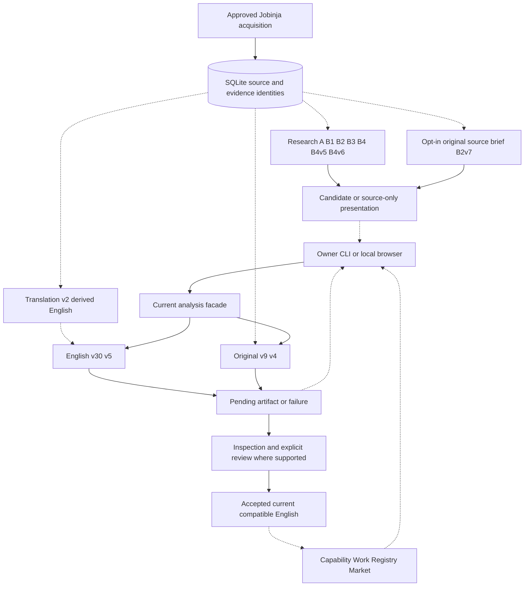
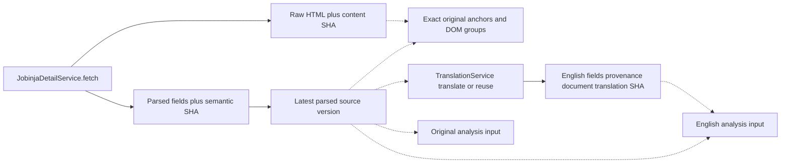
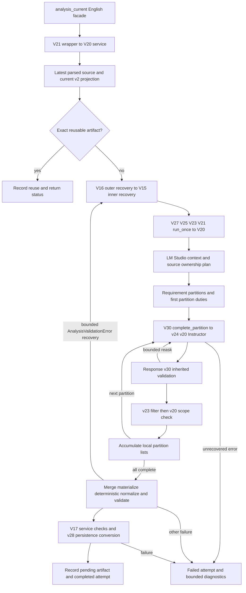
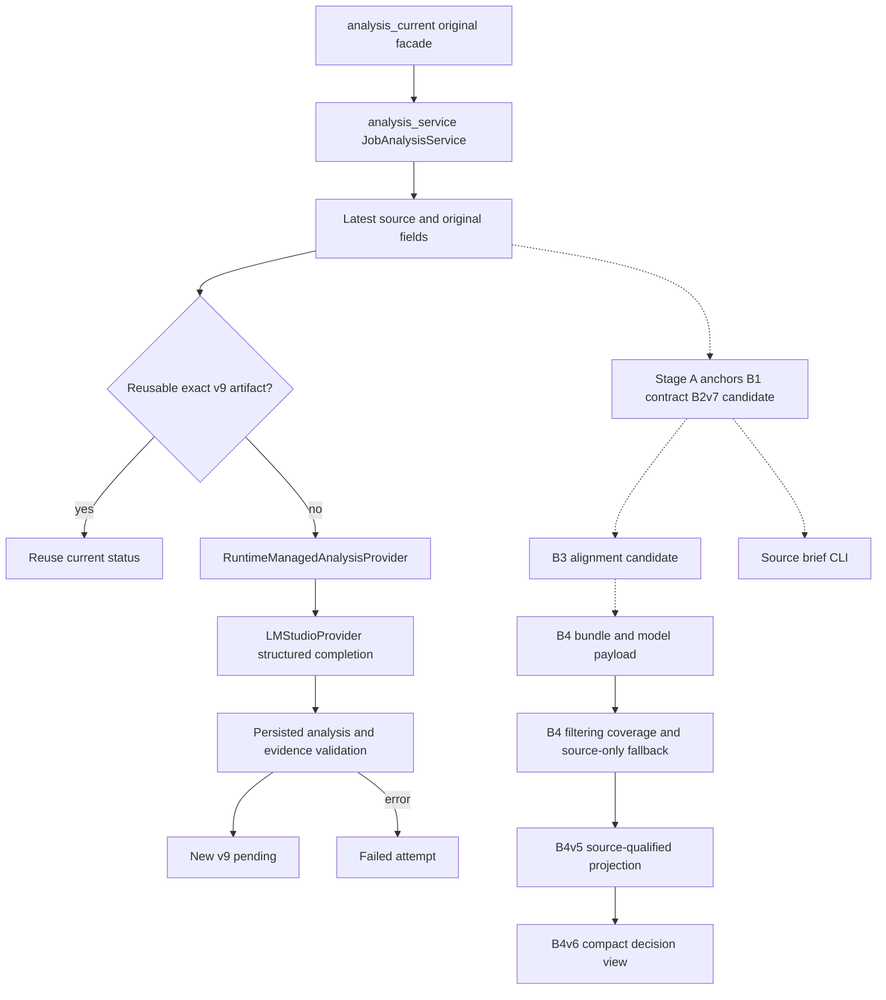
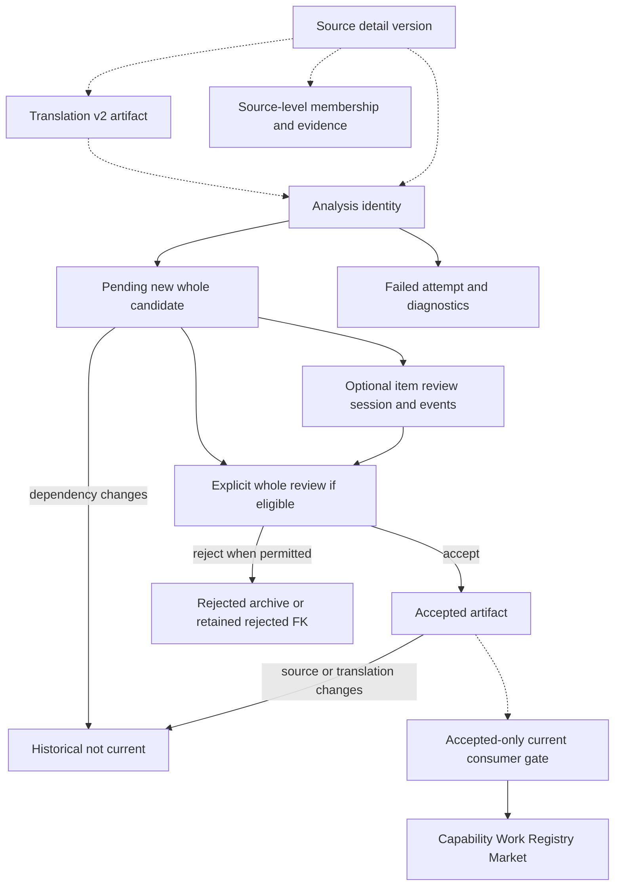

# Architecture understandability — DOC.2 verified P1.6 runtime baseline

**Date:** 2026-11-25. **Code revision inspected:** `64a24ccd8351c45554732730ddd43d4a070d835b` (main). **Scope:** P1.6 source, translation, public semantic routes, candidate paths, review/currentness and immediate consumers. **Disposition:** as-built supporting map, not selected future architecture. Read alongside [Current Runtime and Versioned Semantic Code](../CURRENT_RUNTIME_AND_VERSIONED_CODE.md), [Architecture](../ARCHITECTURE.md), [Semantic Analysis](../SEMANTIC_ANALYSIS.md), [E1 causal record](2026-11-24_P16_EVOLUTION_E1_ROOT_CAUSE_INVESTIGATION.md) and [DOC.1](2026-11-24_ARCHITECTURE_UNDERSTANDABILITY_DOC1_GAP_AUDIT.md). Preserve this dated baseline if E2 chooses a different architecture.

**How to read:** C = public/current; T = active transitive implementation; K = accepted-only compatibility; R = research/candidate/opt-in; H = historical-only route; D = deferred. Solid arrows in execution diagrams are direct calls or explicit sequence; dashed arrows indicate data/authority dependencies or optional experiment composition, not automatic runtime calls. Static inspection establishes actual code paths and conditions, not successful execution on every source. Observed evidence references below identify retained/replayed behavior; no fresh inference. All module references relative to `src/jobhunter/`. Diagrams omit unrelated acquisition, UI and market internals (DOC.6). No source ads or private model payloads here.

## 1. System and routes (context/container)



One Python modular monolith; local SQLite and raw HTML evidence, local LM Studio for current configured models. Provider abstraction also contains Google translation option, not authorized for current E work. No autonomous agent, RAG or new production route. The arrow from review to accepted current compatible English applies only to supported English review and exact dependencies, not original v9 or research display. Candidate paths do not write accepted facts. Source acquisition/lifecycle and source-based Market membership can operate without accepted P1.6; accepted semantic counts cannot.

| Surface | Actual owner | Route / boundary |
| --- | --- | --- |
| CLI entry (C) | pyproject.toml console script -> app_entrypoint.main -> entrypoint.main / market_cli.main | `jobs analyze` dispatch _run_job_analysis, mode-specific methods; review _review_job_analysis English. Mutating commands can sync public corpus through automatic_corpus_destination; diagnostic/item-review/source-brief early exit without export. Return codes do not prove no durable work occurred. |
| Browser (C) | web/app.py _analysis_service -> analysis_current.build_job_analysis_service | POST /jobs/{source_job_id}/analyze-english or /analyze-original calls run_english/run_original; English review POST /review-analysis; CSRF/operation wrapper. |
| Shared public facade (C) | analysis_current.JobAnalysisService, build_job_analysis_service | Select English v30 or original v9; batch facade _run_mode; analyze_job default English; market_workspace uses same facade. |
| Original source brief (R, user-accessible opt-in) | app_entrypoint.main -> source_brief_cli.main -> source_brief | Direct SQLite URI mode=ro first operation, latest parsed version, raw HTML hash, B2v7. No inference or export. |
| Source-first research (R) | source_span_identity, source_item_candidate_b2_v7_dom, source_bound_translation_b3, source_job_understanding_b4, source_qualified_b4v5/v6 | Composable research scripts and candidate contracts; no automatic production route. |
| Legacy (K/H) | exact accepted v20/v21/v23/v28 v5 compatibility, older versioned standalone runtimes and diagnostics | Reuse only allowed identities and accepted dependencies; historical tests not deletion authorization. |

## 2. Source capture, derived projection and reuse (data dependencies)



- `jobinja_detail_service.JobinjaDetailService.fetch` and `_semantic_sha256`: original content SHA/evidence path plus parsed source semantic SHA; semantic hash excludes language/parser_version (E1.2). Parsed identity and observation are distinct. `translation_store.TranslationStore.latest_source_version` exposes current successfully parsed version. Normal store methods may initialize DB; don't use them on frozen evidence merely to inspect.
- `translation_service.TranslationService._translate_source`: provider identity and exact reuse via _existing_artifact; `translation/projection.collect_translatable_texts` deduplicates Arabic-script-bearing strings, including whole description; native segments preserved, other fields can still need translation. `build_english_projection` and integrity checks validate shape, nonempty/script/length, stable dates, projection provenance; persist via TranslationStore.record_artifact/record_attempt with source semantic SHA, translation schema/provider/model, translated fields/document/provenance and projection hash. `current_artifact` selects current configured v2 projection; targeted English analyze does **not** automatically translate/repair missing projection.
- English analysis evidence is derived English field excerpts/catalog, not exact original source anchors. Original analysis sees _authoritative_source_fields and null translation dependency. B1 source-item anchors separately bind original description exact span/offset/hash/field/source semantic identity; board metadata uses structured pointer/hash, not interchangeable with original text.
- E1.8 observed native descriptions identity in two Nov23 failures but v2 field identity did not certify full linguistic fidelity: paraphrase/degree/role/name shifts on Persian source. B3 binds source item and English target offsets/hash when established; no general equivalence or nested target offset guarantee.

## 3. English v30 concrete execution (component and call flow)



The correction edge is schematic: effective V16.complete_structured wraps V15.complete_structured with nested AnalysisValidationError recovery, not generic InferenceResponseError or service-level post-provider errors. Up to four _run_once invocations in the nested path (two per inner invocation, two outer invocations), not a recursive loop. V16 also performs concept cleanup and validation after the inner result. V14's own complete_structured is overridden. Source/projection readiness failures before provider/attempt timestamp may have no failure row. Reuse can return pending exact artifact or eligible accepted older compatible artifact, not auto-promote. If a post-persistence step fails a failed attempt may coexist with durable work; no claim of a globally atomic transaction.

### Effective owners at inspected revision

| Stage | Resolved function / class owner | Contract / caveat |
| --- | --- | --- |
| Construct | analysis_runtime_v30.build_v30_analysis_service | TranslationStore, existing translation service, AnalysisStore, AnalysisFailureDiagnosticStore, V30CandidateAnalysisProvider |
| Service entry | analysis_service_v21.JobAnalysisServiceV21.analyze_english_job -> analysis_service_v20.JobAnalysisServiceV20.analyze_english_job | source/projection currentness, find_artifact exact deps, result validation, pending record; V21 redacts inference failures |
| Outer provider | analysis_runtime_v16.V16CandidateAnalysisProvider.complete_structured/_attempt -> analysis_runtime_v15.V15CandidateAnalysisProvider.complete_structured | _v15_candidate_evidence_view wraps v14 view; decomposed_requirement_references; nested bounded AnalysisValidationError correction, V16 cleanup/validation |
| Run | analysis_runtime_v27.V27CandidateAnalysisProvider._run_once -> V25 -> V23 -> V21 -> analysis_runtime_v20.V20CandidateAnalysisProvider._run_once | inherited residual ownership, heading duplicate removal, preference ownership, diagnostic context, shared engine |
| Runtime | inference/lm_studio_runtime.ensure_lm_studio_model_context | context16384, exclusive_llm, unload other LLMs or wrong context, verify model instance and applied context; not a benchmark |
| Deterministic preparation | analysis_runtime_v20._v20_deterministic_structured_skills, _v20_complete_requirement_plan plus inherited v18 structured partition, v15 normalization | deterministic experience/skills materialization, board tags required/high (RC08); not semantic proof |
| Coverage | V26._requirement_coverage_plan, V21._responsibility_coverage_plan, V25._requirement_partitions | requirement planning, typically max8 refs, duties first partition only; false Skills-as-duty traced to evidence_refs_v21 |
| Scoped call | analysis_runtime_v30.V30CandidateAnalysisProvider._complete_partition -> inference/instructor_lm_studio_v24.complete_analysis_partition_with_instructor_v24 -> inference/instructor_lm_studio_v20._complete_analysis_partition_with_instructor | exact_item_coverage, scoped evidence refs, full validation catalog local; analysis_fields removed from sent user payload |
| Model validation | inference/instructor_lm_studio_v30.JobAnalysisResponseV30, AnalysisRequirementV30 | Instructor JSON_SCHEMA, temp0, per-partition seed, max output8192 configured, validation_retries1; inherited validators before filter |
| Filter and merge | analysis_runtime_v23._filter_unassigned_partition_claims, analysis_runtime_v20._assert_partition_scope, _merge_partition_structured, V23._persistable_structured | validated parts in memory, global checks, deterministic source entries/exclusions, validate_v15_candidate_structured |
| Persist | validate_v17_candidate_structured -> analysis_service_v28.JobAnalysisServiceV28._persist_analysis -> analysis_persistence_v23.persisted_analysis_v23 and persisted_qualification_plan_v28 -> _validate_evidence_v17 -> AnalysisStore.record_artifact/record_attempt | source and translation dependency, exact model/prompt/schema, pending review; original source untouched |
| Fail | V21._record_failed_attempt and AnalysisFailureDiagnosticStore.record_failure | bounded private failure capture best effort; not a complete call log or whole earlier partition payload |

**Inheritance map (MRO, not call sequence):**

```text
Service: V30 > V29 > V28 > V27 > V26 > V25 > V24 > V23 > V22 > V21 > V20
Provider: V30 > V29 > V28 > V27 > V26 > V25 > V24 > V23 > V21 > V20 >
          V19 > V18 > V17 > V16 > V15 > V14
Response: V30 > V29 > V27 > V25 > V23 > V22 > V21 > V20 > V19 > V17 >
          V14 > JobAnalysisResponse > _StrictModel
Requirement: V30 > V29 > V27 > V25 > V23 > V22 > V21 > V20 > V19 > V14 >
             AnalysisRequirement > _StrictModel
```

**Actual assembled prompt/schema and validation:** E1.6 measured base v30 prompt 28,068 chars/128 bullet lines, per-partition system 28,678 chars for reconstructed cases; v30 response has role_purpose/responsibilities/requirements/coverage_exclusions (first three required). Requirement mandatory keys concept, depth_signal (nullable), type, concept_type, evidence, confidence, rationale, item_excerpt. 13 inherited requirement model validators, one field validator; four response model validators. v23 preserve_source_alternatives rewrites a multi-subject excerpt into concept; v21 degree separation/canonicalization and v20 depth validation can disagree; v17 response quality guard enforces duty coverage before filter. See exact E1.4/5/6 replay receipts and [static verification receipt](2026-11-25_doc2_runtime/SAFE_DOC2_RUNTIME_VERIFICATION.json). No claim all inherited functions execute on all items. Model-facing scope includes only assigned refs (duty refs in first partition); evidence association, Pydantic shape, semantic correctness, full coverage and acceptance are independent dimensions.

**Runtime limits:** actual HTTP connect capped10s, read=None, write/pool30s, transport retries0 in v20 wrapper even if configured retry1; one validation retry per partition (up to two attempts if reached), nested V15/V16 whole-plan reruns only on specific exception; structural bound 2 times sum of partitions across up to four reached plans, not a global physical-call ceiling. Not an enforced whole-job wall deadline; E1.10. Failed partition aborts local lists, no persisted partial analysis; diagnostic rows do not establish physical total or retained earlier success. B5 budget guard is scoped research, not applied to current v30. Historical frozen cases: backend neutral retry changed by inherited normalization; AI motivation rejected as missing/invalid depth; security false Skills duty planned; six retained completions rejected offline, counterfactuals distinguish actual vs misleading pass. These are observed/replayed controls, not a fresh inference trace.

## 4. Original-language v9, source-first candidate and fallback



- Original C route: analysis_runtime.build_job_analysis_service -> analysis_service.JobAnalysisService.analyze_original_job/_analyze_job. Original fields, same model context16384/exclusive runtime via RuntimeManagedAnalysisProvider.complete_structured -> base LMStudioProvider; no v30 partition/Instructor claim. _persisted_analysis + _validate_evidence, record artifact with translation_artifact_id=None and new original pending (Nov23 guard). Exact reuse can return historical accepted v9; do not auto-relabel. Public CLI prints semantic status, browser original badge currently labels ready/model if artifact exists (static code, not live UI verification). English review route is not an original promotion endpoint. V9 audit remains open.
- Research composition (dashed dependencies): source_span_identity.bind_original_source_span/verify_original_source_anchor; B2v7 interpreter -> v6/v5/v4 DOM and earlier contracts; B1 graph/item/board constraints remain candidate-only. B2 exact checks do not certify semantic labels; heading-scope/alternative/work-capability limits RC06–09. B3 select_b3_items / make_b1_source_bound_alignment/native identity with source and target hashes; reviewed correction overlay remains explicitly labeled. B5 source_bound_translation_budget_b5 and batching research cap physical attempts; no current automatic model use.
- B4 build_b4_evidence_bundle -> build_b4_model_payload -> validate_b4_model_response/filter_b4_model_fragments -> finalize_b4_case/build_coverage_ledger/build_source_only_brief. Reference checks and quarantine, optional abstention if no explicit duties, separate source fallback; may still pass false semantic claims, global summary can block fragments and unresolved ledger may look full. B4v5 project_source_qualified_case applies explicitly selected reviewed alignment overlay and withholds affected claims; B4v6 build_compact_decision_view retains drilldown and limits visibility; no accepted downstream route.
- Source-brief is separate (not B4 fallback): source_brief_cli.source_brief uses B2v7 exact original inventory, no translation, read-only, selected group preview or --all, metadata separately and alternative counts. No model output, no guarantee exhaustive/accurate semantic labels. Prior Nov23 82 extracted,35 visible,47 additional across three failed-v30 cases.

## 5. Artifact state, review and consumers (authority/data view)



Translation dependency edge is English only. Failure is a separate attempt outcome, not necessarily an artifact row or new semantic state; stale is derived from currentness selection, not a stored review status. Whole acceptance after optional item session completion is separate from item review completion. Pending can be displayed/inspected/reused for exact identity but not treated as accepted facts. Candidate fragments are **proposed** E2, not current artifact state.

| Entity / identity | Currentness/authority rule and owner |
| --- | --- |
| job_detail_versions | source job/version, parsed content and semantic SHA, source evidence path; latest parsed selection |
| job_translation_artifacts | exact source version/semantic SHA, schema/provider/model, target language, projection fields/provenance/hash; TranslationService.current_artifact |
| job_analysis_artifacts | source detail id, translation id (English; null original), model, prompt/schema, analysis/request/raw; AnalysisStore.find_artifact/latest_current/list_current with exact compatible dependencies, nonrejected. Compatibility v20/v21/v23/v28 v5 accepted-only for v30; no historical pending substitution. |
| job_analysis_attempts / failure diagnostics | logical completed/reused/failed with possible artifact FK, bounded diagnostic rows; not physical generation counts or accepted facts |
| item review | AnalysisItemReviewStore.begin/review_item/review_gap/complete; events and session bound to artifact/item/evidence; SQL trigger blocks whole acceptance of started incomplete item review, legacy no-session path still possible; complete is not accept |
| whole review | AnalysisStore.review_current requires current matching identity and reason; accepts explicitly; rejection archives, clears attempt FK/deletes row unless pending snapshot requires retained rejected FK; durable Capability or accepted Market dependency blocks rejection. No automatic historical v9 change. |
| downstream | capability_service.py -> capability_service_v9 inherits capability_service_v8._current_dependencies exact accepted English/projection; work_intelligence_service._current_p16; canonical_registry_review.CanonicalRegistryReviewReader.list_current_claims/_mapping_is_current/_is_current_translation_dependency; market_insights accepted_only/current projection. Source membership not semantic authority. Immutable Market snapshots retain coverage and distinct semantic inputs. |
| exports | app_entrypoint._synchronize_public_corpus -> public_corpus.automatic_corpus_destination/export_public_corpus; isolated DB destination separated from repo public corpus; candidate/diagnostic/private artifacts not silently exported. |

Illustrative failure walkthrough: if a second v30 partition fails, no merged analysis row is persisted; original HTML/parsed source and existing translation still available; source brief can be read. No claim all earlier partition completions survive. If English v30 is pending, job detail can inspect it, explicit review may promote the whole under current contract; accepted-only consumers remain fenced. Existing original v9 may be accepted historically despite known defects; new generation pending; no current original-as-English shortcut. If source or translation changes, exact dependency selectors exclude stale artifacts while frozen snapshots/history remain. Reference matching is not entailment; no absence or eligibility inference from missing candidate claims.

## 6. Verification, limitations and maintenance

Cross-check actual source functions with curated Python inspect (effective inherited owners/MRO, validator ownership), AST/file references and existing read-only receipts; no model load, network, source acquisition or private output dump. [Verification receipt](2026-11-25_doc2_runtime/SAFE_DOC2_RUNTIME_VERIFICATION.json) records source revision, checked names/lines/file hashes and focused tests/replays. Reproduction from repo root with ignored helpers `data/local-acceptance/p16-evolution-e1-2026-11-24/verify_doc2_runtime.py` and `probe_nested_recovery.py`. Fresh offline retry control stubs only _run_once, uses the actual V30 provider and synthetic failures: AnalysisValidationError triggers four invocations (v15 correction flags 0/1/0/1; v16 0/0/1/1), InferenceResponseError triggers one; zero inference. This corrects the earlier E1.6/10 v14 retry bound, not observed historical call counts. V21's _run_once context is active but its _complete_partition instrumentation is overridden by V30; retained diagnostics may lack indexes/prior parts. 90 focused tests passed. Earlier E1.3–10 receipts contain historical/offline observed behavior; static map references are not a new dynamic trace or general call graph. Diagram arrows reviewed against selected functions, not automatic call graph generation; no claim Mermaid rendering tested. Scope excludes exhaustive transitive import audit, all UI operations, full acquisition/market/personal details, model suitability and future selected design. DOC.3/4/7 will establish reusable component profiles, code-derived inspection feasibility and living currentness practice; DOC.5 selected design, DOC.6 broader system maps. Change author updates affected living reference, reviewer checks actual ownership, revision, tests and uncertainty. Preserve dated baseline, avoid silently reusing obsolete state.

**Result:** navigable as-built reference for E1 closure, no semantic acceptance or rollout. E1.11 matrix is decision input for E2, not a selected architecture. Existing B5/B6 and V9 gates remain unchanged.
