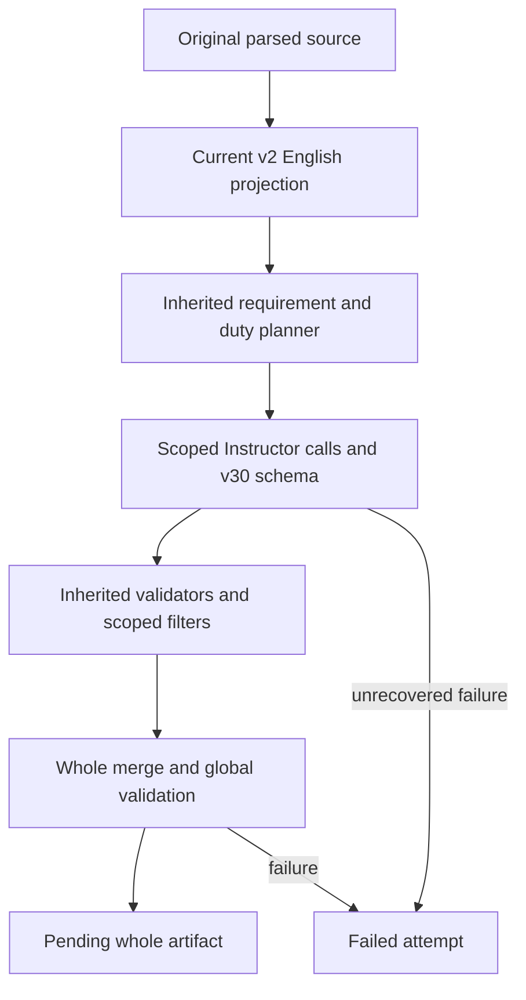
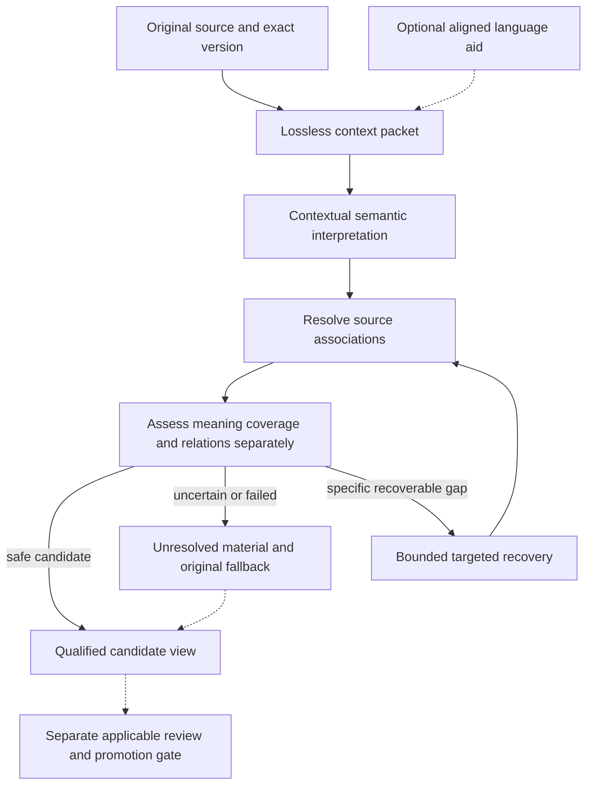

# P1.6 evolution E2 — architectural alternatives, experiment design and decision

**Date:** 2026-11-25. **Base:** `a092f68ed0144fe9633c967cd8e33ac6c0a14a07`. **Scope of this entry:** E2.1 alternatives, not E2.2–E2.6 completion or selected architecture. **State:** design published; local reconciliation pending (Desktop Commander offline). Prior E1 closure CI [45658879033](https://github.com/motafegh/jobhunter/actions/runs/45658879033) verified successful at exact base. No new code, source acquisition, inference, training, model load, database write, review or rollout authorized.

**Authority:** [P1.6 execution tracker](../P16_SEMANTIC_ARCHITECTURE_EVOLUTION_PLAN.md), [Stage B](../P16_STAGE_B_SOURCE_GROUNDED_BILINGUAL_IMPLEMENTATION_PLAN.md), [architecture](../ARCHITECTURE.md), [domain](../DOMAIN_AND_ANALYSIS_MODEL.md), [reasoning policy](../UTILITY_EPISTEMIC_AUTHORITY_AND_REASONING_POLICY.md) and [AI research companion](../AI_ARCHITECTURE_RESEARCH_AND_EVOLUTION_PLAN.md). Inputs: [E1 causal matrix](2026-11-24_P16_EVOLUTION_E1_ROOT_CAUSE_INVESTIGATION.md#2026-11-25-continuation--e111-consolidated-causal-findings-and-e2-decision-inputs) and [DOC.2 as-built map](2026-11-25_ARCHITECTURE_UNDERSTANDABILITY_DOC2_P16_RUNTIME_BASELINE.md). All prior diagnostic cases exposed. Existing v30/v5 English and v9/v4 original routes and accepted-compatible artifacts remain unchanged. This document is the evolving E2 decision record, not a separate checklist.

## 1. Product question and invariant requirements

Which design lets JobHunter understand a real vacancy more accurately, completely and efficiently than the user reading the original, with actionable uncertainty rather than a false sense of certainty? We do not optimize JSON completion, number of categories, model sophistication or benchmark scores in isolation. Accurate employer facts, useful model interpretations, and accepted durable facts are not the same product.

Retain original immutable source, exact version/anchors, source observation vs semantic identity, local-first modular monolith, SQLite, original/derived language distinction, privacy, currentness, existing accepted history and consumer gates. Avoid either under-grounded intelligence or over-gated delivery. Preserve rich natural context: duties and qualifications can overlap or inform each other. A duty may imply ability at some depth without establishing prior paid experience or mandatory employer eligibility. Behavior can be a qualification; classification disagreement without semantic harm is not automatically critical. Keep employer wording and interpretation separately accessible. Review effort proportionate to consequence. No automatic fact promotion from schema success, citations, critic agreement, deterministic label or model confidence.

All arms operate only in isolated research state until applicable E4/B5 and explicit E5/B6 gates. Current selectors for Capability, Work, Registry and Market must remain unchanged. B5 has four exposed failures; no new cohort or autonomous rollout. P2.3 remains deferred.

## 2. Separate the experimental dimensions

A0, A1 and A2 designate semantic architecture families; A3 designates the language-axis alternatives to be compared with a compatible architecture. Not four mandatory end-to-end products, and not a full factorial matrix. Use E2.A0 etc as local labels to avoid confusion with older Stage A or A1 review records.

| Dimension | Candidate choices | Hold fixed when studying |
| --- | --- | --- |
| Semantic architecture | A0 unchanged v30; A1 targeted repair; A2 contextual candidate plus deterministic reconciliation | Same source versions, language representation, model/runtime, common measurement envelope |
| Language (A3) | L0 current English v2; L1 improved contextual/source-aligned English; L2 original-first; L3 hybrid original plus aligned English aids | Same semantic task and compatible architecture, model and task rubric, matched source scope |
| Model | Incumbent E4B; MiMo 9B challenger if feasible; other local models conditional | Same task/contract/input, comparable runtime/decode and budget; disclose unavoidable tokenizer/template differences |
| Recovery/delivery | Existing whole-artifact behavior; targeted local recovery; qualified partial candidate plus source fallback | Same inputs/model outputs for deterministic replay; separately compare new calls and user-facing output |
| Context allocation | Whole coherent ad if it fits; section/group with surrounding context; bounded escalation for unresolved relationships | Same original units and coverage rubric; no silent omission/truncation |

Hard budget envelope belongs to experiment runner for *all* arms, including A0. Do not change A0 semantics or validators to achieve fairness. If a deadline/call ceiling interrupts A0, record budget-stopped rather than pretend the unbounded historical run completed. Measure actual physical requests, preflights, tokens, latency including cold/warm and model switching, failures and review burden. E2.3/4 will freeze exact arms, thresholds and feasible schedules before E3. No new calls now.

## 3. A0 — unchanged English v30 baseline

Purpose: reproduce the current semantic path as a comparator, not repair it or declare it acceptable.



As-built: analysis_current -> V30 service (V21/V20 entry) -> V16/V15 nested recovery -> V27/V25/V23/V21/V20 _run_once, requirement partitions and first-part duties, v30/v24/v20 Instructor, inherited model validators, filtering/merge, V28 persistence, pending review. Exact dependency reuse of accepted compatible v20/v21/v23/v28 v5 is current behavior; in paired fresh generation comparisons isolate caches without deleting accepted history, record reuse separately. A0 reads unchanged frozen v2 fields and current contract, not an edited projection. A0 may fail before returning claims; report delivery failure and score available outputs without inventing absent results. Use source-brief and existing B4v6 as separate user-delivery comparators, not replacement semantic baseline.

Strengths: extensive historical compatibility and tested evidence guards, known interface and persistent shape, exact source/translation identities, established review. Limitations: RC01–05/08/10/12, scope conflicts, deterministic board tag inflation, nested recovery, no persisted partial artifact, English fidelity dependence. Keeping A0 is a valid outcome if alternatives cannot demonstrate net improvement; that does not resolve existing defects or reopen promotion.

## 4. A1 — targeted repair in existing architecture

Purpose: determine whether correcting demonstrated deterministic and representational defects restores reliability without a broader semantic redesign. Keep v30-shaped task, current English input, partition strategy and unchanged output authority for the controlled architecture comparison. Implement future candidate under distinct experimental version and isolated dependency injection; never modify A0 or silently reuse accepted artifacts as candidate outputs.

| Repair candidate | Owner/mechanism | Required proof and non-goal |
| --- | --- | --- |
| Compound requirement scope | v23 preserve_source_alternatives, _source_alternative_concept and v21/v20 depth validators (RC01) | Avoid whole-parent concept overwrite of separate child. Keep exact parent relation and local modifier scope; replay neutral retry and negative controls. No blind deletion of depth or OR. |
| Motivation vs technical depth | v21 lexical explicit-degree requirement and v20 scoped-depth guard (RC02) | Null depth acceptable for non-depth concept when evidence supports it; explicit depth remains preserved or qualified unresolved. Reject borrowed/unsupported values. No regex exception for one advertisement or words in isolation. |
| False duty ownership | evidence_refs_v21 duty section boundaries and V21._responsibility_coverage_plan (RC03) | Identify non-duty section boundaries without losing genuine duties; unchanged retained retry with only false ref corrected is a causal control. Ambiguous units stay unresolved, not magically duties or exclusions. Negative control still rejects missing genuine duty. |
| Board/source separation | analysis_runtime_v20._v20_deterministic_structured_skills (RC08) | Board tags remain source observations; no automatic required/high employer strength solely from tag. Preserve useful metadata. Candidate projection compatibility must be assessed; if schema cannot express without meaning change, make limitation explicit rather than retrofit accepted rows. |
| Coherent instructions | assembled versioned prompts and scoped coverage payload (RC04) | Remove demonstrably obsolete/conflicting instructions only when actual contract behavior agrees. Distinguish a prompt cleanup arm from representation repairs if feasible. No claim fewer characters alone improves meaning. |

A1 is an experimental repair family, not a mandate to implement every row simultaneously. E2.5 select minimal coherent patch set; offline retained response replays isolate first three mechanisms before inference. For combined changes, record ablation or inability to attribute individual effects. Board authority fix may require a distinct candidate projection, not silent v5 semantics amendment. Preserve exact source/translation dependency and hard guards. Budget enforcement is common harness, not A1's claimed improvement; targeted retry policy can be separately compared. Do not use A1 as pretext for broad historical inheritance flattening. Expected advantage: low-to-moderate change scope, compatibility and causal attribution; remaining burden from partitioned task, long inherited instructions, English translation, whole merge and possible misleading coverage classifications. A1 may be sufficient, or may expose a representation ceiling.

## 5. A2 — contextual source-local semantic architecture

### 5.1 Processing and responsibility split

Hypothesis: an LLM given coherent employer language with relevant source context and a compact meaning-oriented contract can interpret more reliably than a model forced to satisfy prespecified semantic categories, depth and coverage obligations; deterministic orchestration should protect evidence and expose missing/invalid claims without forcing every interpretation into a rigid output. This is not proven by prior native JSON tests. Source-local does NOT mean per-sentence isolated prompting; begin with an intact ad where feasible.



| Stage | Deterministic responsibility | LLM semantic responsibility | Failure behavior |
| --- | --- | --- | --- |
| Context packet | Original source/version identity, exact spans and metadata pointers, order, headings, group boundaries, dedup of exact representations, token budget and omitted inventory | None required at preprocessing | Hard identity failure abort affected output; preserve unknown/unclassified original material rather than erase it |
| Primary interpretation | Supply relevant context, validate compact transport envelope, preserve response and provenance | Understand role purpose, work, explicit expectations, preference/conditions, alternatives, motivation and implied ability; retain relevant ambiguity and relationships | Invalid envelope bounded repair if justified; failed generation still source fallback |
| Association and representation | Resolve cited source anchors/child spans/board pointers; ensure exact version/scope; reject fabricated IDs; safe shape normalization only | Propose which evidence supports interpretation and scope; uncertainty if unclear | Invalid association quarantined; exact association not entailment |
| Reconcile | Track coverage inventory, duplicates, shared dependencies, conflicts and provenance; no deterministic semantic coercion | Interpret relations, alternative topology and shared modifiers, distinguish evidence from inference; investigate only selected gaps | If group relationship unresolved, withhold dependent eligibility conclusions; retain safe independent material and source quotes |
| Delivery | Status labels, preview/full drilldown, currentness and authority, source-first fallback and unattempted ledger | Candidate summary of meaning, explicitly inferred capabilities, notable ambiguities | Partial not whole success, no missing-is-absent claims |
| Promotion | Separate explicit review and exact compatible dependency gate | Advisory support only | No auto-acceptance, no downstream candidate adapter |

### 5.2 Context and output design choices for E2.2

Use Stage A exact original anchors, B1 evidence/board/overlap concepts and original HTML groups as substrate. Do not trust B2v7 candidate labels as input truth; its heading heuristics can lose non-list passages and inherit incorrect obligation. Include original unclassified blocks and coverage inventory independent of B2 labels. Preserve title, heading and neighboring context with scoped evidence; never transfer heading scope merely because a finite regex misses a boundary. Whole source if it fits token budget; otherwise coherent group/section with adjacent or shared context, stable group IDs, links to earlier/later clauses and explicit unprocessed inventory. No blind truncation or rigid partition by qualification categories. Evaluate any section planner itself.

Minimal conceptual response (not final schema): a compact list of candidate statements with source references and semantic basis (explicit claim, implied interpretation, unresolved/context), natural-language meaning and only the role/strength/scope/depth/experience/alternative attributes justified by content. A claim can serve multiple semantic functions; shared evidence is allowed, distinct claims use stable identities and linked relations to avoid double counts. Preserve exact source text separately, no requirement for model to retype hashes or all evidence. Use optional relation or group representations when material, not mandatory graph generation. Explicit absence requires evidence and proper scope, not empty arrays or missing output. Do not require the LLM to output every possible field per statement or emit an exhaustive ontology. Confidence may signal uncertainty, never substitute for evidence or review. E2.2 defines actual envelope, identity, optional fields, verification and authority; this entry proposes meaning and responsibility only.

Keep original and candidate claim coverage distinct: every source group accounted for as inspected/summarized/not attempted/excluded with reason/unresolved (implementation vocabulary E2.2); inspected does not mean understood, a reference does not establish meaning completeness. Deterministic ledger based on known inputs and actual outcomes; semantic coverage evaluated source-first. Cross-group dependencies are reconciled before eligibility summary. Candidate views retain unresolved clauses and original drilldown even if translation missing. B4 fragment filtering and compact view are useful engineering seeds, not semantic truth. Use original source-brief fallback independently of B4's translated input dependency.

### 5.3 Illustrative synthetic passage (authored, not an archived ad)

> Build and maintain internal APIs using Python or Go. Solid knowledge of engineering principles is expected. Experience deploying services is preferred. A degree or equivalent project experience is acceptable. Strong interest in learning is important. Hybrid work by agreement.

Desired interpretation, not model output or accepted evaluation labels:

| Material meaning | Candidate interpretation | What must not be inferred |
| --- | --- | --- |
| Assigned work and tools | Build/maintain APIs; Python or Go associated with duty; implies ability to do API work | Both languages mandatory; prior paid API experience required |
| Engineering principles | Explicit expected solid knowledge, separate concept and depth | Copy solid to programming or motivation |
| Deployment | Explicit preferred experience | Mandatory deployment or exact years |
| Degree/experience | Preserve OR and equivalent scope, or show intact clause unresolved | Require both; substitute paid work for project experience |
| Motivation | Behavioral expectation/qualification as appropriate, no technical degree | Strong proficiency or mandatory work history |
| Arrangement | Hybrid by agreement, separately visible | Technical qualification or guaranteed remote |

This example illustrates overlap without forced separation. One source group can contribute work and capability meaning. The UI can answer "what would I do, what do they expect me to know, what prior evidence do they ask for, what is optional, what conditions/alternatives matter?" without forcing unrelated claims into an artificial single score. Actual interpretation and user benefit must be evaluated.

### 5.4 Recovery and reuse of existing modules

Propose bounded targeted recovery for invalid representation or unresolved material, not endless full-job rewrites. An independent fragment survives only if its own source/contract/model/run dependencies are valid and unresolved global relation cannot change its meaning. Example: if degree/experience OR topology unresolved, retain exact clause and qualified uncertainty; do not mark degree mandatory. An unrelated valid location statement can remain visible. Distinguish malformed JSON (recoverable only without inventing meaning), unsupported association, contradictory semantics and incomplete coverage. No auto-promotion from partial. Receipts preserve raw/normalized versions privately, actual stage attempts and dependency identities. No new agent framework or separate database by default; use isolated research artifact and existing local runtime/budget seam if compatible. E2.2 determines whether local checkpointing is necessary versus safe end-of-run receipts. E2.3 freezes recovery caps.

Benefits hypothesized: broader contextual meaning, fewer mandatory fields, lower validation failure blast radius, original source visibility, potentially lower repeated prompt cost. Risks: larger whole-context prompts, missed units/relations, freeform hallucinations, weaker comparability with v5, new candidate schema/review/presentation burden, no guarantee small models perform better. Compare against A0 and A1 with same language/model before claiming A2 advantage. Do not simply rebuild old native v2/v3 prompt or B4 as new production path: prior native source-ref trials passed structure while missing material semantics, B4 reference filtering passed incorrect obligation.

## 6. A3 — language strategy, orthogonal to A1/A2

Current English v30 is translation-dependent, but translation is derived convenience, not source authority. English-native descriptions still failed due to nontranslation causes. Original v9 is a historical comparator (known semantic errors, new outputs pending), not evidence original-first is superior. Use the same compatible semantic architecture and task across language arms to isolate language contribution.

| Arm | Flow | Context/fidelity tradeoff | Resource hypothesis |
| --- | --- | --- | --- |
| L0 existing v2 | Current whole-field derived English -> semantic reasoning -> resolve to original where possible | Familiar analysis language; translation may alter names/strength/duties; field association not exact original span equivalence | Reuse possible; translation and model switches when cold |
| L1 improved contextual translation | Original groups with headings/shared clauses -> source-aligned translation or reviewed aid -> same semantic reasoning | Better possible alignment; still depends on linguistic fidelity and original scope | Extra translation calls or bounded batches; compare existing B3/B5 without assuming superiority |
| L2 original-first | Original-language text with stable anchors -> semantic reasoning -> translate selected display content if needed | Original context direct; model Persian/mixed-language competence unknown; English presentation separate | May avoid prerequisite translation; display translation and recovery still cost |
| L3 hybrid | Original plus aligned English aids when useful -> semantic reasoning over paired views -> preserve discrepancies | Potential support for names/technical terms, but conflicting aids may bias interpretation; original controls | Larger input and possibly extra translation; selective rather than automatic double context |

Native English uses identity for native description, but metadata may still require translation. No lossless-language assumption for metadata. For L0/A2 mapping of exact English refs to original: if v2 only provides field-level alignment, label original field association and unresolved exact original child evidence, not fabricated exact anchor. Do not disadvantage a language arm by granting another unsupported source precision. Compare both what each arm can establish and what it cannot. Preserve original group/compound relation context and terminology, negation, numbers, names, scope, conditions and attribution. Translation aid invalidation affects only dependent candidates, not source truth. L2/L3 source-local refs can bind original exact anchors; alignment does not prove meaning. Translation of display must not rewrite accepted original claim. LLM output language fixed where practical; record unavoidable tokenization and context differences. Separate translation accuracy/cost from semantic interpretation and end-to-end user task. Reuse B3/B5 alignment and budget facilities only if verified adequate; no forced one-call-per-item translation.

## 7. Comparative tradeoff matrix (design estimates, not measured ranks)

| Dimension | A0 | A1 | A2 | A3 language variants |
| --- | --- | --- | --- | --- |
| Context preservation | Scoped parent/child partitions, known false plan | Same context with corrected ownership | Coherent source groups/whole ad, cross-group relation need | Original, translated or both; potential conflict/overhead |
| Evidence safety | Tested derived-field association and strict guards; known semantic false passes | Preserve hard association; repair proven scope/authority defects | Exact source identities where available, explicit unresolved, quarantine; new contract needs tests | Original binding and translation association distinct |
| Useful delivery | Whole pending or failure; separate source fallback | Similar whole delivery, fewer demonstrated blockers hypothesized | Candidate partial + source fallback; full only when justified | Same delivery contract; language fidelity affects result |
| Model demand | Large inherited prompt and fixed fields | Similar, possibly coherent narrower instructions | Fewer mandatory fields; richer context reasoning may be demanding | Language skill/tokenizer/dual context differences |
| Latency/cost | Historical long failure and nested retry potential | Potentially fewer failed reruns; unmeasured | Potential fewer redundant calls; larger context or recovery may offset | Translation/model-switch savings vs input and display costs |
| Implementation | Existing, no semantic change | Narrow versioned experimental patches; compatibility limits | New candidate envelope and reconciliation/view; higher initial burden | Depends on chosen common architecture and mapping |
| Maintenance | Deep inheritance and patch interactions | Modest local changes, risk new patch accumulation | More explicit ownership hypothesized; risk new generic framework complexity | Additional bilingual lineage and evaluation |
| Authority/compatibility | Existing pending/accepted selectors | Candidate isolation; no silent v5 semantics change | Sidecar initially, no automatic durable adapter | Same protection; no original-as-English shortcut |

These alternatives address RC01–03 (A1); RC04/06–09/12–13 (A2 with A1 comparator); RC10–11 (A3); RC05/16 (model/budget/recovery comparison); RC14–15 (protected authority and qualified presentation, separate V9 audit); RC17 (source-first and user-task evaluation); RC18 (DOC track and measured maintainability). Do not use any improvement direction to remove hard integrity/currentness guards.

## 8. Proposed discriminating sequence, not frozen protocol

1. Offline retained-response controls for A1; candidate design must preserve genuine meaning and reject genuine missing duty/unsupported scope. A1 may be rejected if repair harms meaning or requires unbounded special-case logic.
2. Model-only screen A0 with E4B and viable MiMo 9B challenger; exact current input/contract and shared bound. Preserve failure, not only complete outputs. If A0 causes all failures, record floor effect and compare selected same-task model pair on A2 separately rather than declare models equal.
3. Architecture-only A0/A1/A2 using incumbent, frozen common English v2 input and original evidence availability tracked; if A2 uses original for association only, explicitly keep that operation separate from model input. Score original-source meaning and delivery for all; exact English vs original evidence precision differences are outcomes, not erased.
4. Language-axis L0/L2/L3 and L1 if justified, on selected compatible architecture and same model, matched source context. Include native-English control and Persian/mixed language. Do not compare unpaired original v9 vs v30 as causal language study.
5. Selected interaction/challenger tests and recovery/partial delivery replay only if needed. Consider conditional 12B QAT or specialized translation if E2 hardware and budgets support them. No full model × architecture × language × recovery grid; no mandatory RAG/agents/embedding/training in E3. Source-brief/B4v6/original reading are practical output/utility controls.
6. E2.3–4 freeze cases, stratification, reviewers/exposure, thresholds, scoring denominators, caps and stop rules before new inference. E2.5 selects actual minimal experimental arms and explicit owner decisions where required; E2.6 reconciles docs and freezes E3. No new independent cohort until E4 applicable gates.

The sequence is a recommendation, not selected implementation. A1 and A2 are both legitimate candidates; A2 is the leading architectural hypothesis because it can address shared responsibility/delivery defects rather than patch isolated symptoms. A3 could complement either. If targeted repair delivers comparable fidelity/utility at lower cost, prefer it; if none improves over protected baseline, retain/defer. No proof yet.

## 9. Existing components to retain, adapt experimentally or leave alone

| Component | E2.1 disposition |
| --- | --- |
| Source acquisition, SQLite source versions, exact hashes/anchors, source policy | Retain unchanged; no fetch or parser rewrite needed to design alternatives |
| v30/v5 and compatible accepted paths, original v9/v4 | Preserve as current/baseline; candidate changes have distinct identity and isolated state |
| Stage A / B1 evidence and relation contracts | Reuse original span, pointer, lineage primitives and relationship semantics where suitable; E2.2 evaluate contract fit |
| B2v7 DOM and source brief | Reuse structural groups and read-only fallback; classification only candidate, not truth or exhaustive segmentation |
| B3/B5 alignment/budget | Reuse exact alignment and bounded transport concepts as compatible; validate context fidelity and actual enforcement |
| B4/B4v5/v6 | Reuse candidate evidence/visibility patterns; do not inherit misleading complete state, summary blast radius or translation dependency blindly |
| Analysis diagnostics/item review | Retain old contracts, examine actual failure/review states for new candidate receipt design; do not create competing authority ledger |
| Capability, Work, Registry, Market, public corpus | No new semantic consumer route or accepted facts. Historical V9 blast-radius audit independent. |
| AR.2 AI Lab and DOC.3/4/7 | Minimal reusable experiment manifests and component profiles; future generator only if useful, no general platform build |

## 10. Handoff, verification and limitations

E2.1 design deliverable contains required four directions, comparable dimensions, concrete processing responsibilities, causal evidence links, existing component reuse and no-change alternative. E2.2 should specify candidate authority, evidence group/child alignment, optional depth/experience, source vs inference relations, uncertainty and partial state, alternative scope, reconciliation and promotion compatibility. This is the next design task after E2.1 reconciliation; no final schema, implementation, model selection or scoring thresholds here.

Remote-only documentation increment: Desktop Commander reported both registered local devices offline. Remote main verified at exact base and E1 CI successful; reviewed repository tracker, E1 matrix, DOC.2 owners, architecture/domain/reasoning policy, Stage B and AI research references via GitHub. No new private source/DB access, no local verification/tests, no inference or production work. Reproducibility of E1 remains existing receipts, not new replay. Remote document-only diff, linked paths and tracker count to be verified at publication. E2.1 checkbox intentionally remains open pending local main synchronization and protected-state reconciliation under existing milestone discipline. Recheck with `git status --short --branch`, `git pull --ff-only` only if safe, exact HEAD/origin/main, `.venv/bin/python data/local-acceptance/2026-11-23-fresh-e2e-manual-audit/verify_reconciliation_2026_11_24.py`, and CI at new revision; then close E2.1 and proceed. If local changed or pull conflicts, preserve state and reconcile, not force. No data exports or automatic promotion. User has approved continuing design, not a selected architecture or governing contract change.


## 2026-11-26 continuation — E2.1 reconciliation and E2.2 candidate semantic contract

**Base:** `74555ad4d6b0bc0b361e5b00260bece96419b467`. Local WSL device restored; clean main fast-forwarded from a092f68 to exact remote base. Prior E2.1 [CI 45694817594](https://github.com/motafegh/jobhunter/actions/runs/45694817594) completed successfully at exact base. Protected-state reconciliation passed (production DB and corpus manifest SHA, frozen private receipt, four SQLite integrity/FK checks and nine routing references). E2.1 now meets its recorded closure conditions. This entry designs E2.2, not the selected architecture, final production schema or implementation. Existing [B1 ADR](2026-11-14_P16_B1_SOURCE_ITEM_BILINGUAL_CONTRACT_ARCHITECTURE_DECISION.md), [E1 matrix](2026-11-24_P16_EVOLUTION_E1_ROOT_CAUSE_INVESTIGATION.md), [DOC.2 map](2026-11-25_ARCHITECTURE_UNDERSTANDABILITY_DOC2_P16_RUNTIME_BASELINE.md) and permanent policy control. Preserve B1 and v30/v9 contracts and historical artifacts byte-for-byte. No model call, load, acquisition, new accepted facts, database migration or consumer change.

### 11. Design decision — separate meaning from bookkeeping and authority

Design two interfaces rather than one large Pydantic model that simultaneously serves generation, persistence, evidence verification and user presentation. These are conceptual draft contracts for E2.3–5 selection; not yet runtime interfaces or accepted new versions.

| Interface | Purpose | Owner |
| --- | --- | --- |
| Context packet | Source units in order, headings and neighboring context, stable short handles, original or derived language per arm, clearly named board observations | Deterministic preparation; no authoritative semantic labels |
| Model response | Compact contextual statements, evidence handles, basis and optional meaning/scope/relations; open questions when material | LLM, semantic judgment only |
| Candidate envelope | Exact dependencies, source/target association, immutable claim identity, normalized representation, execution/coverage/assessment and review state, error and resource receipts | System, except separately attributed semantic assessment |
| Decision view | Useful grouped candidate statements, original drilldown, explicit unresolved/partial status and observed metadata | Deterministic presentation + optional attributed model synthesis |
| Accepted artifact | Reviewed, compatible, current version under approved contract | Existing production rules today; future promotion only B6 |

The first two form the model-facing task; the last three are **not** fields the model must generate. Never ask it to calculate hashes, assign persistent IDs, establish review status, declare its own acceptance, count completeness or invent exact offsets. Prefer a single coherent prompt/task and short evidence handles; no obligation to emit every semantic axis on every statement. If a model omits a material qualifier, this is a semantic omission to detect/assess, not a reason to manufacture it deterministically. This direction respects E1 RC01–18 and B1's orthogonal authority principle. A0 retains its exact schema and A1 remains an experimental targeted-repair option; A2 draft does not replace their comparators.

### 12. Compact model-facing contract (proposed)

Illustrative names, to be frozen only after E2.3–5. Minimum valid response is an object with a statements array (possibly empty; never proof of absence). Each statement has local reference, short natural meaning, evidence handles (nonempty for source-linked claims) and basis. Basis is explicit source interpretation, contextual inference, or unresolved reading. Explicit means the model *claims* that source says it; not verified truth. Local refs are request-local aliases, not stable IDs. System validates association against the exact packet, not model-provided arbitrary text. A whole uncertain group may remain an exact quote with an unresolved statement. Optional open questions reference context and identify a material ambiguity; they do not require an answer or cause automatic retry.

| Model field | Required? | Interpretation |
| --- | --- | --- |
| ref | yes | unique within returned response; system resolves it to candidate ID |
| meaning | yes | concise natural interpretation with all material qualifiers |
| evidence | yes | one or more handles scoped to packet; may cite overlapping/group and context units |
| basis | yes | explicit / inferred / unresolved (proposal, not approval) |
| roles | optional | one or more useful semantic roles (work, qualification, behavior, arrangement, compensation/benefit, application, purpose, context); overlap allowed, no exhaustive closed taxonomy required |
| strength | optional | required / preferred / stated expectation / unresolved when source supports distinction; never convert an inferred capability into explicit obligation |
| depth / experience | optional | source-local depth wording, stated prior-exposure/duration or implied work scope; distinguish dimensions, no arbitrary numeric score |
| relations | optional, response-level | source-supported alternatives/conditions/shared qualifier links or inferred work-capability relation; omit if not established, preserve group wording |
| open_questions | optional, response-level | unresolved material interpretation or relationship, source handles and reason |

Only four statement fields are mandatory (ref, meaning, evidence, basis); optional attributes carry meaning where useful. The exact encoding of depth/experience/roles and relation types is to be kept minimal in the frozen implementation; optional is not permission to silently discard source meaning. No required rationale/confidence/ontology per claim, no technical degree forced from adjectives. Model-facing examples show overlap and abstention; prohibit adding a second checklist of all E1 edge cases to the prompt. Treat source/retrieved content as data, never instructions. No arbitrary tools or external retrieval in the initial arm. The system sets max context/output, passes exact context scope and records omitted units. Avoid item-by-item prompting by default; use intact ad or meaningful contextual groups, not isolated taxonomy buckets.

### 13. Source identity, group and child alignment

Reuse `source_span_identity.bind_original_source_span` / `verify_original_source_anchor` and B1 original description source anchor identity (field, source job/version, semantic hash, character/UTF-8 offsets, exact substring/hash). Board metadata uses separate B1 JSON Pointer/canonical selected-value and field digests. Source hash verifies content; no claim of linguistic meaning. Reuse B2v7 DOM group structure as a candidate aid only; independently inventory original text and preserve meaningful non-list passages, headings/context and units that its classifier missed. Overlap legal; stable group reference for enclosing qualifier and relation. Never synthesize a child exact span from approximate translation or concatenate noncontiguous text as a single contiguous span. For actual discontiguous evidence use multiple anchors. Context handles may help meaning but not replace required evidence: an original heading alone cannot support an unrelated child's named skill; group and child references may jointly support a statement.

Packet has deterministic handle->immutable reference map, ordered unit inventory and source/version/representation fingerprint. Each returned handle resolves to an included reference; child text boundaries may be resolved only from exact source and parent scope, with ambiguity marked unresolved, not fuzzy-bound. Child identity is content+scope, not text-only; identical phrase at different positions may differ in modality. Group/child edges reflect containment, not semantic equivalence. For L0 v2 English only, retain exact English reference and source-field association, original child alignment unresolved; do not claim exact original anchor without proof. L1/L3 B3 alignment may be many-to-many and source-bound candidate; native exact separate. Preserve source/target offset/hash lineage, semantic translation review separate, unresolved target not a reason to hide original text. Derived translation or reviewed correction has distinct revision; invalidation affects dependent statements. No destructive edits of original or previous target.

### 14. Meaning, normalization and relationships

Maintain independent dimensions, not disjoint classifications. A statement can describe both work and qualification if source context says so; an inferred work-capability statement explicitly links to the work evidence and remains inference. Do not count the same employer statement twice merely because two roles share an identity; distinct material assertions in a group may have separate candidate IDs. Distinguish employer-expressed obligation from model-inferred practical necessity and from personal eligibility (latter deferred). Board skill presence is a board observation, not automatic employer-required qualification; board/prose conflicting values coexist with typed conflict, no overwriting or automatic strength upgrade. Preserve conditions, uncertainty and qualifications even if no canonical concept available. Unknown role is not source omission and unknown strength is not optional. Behavioral expectations can be explicit qualifications; employment arrangement can be an explicit eligibility condition if actual source says so. No blanket semantic rule excluding either, only typed meaning and scope. No applicant score or decision.

| Dimension | Example and safe boundary |
| --- | --- |
| Depth | "solid knowledge of engineering principles" attaches solid only to that concept. "Strong interest in learning" is motivation, not technical proficiency. Omit structured depth when inapplicable; preserve actual source phrase. |
| Prior exposure | "Build APIs" implies ability to do work, not paid employment or years. "2 years of experience" preserves duration/unit/comparator and scope; "project experience" is not automatically professional experience. |
| Modality | "Python preferred" remains preferred even with board Python tag or duty involving Python. "Expected" is not automatically formal mandatory eligibility. |
| Alternative | "Python or Go" as work tooling may be work options, not eligibility; "degree or equivalent project experience" is an eligibility alternative if source supports it. |
| Negation and condition | "No prior work experience required" is explicit negative obligation, not lack of evidence; "if selected, pass exam" is conditional, not unconditional prerequisite. |

Safe mechanical normalization: whitespace/escaping, source-backed exact span binding, recognized harmless representation aliases with unchanged meaning, canonical serialization and de-dup of byte/identity-identical records. Record raw/normalized digests, operation/version/reason and lineage. Never silently remove a source modifier, join alternative concepts, infer missing duration, replace model category from lexical heading, reclassify obligation, change negation or assume equivalence. If malformed depth can be made unknown without losing material source wording and evidence, preserve wording, mark unknown and keep unaffected meaning; explicit depth omitted remains an unresolved coverage/meaning issue. Ambiguous representation that affects meaning gets targeted semantic review or abstention. Exact evidence association alone does not establish entailment. No general lexical semantic validator as final truth; deterministic guard rejects known invalid references, authority transitions or structurally inconsistent representations, while semantic judgments remain attributed and scored.

### 15. Alternative groups and conditional scope

Reuse B1 graph semantics as a candidate internal representation only when source supports topology. Keep group quote, qualifier references, ordered children and relation type (AND / OR / conditional / example / unresolved). Distinguish formal eligibility routes from tool options, illustrative examples and work-capability relations; no treating every "or" as applicant eligibility. A group may contain nested groups; every edge resolves, DAG acyclic, leaves inside allowed job/version and their scoped evidence, duplicate/unreachable references rejected. For formal paths, all_of requires each child, any_of one path, conditional implication only inside established scope; do not compute user's eligibility. Local mandatory leaf in chosen option is not globally mandatory. For example:

```text
candidate group: degree OR equivalent project experience
  degree: required_if_path_chosen
  project experience: required_if_path_chosen
  shared qualifier: equivalent
global mandatory leaves: none (unless supported elsewhere)
```

If topology/qualifier/leaf scope unresolved, show intact group as unresolved; withhold simplified eligibility summary dependent on group. Preserve safe unrelated claims. Do not force graph construction when exact compound wording is more useful and no structured route necessary. E2.4 evaluates material preserved paths, not graph count. B1 validator validates references and Boolean graph structure, not employer intent. Model suggests relation, deterministic system verifies structure and dependency, semantic assessment evaluates actual meaning. Record reason if relation unresolved rather than adding arbitrary edges.

### 16. Candidate envelope, independent state axes and partial delivery

Use a versioned private isolated sidecar for A2 research initially (append-only run/claim revisions plus receipts); no new production SQLite tables or public route. Conceptual envelope:

```text
run identity = source job/version/hash + packet/representation hash
               + source/translation dependencies + model artifact/config
               + semantic contract/prompt/runner versions + unique attempt/run ID
claim revision = run ID + system-assigned local ID + digest of meaning,
                 basis, roles, scoped evidence and material relation dependencies
fragment = immutable claim revision set + dependency IDs + validation/assessment state
```

Reuse only when exact inputs/contract/config/evidence/dependencies match and review/authority still compatible; explicit attempt/cache/reuse receipts. Do not dedup distinct independent runs solely on text equality; exact identity and claim equivalence different. Corrections create successor revisions, never mutate raw response or accepted historical state. Relation groups refer to immutable claim revisions; compute content digests of normalized relation records separately, avoid cyclic ID hash dependency. Stale status derived from current dependencies, not retrospective deletion. Every record retains source and run lineage; no public raw content export. New candidate contract has distinct ID from v5/B1. A1 if selected may produce existing-shape output inside separate experimental envelope, never assign existing accepted contract authority.

| Axis | Proposed states / ownership | Not implied |
| --- | --- | --- |
| Execution | not attempted / completed / failed / budget stopped / timeout; system receipt per unit and physical call | Semantic correctness |
| Association/integrity | verified exact / verified field only / unresolved / invalid; system | Entailment or precise original alignment |
| Semantic assessment | unreviewed / supported / partially supported / contradicted / unsupported / unresolved; attributed reviewer or assessment provenance | Independent human approval or durable acceptance |
| Coverage | observed inventory per unit: attempted, not attempted, linked, excluded with reason, unresolved; separately meaning coverage review | Exhaustive ad understanding from all refs linked |
| Relation consistency | resolved candidate / unresolved / invalid; structural vs semantic assessment separate | Correct eligibility |
| Delivery | source-only / qualified partial / whole candidate / withheld; system from known states + semantic scope | Accepted artifact, complete understanding |
| Authority | candidate_only, no downstream; existing accepted historical/current separate | New promotion by generation or review label |

A whole candidate means all **planned** processing completed and no known material unresolved delivery dependency for the stated scope; explicitly distinguish planned scope from complete original semantic coverage. Never call it "complete understanding" absent source-first assessment. Budget or model failure may deliver source-only or partial candidate; execution remains failed/stopped. Invalid identity/source hash blocks affected evidence, not a guessed quote. Invalid claim association quarantines claim and dependent relations; valid unrelated source still accessible. Wrong/unsupported semantic claim withheld from supported view; unreviewed candidate may be shown as labeled proposal under bounded authority, never called supported solely by citation. Global group failure withhold dependent claims/summary, not unrelated material. No hidden not-attempted content or absence inference. If source is invalid or stale, no current candidate claims; historical display clearly labeled only if allowed. Missing translation does not hide original source. Review can be selective/proportionate for candidate use; consequential claims with unresolved meaning are explicitly qualified/withheld. Whole accepted state requires separate applicable policy, not merely all local items reviewed.

### 17. Delivery controls and promotion compatibility

| Situation | Allowed user-facing result | Downstream result |
| --- | --- | --- |
| Valid source, no model output | Source inventory with original text, candidate classification label, missing analysis | No new accepted semantics |
| Exact ref, unreviewed interpretation | Bounded labeled candidate; evidence drilldown, uncertainty | None |
| Supported fragment, unrelated failure | Qualified partial with failed/not-attempted inventory, safe fragment + originals | None |
| Unresolved alternative or conflicting meaning | Preserve exact group/board and narrative, label ambiguity; suppress dependent mandatory/eligibility summary | None |
| Source/translation revision changed | Historical only or withheld; new candidate needed | No current reuse of stale dependencies |
| Whole candidate, individually reviewed | Candidate with review scope/provenance | No automatic accepted conversion |
| Future B6 decision | Separate compatible approved artifact, explicit review/migration/rollback; currentness verified | Accepted-only consumers under approved rules |

No candidate adapter for Capability/Work/Registry/Market, no implicit public corpus export, no original v9 as English accepted substitute. Existing v20/v21/v23/v28 accepted-only compatibility and new v9 pending rule unchanged; V9 historical audit independently open. B6 must define durable representation compatibility, review/promotion transition, migration/backup, versioned consumer checks and rollback; if unable to faithfully represent new claims in legacy v5, retain separate candidate or choose new explicitly approved contract rather than coerce. Reuse principles of AnalysisItemReviewStore (append-only provenance, separate whole acceptance) but do not write its current v5 tables from candidate runner. Review event binds exact claim/group/source/target digest, dimension, reviewer class/exposure, disposition, reason and predecessor; different review dimensions not interchangeable. No model reviewer certifies its own output. No change to current owner acceptance policy.

### 18. Design-only worked fixture and negative controls

The companion [synthetic contract examples](2026-11-26_p16_e2/SEMANTIC_CONTRACT_EXAMPLES.json) contain authored fictional source passages, a compact example response, explicit system-owned expected states and negative/partial scenarios. They are design illustrations, not generated predictions, real job source evidence or independent gold labels. Exact sample refs are local handles only. E3 must implement deterministic cross-reference/identity/dependency checks and evaluate semantic meaning on frozen source-first cases; do not claim semantic validators from illustrative expected outputs. Design controls cover compound OR/depth scope, motivational adjective, board/prose preference, overlap and prior work, conditional eligibility, malformed/unsupported reference, unaligned translation, incomplete processing, dependent group failure and stale state. Existing B1 fixture validator/source-span tests and B4/source-brief/authority tests remain baseline; no new runtime code. E2.3 chooses minimal arms and exact frozen fixture/model protocol, E2.4 thresholds, E2.5 decision/owner approval as applicable. Do not demand all optional fields, all relations, separate agents or full production persistence in first trial.

**Disposition:** E2.2 design complete when linked fixture, structural design checks and existing regression/protected-state evidence recorded. Candidate contract remains experimental draft; no selected model/architecture, no production schema/authority change. Next E2.3 bounded comparative protocol. DOC.3/4/7 remain required before E2.6; DOC.5 after selection. Local/remote main reconciliation and CI recorded per milestone.

**Local design verification:** 130 existing focused tests passed with warnings as errors (B1 contract, exact spans, B4/B4v5/v6, source brief, item/semantic review, v30 currentness and Capability v9 boundary). The ignored helper `data/local-acceptance/p16-evolution-e1-2026-11-24/verify_e2_2_design.py` built synthetic examples using the existing span binder/verifier: 12 exact anchors including four child spans, two expected tamper/stale rejections, 10 authored candidate statements and 12 prospective design scenarios. Statement/ref/relationship reference assertions passed; semantic scenarios are expectations only, not tested implementation. [Verification receipt](2026-11-26_p16_e2/SAFE_E2_1_2_DESIGN_VERIFICATION.json) records commands and protected-state checks. No new source/model calls. E2.1/E2.2 closed as design only; E2.3 next.


## 2026-11-26 continuation — E2.3 bounded exposed comparative protocol

**Base:** `e015d4d6839f85bd0dc62e32698f4abfdc30a00c`. Prior E2.1/E2.2 [CI 45817475794](https://github.com/motafegh/jobhunter/actions/runs/45817475794) verified success at exact base. E2.3 preregisters concrete inputs, models, arms, budgets, ordering, stops and minimum AI Lab records. E2.4 scoring/thresholds and E2.5 selection remain open; E2.6 freezes implementation requirements and E3 seals executable identities before inference. No architecture superiority, model qualification, B5/B6, production routing or authority. Zero new inference/acquisition/load/download/training. Read-only local metadata/weight hashes and public model-card rights reconnaissance only; no private source sent externally. E1/E2.1/E2.2, Stage B and [AI research companion](../AI_ARCHITECTURE_RESEARCH_AND_EVOLUTION_PLAN.md) control.

### 19. Dataset and source-first assessment

Nine live-comparison cases selected from frozen E1 evidence for known causal mechanisms, structure, language and variation in size, not a population sample. Three additional accepted anchors are compatibility controls with no new inference. All 12 unique original-description SHA; not proof of near-duplicate or employer independence. All previously exposed, no holdout/training claim. Case aliases stable; exact version/semantic/HTML and v2 artifact hashes in sealed private manifest, no raw text in Git.

| Alias / retained ID | Snapshot | Original/English chars | Description | Diagnostic purpose |
| --- | --- | ---: | --- | --- |
| D1 tdIF | Nov23 | 4575/4575 | native identity | dense backend, compound OR and depth |
| D2 td0u | Nov23 | 1536/1536 | native identity | AI/speech, motivation/depth and preference |
| D3 td0r | Nov23 | 1047/1465 | translated | security, false duty plan, translation drift |
| D4 tNhZ | B0 A1 | 1790/2215 | translated | Python/AI work, optional LLM/domain, arrangement |
| D5 tMps | B0 A1 | 1830/2151 | translated | dense applied AI, nested eligibility alternatives |
| D6 tNDx | B0 A1 | 1274/1755 | translated | EDR, certificate/equivalent, ambiguity/board conflicts |
| D7 tMjm | B0 A1 | 804/1113 | translated | no explicit duty list, traits/remote |
| R1 tG9K | B0 configured | 2110/2110 | native identity | dense accepted anchor 36 |
| R2 t4jp | B0 configured | 344/436 | translated | sparse accepted anchor 37 |
| R3 tmBK | B0 configured | 709/861 | translated | offline anchor 39 |
| R4 t4qV | B0 configured | 1016/1210 | translated | offline anchor 44 |
| R5 tmyX | B0 configured | 1257/1550 | translated | offline anchor 46 |

All parsed language labels mixed; native description identity does not mean all metadata English. Characters not tokens/density scores. Verified 12 original semantic/HTML identities, recomputed exact v2 projection hashes from fields/provenance/schema, all three snapshot integrity/FK and unchanged SHA checks. Private `data/local-acceptance/p16-evolution-e1-2026-11-24/PRIVATE_E2_3_SOURCE_SELECTION.json` SHA `45161b2cdb22d3ca74e93612ba4ce71da9af3fddca9412fca191666b69d85c37` seals exact source/translation/version, snapshot and retained review hashes. Reproduce via ignored `freeze_e2_3_inputs.py` same directory (verify to temp or compare, do not overwrite sealed inputs); [B0 protocol](2026-11-14_P16_B0_FROZEN_BASELINE_AND_EVALUATION_PROTOCOL.md) and E1 inventory document original DB provenance. Safe aggregate [protocol manifest](2026-11-26_p16_e2/EXPERIMENT_PROTOCOL_DRAFT.json).

Use D1–7 for exposed causal/development diagnostics, R1–2 as live size/compatibility controls, R3–5 offline compatibility. No changing selection after outputs. All four prior B5 cohorts excluded from primary E3 inference, available only for already-required sealed offline regression checks; remain exposed, never new holdout. Future independent E4/B5 separate; exclude archive-relative description duplicates, near-duplicates/reposts and reviewer exposure, no automatic fifth acquisition. Before first E3 source generation freeze original-source-only per-case material assertions/relations, exact spans, uncertainty and review scope; use B0/Nov23 retained source-first seals, directly inspect original R1/R2 not accepted artifacts as truth. Record prior-context exposure, disagreements, unknowns, source review digest and rights. No new output while constructing references. Do not replace ambiguous case. Mask arm labels/order during scoring where feasible; prior exposure cannot be erased; no independent claim without actual isolation. E2.4 defines threshold and operational rubric before generation. No training/tuning on scored outputs; revised design needs new run ID.

### 20. Model artifacts and viability gates

M0 incumbent `gemma-4-e4b-it-ud` Q4_K_XL; M1 challenger `mimo-v2.6-distill-qwen-9b` Q4_K_L; M2 `gemma-4-e2b-it` Q4_K_M predefined substitute only if M1 fails **technical or rights preflight before any diagnostic output**. M2 is not cross-family evidence; unresolved M1 question explicit. All three exact GGUF weight files streamed and SHA-256 computed, catalog paths and byte sizes matched, file size/mtime unchanged during read. Safe [model identity receipt](2026-11-26_p16_e2/MODEL_ARTIFACT_IDENTITIES.json); private original receipt SHA `c6f15538528a94e324ce06f0d9299ec856eca6ca15ee7b7d971989548f95d671`. Full bytes not server alias; header template fingerprint not actual runtime template. No new download. Frozen v2 translation always E2B.

Upstream public model cards inspected 2026-11-26: [Google E4B](https://huggingface.co/google/gemma-4-E4B-it) and [E2B](https://huggingface.co/google/gemma-4-E2B-it) declare Apache-2.0; [XiaomiMiMo](https://huggingface.co/XiaomiMiMo/MiMo-V2.6-Distill-Qwen-9B) declares MIT. Candidate quantization references [Unsloth E4B](https://huggingface.co/unsloth/gemma-4-E4B-it-GGUF) and [bartowski MiMo](https://huggingface.co/bartowski/MiMo-V2.6-Distill-Qwen-9B-GGUF); exact local SHA-to-upstream revision not established; MiMo GGUF header has no license and no local card/terms files observed. These are rights reconnaissance, not verified local package lineage or permission to redistribute/train. Before E3 dispatch record applicable local-use rights and source private-use authorization; resolve provenance uncertainty or block affected arm. No job source to external services.

Observed now E2B loaded idle, context16384, four parallel slots metadata; RTX3070 8192 MiB /4743 free, WSL ~50 GiB total/~49 available, 16 GiB unused swap. Distinct from E1.10 unloaded observation. No unload/load now. In E3 dedicated authorized window only; stop if other work active; one LLM and request at a time, no automatic eviction of user workloads. Verify actual backend/model instance/weight identity, context/template/reasoning configuration, GPU placement/cache and host Windows + WSL memory before dispatch. Model placement may differ, record confound; no nominal fit claim. Recheck file digest or immutable artifact proof at run seal.

Preflight E3 only after runner guard tests: max two synthetic non-job JSON completion POSTs per model (initial and one recoverable setup retry), 180s/model including setup, cap512 output/context16384, max16 local control HTTP attempts/model. Total 6 POSTs/9min max for M0/M1/M2. No probe for identity/rights-blocked model. Confirm actual structured output/template/tokenizer/context, memory and local-use rights. If M0 infeasible stop (no replacement baseline). M1 technical/rights failure permits M2 after separate preflight and explicit amended manifest before diagnostic results, never after disappointing scores. If both challengers blocked, narrow to M0 with documented blocker and unresolved model question; E2.5/E3 decision must reflect it. M1 actual job failure retained, no swap. No model load/qualification today.

### 21. Proposed fixed cell matrix and staging

One cell = one logical job/model/architecture/language run, all recovery/attempts included. C = D1–7,R1–2 canonical order. S = D1,D2,D3,D7,R1 (causal failures, no-duty and dense positive anchor). L = D2,D3,D4,D5,D6,D7,R2 (six translated + native description control). H = D3,D5,D6 (three high-risk bilingual cases). A0 unchanged current v30/v5, A1 targeted repair, A2 compact E2.2 candidate; L0 frozen v2. Freeze code/prompt/schema/config before live trial; E2.5 may narrow before outputs; any later changes new ID, no hidden edits or per-job rules.

| Stage | Cells | Model | Architecture/language | Question |
| --- | ---: | --- | --- | --- |
| 1a screen baseline | 5 S | M0 | A0/L0 | model control |
| 1b challenger | 5 S | M1 or predeclared M2 | A0/L0 | model-only |
| 2a expand baseline | 4 C minus S | M0 | A0/L0 | nine total baseline cells |
| 2b targeted repair | 9 C | M0 | A1/L0 | same model/input repair |
| 2c contextual | 9 C | M0 | A2/L0 | architecture-only |
| 3 interaction (conditional) | 5 S | qualified challenger | A2/L0 | same A2 task vs M0 and challenger A0 |
| 4a original-first | 7 L | M0 | A2/L2 | matched language comparison |
| 4b hybrid | 3 H | M0 | A2/L3 | original plus labeled v2 field-only aid |

47 max unique cells = 32 primary +5 conditional interaction +10 language. Count baseline screen once. Stage3 conditional on both models and A2 technical viability, no integrity breach and remaining sealed budget, **not** best-case selection; run despite A0 floor effect where viable. If A2 absent, blocked cells recorded. L3 first hybrid uses same existing full v2 field-only aid (no invented exact child alignment). L1 improved contextual translation/item-aligned hybrid deferred until specific benefit hypothesis justifies separate experiment, no L1 result claim. B3/B5 retained historical comparators. L0 A2 model receives derived English only and same board fields as A0/A1, original association/review outside model. L2 original fields; L3 both labeled representations, full aid if fits; do not truncate/select silently. Target English candidate meanings where practical across arms, exact original drilldown via refs; no forced display translation in initial trial. D2 metadata still translated, not invariant whole input. No new translation calls; report cached projection generation costs separately from end-to-end translation/switch costs, don't claim actual translation savings.

Fresh A0 generation from isolated per-cell source/translation clone, no historical cache reuse masquerading as inference; verify exact v30/v5 prompt, schema, service/provider semantics and source/v2 dependencies. Construct private copy with requisite source/translation and schema or verified test-only lookup bypass seam; preserve originals, accepted rows and consumers; no delete/reject in frozen or production DB. If cannot reproduce exact A0 except common harness, block it. Original v9, B4v6/source-brief and original reading retained comparators (no fresh calls, not equivalent semantic outputs). Offline A1 causal replay first using six retained failures, 15 E1 counterfactuals and genuine-duty/unsafe-normalization negative controls. A2 partial/authority controls E2.2/E1.9. Preserve all outcomes including failure, partial, rejected, unattempted; no cherry-picking valid JSON. Proposed schedule and caps in manifest.


### 22. Common runtime and finite budgets

These are proposed engineering ceilings, not expected duration or throughput, chosen without explicit owner time-budget guidance. E2.5 may narrow before any outputs. 47 × 8 =376 diagnostic generation POST slots; 47 ×240s=11,280s (188min) cell ceiling; preflight extra ≤6 POSTs/9min. Overall ≤382 generation POSTs including preflight, plus separate control operations; cumulative active execution ≤4h (setup/cleanup included, human review separately timed). Bounded sessions ≤60 active minutes and ≤12 diagnostic cells; resume only sealed next planned cell, stop at budget, preserve incomplete/unattempted. No automatic extension or repeat. No background execution now.

| Limit | Common proposed value |
| --- | --- |
| Physical dispatches | 8/cell including all nested/reask/transport/targeted recovery attempts, count attempted send before transport; failures count |
| Cell wall | 240s monotonic setup/load through result/receipt; cold/warm and transitions recorded separately |
| Per generation | context16384, max output8192 per A0; exact effective template/input+allowance must fit or context-blocked, no silent truncation or output/context change |
| Reservations | 65,536 output and 131,072 context-window tokens/cell; max 3,080,192 output /6,160,384 context-window reservations across47 cells; preflight +3,072/+98,304. These are reserved maxima, NOT actual usage. |
| Decoding | A0 actual temp0 and existing seed path unchanged; A1 same; A2 temp0 seed17 base, deterministic per-unit mapping frozen before execution. Record supported/applied settings and nondeterminism; do not equate token streams across families. |
| Reasoning | A0 effective native settings unchanged; comparable supported mode in A1/A2 same-model arm, record divergence; no new thinking-mode arm or unsupported fields |
| Memory | reserve headroom; stop/skip if monitored free VRAM <512MiB, Windows available memory <8GiB or WSL available <8GiB, swap growth >512MiB during session, OOM/thermal instability; sample ≤1s where supported. Not guaranteed hard allocation cap; block if unsafe monitoring/stop, record placement/peaks. No concurrent experiment LLMs. |
| Controls | loopback LM Studio 18080 only, trust_env=False, no external provider/redirects; explicit route allowlist; separate max16 control HTTP attempts per cell/model preflight including load/unload/status/tokenization, total ≤800 |
| Repeat | one logical cell; recovery within same cap; no best-of-N or extra scored repeat; later repeat study new ID |

Use actual serialized messages/schema and applied tokenizer/template accounting before dispatch including reask; absent trustworthy context-fit check means block, not char/4 estimate. Reserve full output/window before request; count physical attempts even when usage absent. Provider-reported prompt/completion/reasoning/total separately, missing null/reason; no requirement to retain private hidden reasoning. If A0 prompt+8192 output cannot fit, record context-blocked under common envelope, don't silently reduce output. Provider violating cap/truncation -> record protocol failure; not complete. E3 verify actual context accounting and enforcement. Frozen v2 use does not measure full translation latency.

Ordering: stage1 M0 S canonical then challenger S reverse, one model block each; stage2 M0 remaining A0 canonical, A1 C reverse, A2 C canonical; stage3 challenger S reverse; stage4 M0 L canonical then H reverse. Actual first cold/load vs warm recorded, no full randomization/balance claim; no latency ranking without setup/order confounds. Fixed order no output-dependent case selection. If A0 floor effect, retain failed cells; conditional same-task A2 challenger useful to investigate floor. Explicit scope if stage skipped. Stage breaks at cell boundary or watchdog; retain started-but-no-response attempt. No other workload interrupted; server cancellation not guaranteed by client timeout, verify idle before next cell or stop session, don't kill user-owned server.

**Enforcement seam:** existing B5PhysicalBudgetTransport is translation-only guard (POST 18080 chat/completions, POSIX main-thread deadline, 1–8 calls), not current universal v30 cap. E3 implement/prove shared counter and monotonic deadline across *all* actual A0/A1/A2 clients and nested V15/V16 recoveries/Instructor retries, separate bounded control path. Isolated worker + parent watchdog, durable predispatch journal, no dispatch after stop even if exception caught; fail closed on uninstrumented route. Before any real probe use stub transport tests for ninth refusal, 5xx/retry counting, slow response abort, nested wrapper budget not reset, denied URL, missing usage, uninstrumented path, state isolation. Include setup/teardown; stop if server-side cancellation/idle not established; do not assume client termination cancels compute. Memory thresholds are sampled operational stops, not guarantee no transient peak.

### 23. Minimal AI Lab manifest, review and receipts

No separate dashboard/agent framework; build minimal experiment capability from current replayers/receipts. Private workspace `data/local-acceptance/p16-evolution-e3/<experiment-id>/`; Git only safe counts/hashes/technical metadata. E2.3 manifest is preregistration draft; E2.6 selected requirements frozen, E3 implementation then seal exact executable code/prompt/schema/runner/config/input/review and model/runtime/rights before any source inference. No secrets, raw source/translation/response content in Git. Exact private snapshot clones and raw hash verification; isolated corpus destination, refuse production DB/output path; before/after original frozen/production state checks. Current accepted compatibility, v9 pending and downstream selectors unchanged. No implicit artifact adapter or corpus export.

| Record | Minimum fields |
| --- | --- |
| Manifest | ID/base/implementation revision, selected cell matrix/order and inputs, model digest/quant/template/runtime/rights, prompt/schema/config hashes, budgets, rubric/reviewer exposure/approval, stop/repeat rules; immutable after freeze |
| Case receipt | planned ID, start/end monotonic, status not attempted/blocked/failed/budget stopped/partial/valid pending/rejected/reviewed candidate, source/output dependency identities, actual model instance/stage/attempts and context/finish state, elapsed/load/cache, memory samples/peaks, missing reason |
| Dispatch journal | ordinal/cell/partition/reask/type, predispatch timestamp/reservation, endpoint class, response/connection outcome/time/usage, outstanding attempts; no raw data in safe receipt |
| Review | sealed source-only exact material units and relations, reviewer role/exposure, arm masking if feasible, claim support/depth/strength/alternatives/translation/coverage/utility, disagreements/adjudication |
| Paired report | planned/attempted/valid/delivery/meaning counts, comparable pairs and missing pairs, per-case/stratum differences, full failures and correct abstention, actual resources and review/reading time, hard incidents, maintenance burden and retain/revise/reject |

E2.4 next freezes hard integrity/authority/privacy, false mandatory/prior experience/negation/alternative/identity claims, material meaning/relations coverage, supported/partial/contradicted/unsupported/unknown, bilingual fidelity, qualified delivery, actual latency/calls/tokens/memory, maintenance, user-task correctness/time and source-only/original comparisons. Show all planned denominators, actual attempted and comparable pairs, failed/no artifact not zero-claim success; omissions separate from false claims. No arbitrary aggregate success score in this step. E4 genuine owner/independent usefulness remains separate, no assistant review called independent. RAG, critic, extra models, training/agents deferred absent specific bounded benefit question. No additional cohort.

### 24. Verification and disposition

[Protocol draft](2026-11-26_p16_e2/EXPERIMENT_PROTOCOL_DRAFT.json) seals planned cells, stages, budgets and source manifest hash; [model identities](2026-11-26_p16_e2/MODEL_ARTIFACT_IDENTITIES.json) records exact local weight digests. [Verification receipt](2026-11-26_p16_e2/SAFE_E2_3_PROTOCOL_VERIFICATION.json) records read-only checks, machine-checked schedule/caps, focused existing regression tests and protected-state reconciliation. No new model calls or semantic evaluation results; model rights lineage/effective serving templates and actual feasibility remain E3 gates, not completed qualifications. E2.3 complete as design only, E2.4 next. DOC.3/4/7 before E2.6, DOC.5 after selection. Exact runnable protocol sealed before inference; no production change, B5/B6 or model promotion.

**Verification details:** `freeze_e2_3_inputs.py` and `verify_e2_3_protocol.py` retained in ignored E1 workspace; 12 exact sources and projection hashes across 3 unchanged snapshots, 3 full model byte hashes (14,731,609,120 bytes), 47 unique planned cells and all matching model/architecture/language pairs/caps checked. Source selection sealed privately; no fresh source review/output. 113 existing focused tests passed with warnings as errors; budget tests cover the existing B5 guard only, not new E3 guard enforcement. E3 new runner tests are required. Final protected-state reconciliation and artifact digests in safe receipt.


## 2026-11-26 continuation — E2.4 scoring, acceptance thresholds and model discovery

**Base:** `78536fe7d8856f19ca3d06d2e8703842a2e64fbd`. Prior E2.3 [CI 45819165603](https://github.com/motafegh/jobhunter/actions/runs/45819165603) passed at exact revision. Owner agrees with E2.3 and plans to download recommended models for future research. [Model discovery and qualification register](2026-11-26_AI_MODEL_DISCOVERY_AND_QUALIFICATION_REGISTER.md) records priorities, existing inventory and separately bounded screening. No change to E2.3 input/model/schedule/budget manifests; new candidates registered only, not qualified, no additional execution authorized. E2.4 predeclares decision rules before new outputs; E2.5 may explicitly accept/narrow/amend before results, E2.6 freezes requirements, E3 seals executable identities and source-only labels. Not independent semantic evaluation, B5 acceptance, B6 promotion, production schema or new durable authority. All E3 cases exposed.

### 25. Reference, review units and adjudication

Measure useful, faithful career intelligence, not JSON adherence or exact taxonomy. Before first E3 output freeze private source-first reference for all nine C cases: original version/hash, exact original spans or board pointers, material assertion ID and meaning, role(s), source/inferred basis, obligation, conditions, alternative/qualifier scope, depth/prior experience where applicable, severity, inclusion rationale, uncertainty and reviewer exposure. Original source controls; never use previous accepted output, translated wording or another model as truth. Count distinct material assertions, not lines/categories; shared meaning counted once even with overlapping roles, distinct assertions in one clause allowed with documented split rationale. Count material duties, qualifications, preferences, conditions, benefits, behaviors, arrangements and application information. Headings may convey scope without being independent assertions. Material modifier omission counts against underlying unit, not multiple times for same adjective. Relation groups have separate denominator; leaves may also be material statements, never sum the two denominators. Board/prose attribution distinct.

Reference states: definite; genuinely ambiguous source (expected qualified uncertainty); not applicable (document why); reviewer-unresolved (report separately, consequential ambiguity blocks advancement). Lack of evidence is not negative claim. D7 no explicit duty list is a negative control for invented duties, not proof job involves no work. Correct abstention on genuinely ambiguous source earns uncertainty credit, not recall of a definite claim. Unjustified abstention is omission. Work-implied capability can be useful when supported, clearly inferred and proportional, never mandatory prior paid experience without source evidence. No recall quota for unbounded possible inferences.

Recheck retained B0/Nov23 source-first records against original, including R1/R2 accepted anchors; freeze per-case reference and user-task question/answer key with exact evidence before generation. Reviewers record exposure (assistant prior-context-exposed, not independent). Mask arms and use stable shuffled review order (seed17) where feasible; schema/language clues may remain. Seal first verdicts before comparison. Adjudicate disagreement against original; unresolved consequential disagreement blocks retain. Reference correction only versioned, with original labels/results and rationale preserved and all arms symmetrically rescored; if predeclaration compromised, report not established. No changing cases/thresholds after results.

### 26. Score dimensions and denominator discipline

**Strict reference recall:** each definite material source assertion per planned cell is supported-complete, partial (true but missing material qualifier), contradicted, omitted or explicit-unresolved; reviewer-unresolved reference recorded separately. A reference earns full credit once regardless of number of claims. A failed/blocked/unattempted/no-artifact cell contributes zero supported reference units, not a false claim; preserve cause. Ambiguity and negative-control targets separate. Report per-case and category counts, macro equal weight over applicable cases, micro pooled units, conditional delivered view separately. No artifact omitted from planned denominator. Truly absent dimension N/A, not 100%. Do not revise denominator based on model behavior.

**Strict claim precision:** normalize duplicate semantic propositions for scoring, not raw output rewriting; repeated presentation burden separately. Link evidence and basis. Adjudicable material assertions (including inferred) supported-complete, partial, contradicted, unsupported or asserted-unresolved; precision = fully supported / all adjudicable asserted claims. Explicit nonassertive uncertainty/questions assessed separately. Reference-unresolved count reported; consequential unresolved adjudication blocks advancement. Zero asserted claims -> N/A, not success. Clearly labeled supported inference can earn claim precision, not employer-explicit reference credit. No half-credit for partial in primary gates (optional sensitivity only). Score raw errors/recovery, post-normalization model meaning, and actual delivered meaning separately; rejected/quarantined raw errors not displayed errors but coverage loss. Exact quote fallback increases source-only answerability, not model semantic recall. No reuse of old accepted output as fresh generation.

**Evidence/relations:** report exact original, verified field-only, unresolved, invalid association; identity is not entailment. L0 honest field-only original alignment is not exact child alignment, compare applicable precision rather than fabricate equivalence. Invalid/stale/foreign anchor displayed as valid is hard breach; withheld unresolved decreases delivery. Score material alternative/conditional/shared qualifier scope fully correct, partial, wrong, unresolved/omitted. Interpreted intact group can count without graph; original quote only is source display. Separate semantic dimensions for role, obligation, depth, duration, prior experience, negation, alternatives, identity/name, attribution and conditions; category disagreement without changed meaning not automatic defect.

**Bilingual:** compare original and frozen v2 on six translated cases and D2 native-description partial control, H matched subset; per-unit preservation, changed, omitted, extra unsupported translation, uncertain. Compare names/numbers/negation/modality/OR/technical terms/duty boundaries; separate field association. L2 translation-input fidelity N/A, evaluate candidate against original; any later display translation separate version. D2 metadata may be translated. Attribute inherited v2 vs newly introduced model error vs unresolved cause. Do not claim translation savings from cached v2 or language superiority from a few known examples. Later Hy-MT3 comparison uses same original-unit fidelity and actual costs, not semantic model scores.

### 27. Hard stops, critical errors and useful delivery

Technical integrity/authority/privacy breach (unauthorized write/export, invented/stale/foreign evidence presented as valid, wrong run identity, uninstrumented/unbounded dispatch, hidden fallback, leakage) immediately stops affected experiment/session; quarantine, protected state verification, recorded resolution/new manifest before any continuation. Correct guard refusal is engineering success, not semantic success. Raw hallucination safely quarantined is model error/coverage loss, not displayed critical error. Critical **displayed** error: fabricated explicit work/qualification, false required/preferred/experience/years/material depth/negation/condition/OR scope, material invented/changed names/identity/attribution, board-as-employer, wrong complete/accepted status, meaning-changing translation delivered as fact. Silent absence/completeness claim for missing material qualification/duty/eligibility group is critical. Explicit unresolved safe but zero recall and potential utility failure. Review severity by effect on decision, not rigid taxonomy. Any critical displayed error blocks retain-for-E4 on this arm/run. In isolated diagnostic-only view may finish predetermined cells to characterize errors unless technical breach; no unsafe live delivery, no outcome-dependent schedule. Record every raw and displayed error.

Execution axes remain separate per E2.2: not attempted/blocked, started, failure, timeout, budget stop, schema-invalid, quarantine/rejection, valid whole pending, qualified partial, source-only, reviewed candidate. **Useful semantic delivery (USD):** at least one materially useful supported model interpretation with appropriate source association/authority label; at least one applicable predeclared user task answered correctly beyond raw source availability; zero critical displayed errors. Not trivial paraphrase for count. **Whole qualified delivery:** planned processing complete, accurate scope/no known material unresolved dependencies and per-case quality gates; JSON completion insufficient. Partial can meet USD. Source-only may genuinely be useful but counted separately; no model delivery credit. All candidate-only.

### 28. Proposed numerical advancement gates

Engineering thresholds declared before generation, not statistical confidence or population accuracy. Compare each arm to its intended matched comparator: C n=9 A1/A2 vs A0; S n=5 model-only and interaction; L n=7 language; H n=3 hybrid vs same H L0/L2. Conditional stage skipped = hypothesis not established, no selection from unmatched cells. E3.6 retain means bounded E4 candidate, not accepted authority. All applicable gates required. E2.5 may amend with rationale/version before outputs, not after. Exact inequalities (no rounding to pass), macro before rounding; N/A only for source-grounded absent dimension; insufficient evidence NOT ESTABLISHED. Small denominators may require every unit. Report counts and no generalization.

| Criterion | Bounded retain threshold |
| --- | --- |
| Integrity/authority/privacy | zero breaches; relevant negative controls pass; protected state unchanged |
| Critical displayed errors | zero across all attempted cells, no consequential unresolved adjudication |
| USD | ≥ceil(0.80 × planned n): C 8/9, S 4/5, L 6/7, H 3/3; whole separately reported |
| Strict claim precision | ≥95% pooled adjudicable asserted claims, ≥90% per USD case; zero claims N/A, at least one adjudicable claim per USD |
| Strict reference recall | macro all planned applicable cases ≥80%, conditional macro over USD applicable cases ≥90%, every USD applicable case ≥80%; absent model output 0 for definite units; report micro |
| Explicit duties and qualifications | strict pooled recall for each applicable subset ≥85% across planned set; no wrong or silently absent material duty/eligibility; visible unresolved zero credit; D7 no invented duties |
| Alternative/condition groups | ≥90% fully correct definite material groups across planned applicable cases, zero wrong critical scope; unresolved zero |
| Ambiguity/negative controls | ≥90% correct qualification of frozen ambiguity targets; zero unsupported absence/fabricated explicit duties/mandatory claims; no inference quantity quota |
| New translation component | ≥95% fully preserved definite units pooled and ≥90% per applicable case; zero critical change/unsupported additions; inherited v2 defects recorded separately; L0/L2/L3 semantic gate against original, safely flagged unused aid not automatic rejection |
| User-task proxy | ≥80% strict correct across all applicable planned questions and each USD case; no critical wrong answer; model-only vs fallback reported separately |
| Resource | no protocol breach; full physical attempt/elapsed/control records incl failures, verified stops/idle/memory feasibility; missing usage unknown, no speed claim from missing records |
| Maintenance | clear owners/contracts/tests, bounded change, no per-ad hacks, duplicate authority, uncontrolled retries, unexplained dependencies or framework; report actual active change burden |

No reference-unresolved decisive dimension silently treated N/A. Correct engineering failure may retain a component under explicit bounded engineering decision, not satisfy whole semantic gate. If all fail, protect baseline/no promotion, revise or defer. No score-tuned weakening.

### 29. Comparative benefit and tradeoffs

Absolute gates above necessary, not sufficient. Report paired per-case deltas across planned scope, including absent/failed cells, case wins/ties/losses, pooled precision, macro/micro recall, relation fidelity, USD/whole/source-only delivery, critical errors, tasks, actual attempts, latency/tokens/memory. Report language and sparse/dense strata, no population inference or independent units from repeated claims. No weighted aggregate score. Model-only A0, architecture-only M0 L0, interaction 2x2, language L0/L2/L3 matched subsets; disclose template/runtime/order differences.

Retain for E4 if absolute gates plus one meaningful benefit path and acceptable tradeoff:

- Quality path: ≥10 percentage-point planned macro recall gain OR ≥1 additional USD case OR removal of at least one critical displayed comparator error (candidate zero); no >5 pp loss in other comparable primary strict recall, precision, group fidelity or task correctness, no USD count loss. For inherited bad v2, demonstrate original-source benefit. Comparator precision N/A if no claims: no precision improvement/noninferiority claim, rely on actual coverage/delivery gain plus absolute gate.
- Efficiency path: same absolute gates; no USD count loss or >5 pp primary semantic/task loss; ≥20% lower median of paired candidate/comparator elapsed or generation-attempt ratios (positive denominator, ≥3 matched pairs with useful semantic delivery in both). Include setup/load/transition/recovery/receipt, not only successful warm inference. Report all planned/attempted resource costs incl failures, paired and unmatched denominators, time to first useful partial where measured. Missing timing/usage N/A, no speed/token claim. No latency benefit from early failure.

If neither established, retain simpler protected baseline/no change where safe, revise/defer. If both pass, prefer Pareto improvement (no worse material metrics/cost, at least one better), otherwise explicit quality/efficiency/maintenance tradeoff and incremental costs. More expensive quality may merit bounded E4 evaluation, not universal everyday model. Component engineering retain separately; no silent lower acceptance gate. Interaction skipped => not established. Critical mistakes block user-facing retain, not proof of model's universal inferiority. E2.5 selects experiment, E3.6 selects outcome.

### 30. Utility, time and maintenance

Freeze 5–7 applicable original-source questions per case: actual work, mandatory/preferred/uncertain qualifications, depth/experience, conditional alternatives, board vs employer, employment conditions and useful inferred abilities where relevant. Include expected unknown and no explicit duty controls. Answer key with evidence and applicability. Score exact supported actionable answer 1, wrong/partial/unjustified abstention 0; correct unknown only when source warrants it; unresolved reference/N/A separate. Same questions for candidate-only vs with drilldown/fallback, A0, B4/source-brief and original reading. Record actual evidence path, incorrect conclusions, drilldown burden, time to first correct actionable answer where measured. Assistant source-first answerability is proxy, not actual independent owner time or comprehension.

E4.1 separately prefreeze real owner/context-isolated reviewer protocol: fixed tasks and time cap (proposed 180s/case human review, to be finalized in E4.1), compare original reading and candidate+source view; separate system waiting and reading/rechecking, total end-to-end if uncached generation used. Avoid repeat-reader memorization by stratified matched distinct sources per view or counterbalanced reviewers without repeated source exposure; if repeated, disclose carryover, no independent first-read claim. Freeze keys before exposure, record reviewer expertise/exposure/order, timeouts/incorrect/unanswered/missing times, all denominators. Proposed E4 target: zero critical wrong user conclusions, no lower strict accuracy than comparable original reading; ≥20% lower median total time on comparable matched observations OR ≥10 pp strict task accuracy gain with no greater median total time. At least 3 genuinely comparable observations per view before bounded benefit claim; not statistical power or B5 acceptance. If comparison confounded, NOT ESTABLISHED. E4.3 independent B5 separate frozen protocol; E3 thresholds do not weaken existing hard gates.

Maintainability compare active ownership map, required model fields/validators, actual prompt chars/tokens, retries/partitioning, active version-specific files touched, dependencies/runtime, deterministic vs semantic responsibilities, tests and repeatability/review cost. No raw LOC quality assumption. A2 moving complexity into postprocessing is a potential regression; no optional fields silently made required. DOC.3/4/7 before E2.6, DOC.5 after selection.

### 31. Design validation and next

[Rubric draft](2026-11-26_p16_e2/EVALUATION_RUBRIC_DRAFT.json), [synthetic scoring controls](2026-11-26_p16_e2/SCORING_DESIGN_CONTROLS.json) and [verification](2026-11-26_p16_e2/SAFE_E2_4_SCORING_VERIFICATION.json) are design arithmetic/decision checks, not implemented runtime scoring or new job results. Source reference labels and executable scorer must be sealed before E3 generation; E3 implementation includes negative controls. Protected production state, original manifests/weight identities, 47-cell schedule unchanged. No new inference/acquisition/accepted data. E2.4 closes design only after verification. E2.5 next: choose exact bounded experiments, consider registered models without forcing expansion, record rejected alternatives, versioning/migration/rollback and explicit owner decisions where applicable. E2.6 and DOC gates, E3 implementation/preflight/reference seals before any model output. No B5/B6 or semantic superiority claim.


**Local verification:** 21 synthetic subset arithmetic/decision controls passed using exact fractions (including all-empty, one/two failed planned cases, high precision low recall, critical/integrity failures, unresolved groups, N/A, per-case floors, small-set USD rounding and paired efficiency). These are authored checks, not real outputs or implemented full scoring. 132 existing focused tests passed with warnings as errors. Previous E2.3 manifest and model identity files byte-identical to base; protected state rechecked. No model calls, new sources, downloads or runtime change. [Safe receipt](2026-11-26_p16_e2/SAFE_E2_4_SCORING_VERIFICATION.json) retains command, counts, hashes and limits. E2.4 complete as design; E2.5 next.


## 2026-11-26 continuation — E2.5 bounded experimental design selection

**Base:** `fa7ba6a67da051930186b12d998b98f4945f3e56`. [E2.4 CI 45837660472](https://github.com/motafegh/jobhunter/actions/runs/45837660472) succeeded at exact base. Local main clean and synchronized. Owner approved continuing the investigation/design and previously agreed E2.3 and model discovery; current task selects research implementation within that existing scope, not a changed governing contract, production route, extra model calls or promotion. [E2.3 draft](2026-11-26_p16_e2/EXPERIMENT_PROTOCOL_DRAFT.json), [E2.4 rubric](2026-11-26_p16_e2/EVALUATION_RUBRIC_DRAFT.json) and [E2.2 contract](#2026-11-26-continuation--e21-reconciliation-and-e22-candidate-semantic-contract) remain controls. This is selection of **what to implement and compare**, not selection of winning model/architecture or accepted release. No inference, new acquisition, download, runtime upgrade, weight load, DB migration or accepted state changes today. E2.6/DOC gates and E3 guard/reference seals precede model execution.

### 32. Selected research scope and decision rationale

**Select A0, A1 and A2, with L0/L2/L3 language arms; preserve E2.3 47-cell maximum, all case identities/order/limits and E2.4 thresholds.** A0 unchanged v30/v5 establishes comparator, A1 minimum coherent repair controls for demonstrated mechanical failures, A2 is the leading contextual architecture hypothesis, not an empirically established winner. A1 is necessary to distinguish representation defects from a fundamental architecture ceiling. A2 is justified because E1 demonstrates interacting prompt, classification, recovery, language and partial-delivery problems beyond any single patch. A3 is language axis, not fourth semantic framework. Neither current v30 nor original v9 accepted artifacts are modified or silently regenerated. Retaining incumbent/no change remains legitimate E3.6 outcome if alternative benefits not established; current outstanding semantic issues remain open.

| Decision | Selected scope | Reason / evidence |
| --- | --- | --- |
| A0 | exact unchanged English v30, fresh generation in isolated cells | E1.4–E1.11 causal baseline; preserve actual inherited planner/validators/retries. |
| A1 | narrow repairs to compound alternative/depth, motivation vs depth, false duty boundary, and deterministic board skill authority | RC01–03/08; demonstrated reproducible faults, known harmful inflation; keep inherited task and v30-shaped response under distinct experimental identity. |
| A2 | compact context/statement envelope, system-owned evidence/coverage/relations, bounded recovery and partial delivery | RC04/06–09/12–13; preserve source meaning and disentangle integrity from semantic judgment. |
| L0 | existing frozen v2 English input for A0/A1/A2 | isolates architecture given same source/projection dependency. |
| L2 | original-first on A2 | RC10–11; translation prerequisite may be unnecessary. |
| L3 | A2 original plus frozen field-only v2 aid on H | test aid value and contradictions without new translation generation or invented alignment. |
| Models | M0 E4B and M1 MiMo 9B; M2 E2B only technical/rights fallback before diagnostics | exact pinned local bytes; no model winner selected, actual viability pending. |
| Recovery | common hard budget + A0 inherited semantics, A1 scoped repairs, A2 targeted repair only | compare delivery without silently fixing A0; no full cross-product. |
| Delivery / evaluation | B4v6 and source-brief/original reading as separate controls; E2.4 strict source-first rubric | RC12–17; source availability != semantic recall or usefulness. |

No E2.3 change by default: Stage1 10 cells, Stage2 22 additional cells (27 matched architecture cells incl five baseline reused observations), Stage3 5 conditional interaction, Stage4 10 bilingual cells; total 47. Both models pass preflight before eligible comparison; A0 context-blocked/no-output retained as failure/availability outcome, not zero-claim success. Stage3 not suppressed merely because A0 performs badly. No added repetitions, no secret fallback, no additional screening tranche in this E3 run. The protocol's 382 generation POST ceiling including technical preflight, 800 control HTTP operations, 240s/cell, max 4h active, <=12 cells/60min session remain unchanged. Preflight and execution feasibility, exact model rights, tokenizer fit, runtime backend and hard budget guard remain blockers until actually checked. If technical feasibility requires narrower experiment, versioned amendment before diagnostic outputs (or separate experiment if after), preserve intended denominator/blocked cells; no silent substitution.

### 33. Concrete A1 repair boundary (experimental only)

Implement under distinct isolated research module/adapter, not production v31 or change to existing inherited files by default. Use explicit experimental injection/factory and dedicated response subclass/normalization where necessary. Avoid global monkeypatch in production; if scoped test-only dependency substitution unavoidable, separate process, exact allowlist, prove unchanged A0 path in different worker and no effect on current public service. Freeze exact diff and tests before live runs. Same underlying frozen source fields, v2 translation, model, common envelope and v30-shaped output where faithful. Board observation sidecar explicitly separate, not semantic v5 accepted rows. Preserve raw output and normalized meaning separately. No new broad prompt cleanup; only minimal instructions directly contradicting selected repair (record exact diff/reason and confound). If existing schema/validator cannot express a faithful repaired claim without broad redesign, mark A1 blocked/partial and keep source available; do not coerce accepted v5 or quietly implement A2 under A1 label.

| Slice | Current owner / seam verified in code | Selected repair and negative control |
| --- | --- | --- |
| A1-R1 compound OR and scoped modifier | `inference/instructor_lm_studio_v23.py` `preserve_source_alternatives`, `_source_alternative_concept`; v21 `_canonicalize_scoped_leading_depth`, v20 `_validate_depth_fields_v20` | Preserve parent compound and exact child concept; never overwrite each child with whole parent; bind shared/child modifiers and retain explicit depth; unresolved if meaning cannot be represented. E1 backend retained neutral retry and negative borrowed/deleted depth controls. |
| A1-R2 motivation vs technical depth | v21 canonicalization and v20 `_has_accepted_depth` / `_validate_depth_fields_v20` | Do not make lexical adjective alone proof of technical degree. Permit unknown/not applicable structured depth if source phrase preserved; no per-word or per-ad whitelist, no fake 'strong' proficiency, retain actual degree where source states it. E1 AI retained motivation retry + explicit degree/unsupported depth negatives. |
| A1-R3 false duty ownership | `evidence_refs_v21._candidate_duty_sections`, `_duty_units`, `build_responsibility_coverage_plan_v21`; `V21CandidateAnalysisProvider._responsibility_coverage_plan` | Correct explicit Skills boundary and relevant structural qualification/context transitions; unknown scope unresolved, no invented duty. Keep genuine responsibility list intact and genuine missing-duty control rejects. Avoid universal heading semantic oracle; do not erase ambiguous text. |
| A1-R4 board authority | `analysis_runtime_v20._v20_deterministic_structured_skills`, `_run_once` | Materialize verified board observation separately, never unconditional required/high from tag alone. Keep exact board value, pointer, source identity; prose claim separately validated. Existing helper pops skills from model fields; do not accidentally change A0 task or lose board from assessment. A1 may suppress only deterministic unsupported employer upgrade at source and keep board evidence sidecar; do not inject new mandatory qualifiers or post-hoc relabel actual employer requirement. Test preferred prose + board same skill, board-only tag, explicit required prose, duplicate/distinct source observations. |

Implement R1–R3 individually in offline retained-response counterfactual harness first; test selected combined set and R4 board controls, record which mechanistic effects independently established versus combined. Six retained completions and 15 counterfactuals are exposed; passing replay isn't prospective accuracy. A1 combined live arm estimates selected repair family, not separate causal effect per patch. Never remove hard reference/currentness/duty guard globally to pass cases. If any selected repair introduces unsupported meaning or incompatible representation, stop/revise before seal or retain documented blocked arm; no live per-ad repair. Prompt cleanup-only arm deferred because attribution and budget; do not add a fourth architecture.

### 34. Concrete A2 minimal implementation shape

Use isolated research candidate namespace with explicit version markers: proposed `p16-e3-a1-repair-v1`, `p16-e3-a2-semantic-v1`, `p16-e3-a2-context-v1`, `p16-e3-candidate-envelope-v1`, `p16-e3-lab-receipt-v1`. Final code filenames, hash and actual schemas sealed after E3 implementation, prior to probe/source inference. Avoid versioned inheritance chains for A2; small composition units, not full rewrite. New model-facing response required statement fields exactly ref/meaning/evidence/basis; optional roles/strength/depth/experience/relations/open_questions where useful. No mandatory exhaustive per-item rationale, confidence, graph, hashes, coverage accounting or acceptance state. Original source and derived view distinct. Minimal implementation workstream ownership (names illustrative, not promised code API):

| Component | Inputs / outputs | Reuse / limits |
| --- | --- | --- |
| Source packet builder | immutable original version/parsed fields, raw HTML, exact v2 dependency, language strategy -> ordered units/short handles and deterministic map | reuse `TranslationSourceVersion`, `source_span_identity.bind_original_source_span` / verifier and `source_item_candidate_b2_v4_dom.exact_dom_groups` when exact verification passes; not B2v7 category/strength as truth. Inventory uncovered original text (including non-list/context), no silent dropped units. L0 references exact derived field, original field-only; L2 original exact, L3 original + separately labeled English aid. Board metadata separate source pointers, same frozen available input; A0 legacy internal field pruning is part of architecture, not hidden language factor. |
| Context planner + primary model call | packet -> one coherent whole-ad call when budget-fit, else deterministic meaningful contiguous section/group windows with neighboring/shared context and uncovered ledger -> raw response | freeze per-language planner/seed and full packet hashes, no blind truncation or category-first partitions. Context may be large; if cannot fit full or meaningful groups under caps, explicit unattempted/blocked. E4B and challenger same A2 task. Use local provider structured response/native schema only if actual supported and comparable; no second mandatory critic. |
| Candidate reconciliation | validate envelope, local handles and exact associations; allocate immutable IDs, optional typed links/qualifiers, record raw vs normalized, detect broken refs/relations, per-unit coverage and global unresolved dependencies | B1 anchors/board pointer/graph structural rules reused only where compatible; do not import single-category B1 leaf rule as semantic truth. Mechanical checks not entailment; no deterministic semantic relabel. One bounded targeted repair per materially recoverable unit/group at most within shared 8 POST cap, only if concrete issue known; no blanket retry whole ad or open-ended agent. Invalid/missing reference -> quarantine dependent claims; no repair inventing evidence. |
| Partial decision view | independent valid candidate fragments, group dependency state, original source fallback and explicit unknown/unattempted ledger -> candidate whole/partial/source-only view | reuse B4v6 display/drilldown concepts and source-brief source fallback, not existing translated dependency, false complete label or unsupported required classification. Review state unreviewed vs supported distinct. If unresolved OR, suppress dependent eligibility summary, preserve group quote and unrelated statements. No public CLI/Web new route; private renderer for research. |
| AI Lab run/receipt | frozen manifests, isolated clones/worker, actual budgeted transport/control, raw private outputs, per-call/run/coverage/review receipts | reuse B5 transport budget ideas, E1 replay harness and B0 source-first; not assume translation guard covers A0. Minimal explicit worker entrypoint, no generic workflow engine or new service/database. |
| Source-first evaluator | sealed reference and task keys, model and delivery outcomes -> exact integer/fraction gates and paired report | E2.4 controls, no weighted total, no schema success substitution; separate raw quarantined failures, partial, missing, N/A and reviewer exposure. No auto-review/acceptance. |

For partial delivery the E2.2 independent axes and append-only sidecar contract control. Use file-based JSON/JSONL immutable per-run records and atomic publication to private experiment workspace initially; no new production tables, no generalized checkpoint framework, no public corpus output. Durable predispatch journal separate from final receipt; crashes/timeouts must leave attempted/not-attempted/unresolved distinguishable. Only exact dependency matches allowed, not text-only duplicate merge. Source/translation changes invalidate dependent candidate currentness; corrected candidate revision, no mutation of old receipt. Explicit original source drilldown even if translation or inference failed; scope/coverage status derived from actual planned/processed/linked/reviewed ledger, not model self-assertion. If semantic assessment unreviewed, render as candidate proposal, not 'supported' merely because exact reference. E3.5 source-first review supplies assessed status.

### 35. Model decisions, deferred alternatives and scope control

Local read-only `lms.exe ls --json` returned 14 catalog keys with same byte counts for M0/M1/M2 as E2.3; the seven newly shortlisted download candidates are not visible under their expected catalog identities. This is a catalog observation, not exhaustive filesystem search or rehash/qualification. Do not assume owner downloaded them yet. No weight file, runtime, server instance or config changed. Existing Qwen3.8-27B UD observed. Keep [model research register](2026-11-26_AI_MODEL_DISCOVERY_AND_QUALIFICATION_REGISTER.md) intact; new artifacts do not gate E3. Hash/rights/runtime qualification before future use.

| Alternative | Disposition | Reconsider when |
| --- | --- | --- |
| Add Nemotron/Qwen3.5-9B or every model to current matrix | Deferred; no extra cells | Owner downloads, identity/rights/runtime checks and guarded single-task screen justified after runner available; distinct manifest. |
| Hy-MT3 1.8B/7B dedicated translation and L1 | Deferred from E3 primary run; high-priority separate AR.4 hypothesis | Matched L0/L2/L3 errors or translation cost/fidelity questions identified; explicit bounded translation experiment comparing E2B and fixed original passages. No prerequisite. |
| Inkling/Qwen27B/Gemma12B/MoE/low-bit reasoning | Deferred; higher capacity and offload risk | Specific consequential reasoning deficit, measured feasible runtime and separate budget. No default stronger-model escalation. |
| Embeddings/RAG/graph, agentic critic, fine-tuning/continual learning | Registered only | Task-specific evidence/rights/data and measured benefit over simple baseline; no generic platform or auto-training. |
| Rewrite v30/v9, replace database, add public route or universal model router now | Rejected for this research scope | E4/B5 evidence and explicit E5/B6 owner decision, tested additive migration/rollback. |
| Prompt-only cleanup, all model × architecture × language combinations, per-job special rules | Not selected | Specific causal question with preregistered ablation; no endless version churn or result-dependent selection. |
| Retain A0 and do nothing | Valid eventual no-change outcome, not selected as sole investigation | If alternatives fail benefit/quality gates or cannot run safely, preserve incumbent and documented unresolved defects. |

One selected implementation family (A1 combined four repairs) plus A2, no third new generation contract. User authority: owner agreed to ongoing plan, E2.3 protocol and registered model research. This selection stays inside agreed exposed-case research/limits; no material permanent governance or scope change, no new durable contract/production route approved. No additional owner approval needed merely for isolated design/implementation after DOC/E2.6 gates; any scope expansion, new production semantics/migration, budget increase or independent prospective acquisition must follow applicable explicit decision. Model fallback allowed only under existing preregistered M1 technical/rights blocker before any diagnostic result; if no viable challenger, record unanswered model hypothesis and narrower versioned amendment, not an invented passing comparison.

### 36. E3 implementation order and stop gates

E2.6 freezes requirements; E3.1 implementation must start with harness and offline safety, not live generation. Keep source/reference preparation independent from newly generated outputs.

| Order | Owner task | Required exit evidence |
| --- | --- | --- |
| 0 | DOC.3 component standard, DOC.4 inspection feasibility, DOC.7 orientation/drift and DOC.5 selected design (before E3) | Verified as-built vs proposed distinction, decision links; E2.6 reconcile governing docs and freeze exact selected requirements/controls. |
| 1 | E3.1 isolated AI Lab envelope and runner/guard | Explicit input manifests and clone paths, immutable version/hash validation, actual transport/control injection for all effective provider paths, parent watchdog/physical journal, token/context fit + memory stops; simulated negative checks from E2.3 (nested retries, ninth dispatch, URL deny, crash, timeout, uninstrumented path, protected state). No real probe before pass. |
| 2 | E3.1 A0 fresh baseline adapter, A1 offline replay patches, A2 compact contract/reconciliation | A0 untouched runtime behavior outside common guard, no historical cache or translation regeneration; six retained response/15 E1 controls; R1–R4 repair and genuine negative cases; exact association/optional meaning/authority tests. Freeze actual adapter/provider and prompt/schema identifiers. |
| 3 | E3.2 language/context views and E3.3 partial delivery | L0/L2/L3 input association, original/derived exact identities, no dropped units, group dependencies/ambiguity, partial/source-only fallback and stale/currentness controls; no B1/B4 false completeness or inferred employer qualification. |
| 4 | E3.4 pre-execution seal and bounded preflight | Original-source reference/tasks sealed for all C before any diagnostic output, E2.4 full scorer implemented/tested (including no-claim/empty denominator, missing cases and raw vs displayed errors); exact code/config/prompt/schema/packet/model/rights/backend digests, selected schedule/limits; guard-tested technical probes only, record actual feasibility. No source dispatch if integrity or instrumentation unknown. |
| 5 | E3.4 fixed schedule execution | All applicable 47 cells max under caps, immutable per-dispatch/attempt/receipt incl failed/unattempted, no silent correction or extra rerun, restore experiment-owned state only; protected-state checks. |
| 6 | E3.5 source-first adjudication, paired evaluation and regression | E2.4 strict counts and benefit paths, exposed reviewer scope, archived offline checks/accepted anchors and privacy; no independent/user-time claim. |
| 7 | E3.6 retain/revise/reject/defer | Actual evidence supports bounded E4 candidate, or explicit hold/revise/new experiment; no B5/B6 or production release. |

If implementation cannot prove guards across Instructor and V15/V16 recovery, stop before real inference. No bypass through uninstrumented external process or backend. If source-only reference cannot be sealed or runtime rights unresolved, mark blocker. Do not weaken original authority or ignore E2.4 floors. An isolated cell semantic error blocks its arm retain, not necessarily entire diagnostic run; integrity/authority/privacy breach stops session. New code may be committed on main only as disconnected research code (no public selector/entrypoint changes, no migrations); if isolation impossible, record issue and get explicit alternative design. No claim that new research module is production-current.

### 37. Versioning, migration and rollback

A0 uses exact selected base production source tree and current v30/v5 implementation; executable E3 commit must verify protected provider/service/selector files unchanged relative to base, or explicitly prove isolated injection rather than altering semantics. A1/A2 use separate version markers and private candidate envelopes, not accepted v5/v4 schema versions. Source and translation dependency IDs/hashes remain exact; store experiment IDs/contract/prompt/runtime identities and immutable manifests. A1 v30-shaped candidate is not compatible-current accepted v5; A2 claims cannot be silently projected to v5 or downstream. Existing acceptance, historical IDs, DB/corpus, original v9 pending guard and Capability/Work/Registry/Market selectors remain unchanged. Private clones created from read-only backups, not initializations against retained originals. New research code must refuse production paths, default network off/local allowlist, no hidden exports. Test public routes unchanged and protected DB/frozen evidence hashes + integrity/FK before/after.

Rollback of experiment: stop dispatch, confirm server idle/cancel (no assumption client termination cancels), seal partial receipt and explicit failure, abandon isolated candidate files/clones (retain sealed evidence per local policy), restore only experiment-owned model/worker state under owner control. Do not reset user workloads or delete historical accepted rows. If research code faulty, disable research entrypoint and revert isolated commit via normal Git (no force push), keep evidence and decisions. No migration today. Future B6 if justified requires explicit owner approval, additive versioned persistent contract, actual dependency/currentness and accepted compatibility test, backup + tested restore, idempotent migration, exact reviewer/promotion authority, downstream integration and rollback rehearsals. If fidelity cannot map to existing accepted v5, keep sidecar or select distinct approved version; never mass relabel/recompute. P2.3 stays deferred; V9 audit separate.

### 38. Design verification and next work

[Selection record](2026-11-26_p16_e2/EXPERIMENT_SELECTION.json) records machine-readable choices and rejected/deferred alternatives, exact unchanged E2.3/E2.4 dependency hashes and task gates. [Verification receipt](2026-11-26_p16_e2/SAFE_E2_5_SELECTION_VERIFICATION.json) records checked source seams, plan consistency, focused existing regressions and protected-state verification. E2.5 is a design decision only; no experiments or model qualification. Next DOC.3 component profile standard, then DOC.4, DOC.7 and DOC.5 before final E2.6 freeze (DOC.5 after selection). E2.6 remains the next unchecked E2 item, blocked pending these required documentation companions. No new inference before E3 guards and pre-execution seal. Owner can continue normal manual downloads independently.

**Local verification:** 134 existing focused tests passed with warnings as errors; 12 source files/20 AST symbols identified, catalog rechecked (14 entries, pinned three byte sizes match), five prior protocol/rubric/model/example/control artifacts byte-identical. Static symbols establish existence, not proven injection feasibility or runtime enforcement. Protected-state reconciliation passed. E2.5 completed as selection of experiments only; next DOC.3/4/7/5 then E2.6.
