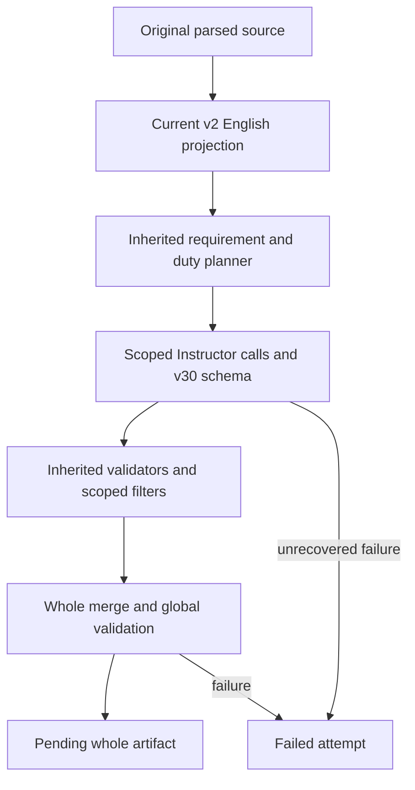
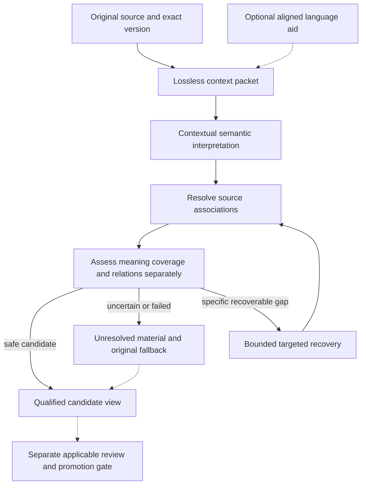

# P1.6 evolution E2 — architectural alternatives, experiment design and decision

**Date:** 2026-11-25. **Base:** `a092f68ed0144fe9633c967cd8e33ac6c0a14a07`. **Scope of this entry:** E2.1 alternatives, not E2.2–E2.6 completion or selected architecture. **State:** design published; local reconciliation pending (Desktop Commander offline). Prior E1 closure CI [45658879033](https://github.com/motafegh/jobhunter/actions/runs/45658879033) verified successful at exact base. No new code, source acquisition, inference, training, model load, database write, review or rollout authorized.

**Authority:** [P1.6 execution tracker](../P16_SEMANTIC_ARCHITECTURE_EVOLUTION_PLAN.md), [Stage B](../P16_STAGE_B_SOURCE_GROUNDED_BILINGUAL_IMPLEMENTATION_PLAN.md), [architecture](../ARCHITECTURE.md), [domain](../DOMAIN_AND_ANALYSIS_MODEL.md), [reasoning policy](../UTILITY_EPISTEMIC_AUTHORITY_AND_REASONING_POLICY.md) and [AI research companion](../AI_ARCHITECTURE_RESEARCH_AND_EVOLUTION_PLAN.md). Inputs: [E1 causal matrix](2026-11-24_P16_EVOLUTION_E1_ROOT_CAUSE_INVESTIGATION.md#2026-11-25-continuation--e111-consolidated-causal-findings-and-e2-decision-inputs) and [DOC.2 as-built map](2026-11-25_ARCHITECTURE_UNDERSTANDABILITY_DOC2_P16_RUNTIME_BASELINE.md). All prior diagnostic cases exposed. Existing v30/v5 English and v9/v4 original routes and accepted-compatible artifacts remain unchanged. This document is the evolving E2 decision record, not a separate checklist.

## 1. Product question and invariant requirements

Which design lets JobHunter understand a real vacancy more accurately, completely and efficiently than the user reading the original, with actionable uncertainty rather than a false sense of certainty? We do not optimize JSON completion, number of categories, model sophistication or benchmark scores in isolation. Accurate employer facts, useful model interpretations, and accepted durable facts are not the same product.

Retain original immutable source, exact version/anchors, source observation vs semantic identity, local-first modular monolith, SQLite, original/derived language distinction, privacy, currentness, existing accepted history and consumer gates. Avoid either under-grounded intelligence or over-gated delivery. Preserve rich natural context: duties and qualifications can overlap or inform each other. A duty may imply ability at some depth without establishing prior paid experience or mandatory employer eligibility. Behavior can be a qualification; classification disagreement without semantic harm is not automatically critical. Keep employer wording and interpretation separately accessible. Review effort proportionate to consequence. No automatic fact promotion from schema success, citations, critic agreement, deterministic label or model confidence.

All arms operate only in isolated research state until applicable E4/B5 and explicit E5/B6 gates. Current selectors for Capability, Work, Registry and Market must remain unchanged. B5 has four exposed failures; no new cohort or autonomous rollout. P2.3 remains deferred.

## 2. Separate the experimental dimensions

A0, A1 and A2 designate semantic architecture families; A3 designates the language-axis alternatives to be compared with a compatible architecture. Not four mandatory end-to-end products, and not a full factorial matrix. Use E2.A0 etc as local labels to avoid confusion with older Stage A or A1 review records.

| Dimension | Candidate choices | Hold fixed when studying |
| --- | --- | --- |
| Semantic architecture | A0 unchanged v30; A1 targeted repair; A2 contextual candidate plus deterministic reconciliation | Same source versions, language representation, model/runtime, common measurement envelope |
| Language (A3) | L0 current English v2; L1 improved contextual/source-aligned English; L2 original-first; L3 hybrid original plus aligned English aids | Same semantic task and compatible architecture, model and task rubric, matched source scope |
| Model | Incumbent E4B; MiMo 9B challenger if feasible; other local models conditional | Same task/contract/input, comparable runtime/decode and budget; disclose unavoidable tokenizer/template differences |
| Recovery/delivery | Existing whole-artifact behavior; targeted local recovery; qualified partial candidate plus source fallback | Same inputs/model outputs for deterministic replay; separately compare new calls and user-facing output |
| Context allocation | Whole coherent ad if it fits; section/group with surrounding context; bounded escalation for unresolved relationships | Same original units and coverage rubric; no silent omission/truncation |

Hard budget envelope belongs to experiment runner for *all* arms, including A0. Do not change A0 semantics or validators to achieve fairness. If a deadline/call ceiling interrupts A0, record budget-stopped rather than pretend the unbounded historical run completed. Measure actual physical requests, preflights, tokens, latency including cold/warm and model switching, failures and review burden. E2.3/4 will freeze exact arms, thresholds and feasible schedules before E3. No new calls now.

## 3. A0 — unchanged English v30 baseline

Purpose: reproduce the current semantic path as a comparator, not repair it or declare it acceptable.



As-built: analysis_current -> V30 service (V21/V20 entry) -> V16/V15 nested recovery -> V27/V25/V23/V21/V20 _run_once, requirement partitions and first-part duties, v30/v24/v20 Instructor, inherited model validators, filtering/merge, V28 persistence, pending review. Exact dependency reuse of accepted compatible v20/v21/v23/v28 v5 is current behavior; in paired fresh generation comparisons isolate caches without deleting accepted history, record reuse separately. A0 reads unchanged frozen v2 fields and current contract, not an edited projection. A0 may fail before returning claims; report delivery failure and score available outputs without inventing absent results. Use source-brief and existing B4v6 as separate user-delivery comparators, not replacement semantic baseline.

Strengths: extensive historical compatibility and tested evidence guards, known interface and persistent shape, exact source/translation identities, established review. Limitations: RC01–05/08/10/12, scope conflicts, deterministic board tag inflation, nested recovery, no persisted partial artifact, English fidelity dependence. Keeping A0 is a valid outcome if alternatives cannot demonstrate net improvement; that does not resolve existing defects or reopen promotion.

## 4. A1 — targeted repair in existing architecture

Purpose: determine whether correcting demonstrated deterministic and representational defects restores reliability without a broader semantic redesign. Keep v30-shaped task, current English input, partition strategy and unchanged output authority for the controlled architecture comparison. Implement future candidate under distinct experimental version and isolated dependency injection; never modify A0 or silently reuse accepted artifacts as candidate outputs.

| Repair candidate | Owner/mechanism | Required proof and non-goal |
| --- | --- | --- |
| Compound requirement scope | v23 preserve_source_alternatives, _source_alternative_concept and v21/v20 depth validators (RC01) | Avoid whole-parent concept overwrite of separate child. Keep exact parent relation and local modifier scope; replay neutral retry and negative controls. No blind deletion of depth or OR. |
| Motivation vs technical depth | v21 lexical explicit-degree requirement and v20 scoped-depth guard (RC02) | Null depth acceptable for non-depth concept when evidence supports it; explicit depth remains preserved or qualified unresolved. Reject borrowed/unsupported values. No regex exception for one advertisement or words in isolation. |
| False duty ownership | evidence_refs_v21 duty section boundaries and V21._responsibility_coverage_plan (RC03) | Identify non-duty section boundaries without losing genuine duties; unchanged retained retry with only false ref corrected is a causal control. Ambiguous units stay unresolved, not magically duties or exclusions. Negative control still rejects missing genuine duty. |
| Board/source separation | analysis_runtime_v20._v20_deterministic_structured_skills (RC08) | Board tags remain source observations; no automatic required/high employer strength solely from tag. Preserve useful metadata. Candidate projection compatibility must be assessed; if schema cannot express without meaning change, make limitation explicit rather than retrofit accepted rows. |
| Coherent instructions | assembled versioned prompts and scoped coverage payload (RC04) | Remove demonstrably obsolete/conflicting instructions only when actual contract behavior agrees. Distinguish a prompt cleanup arm from representation repairs if feasible. No claim fewer characters alone improves meaning. |

A1 is an experimental repair family, not a mandate to implement every row simultaneously. E2.5 select minimal coherent patch set; offline retained response replays isolate first three mechanisms before inference. For combined changes, record ablation or inability to attribute individual effects. Board authority fix may require a distinct candidate projection, not silent v5 semantics amendment. Preserve exact source/translation dependency and hard guards. Budget enforcement is common harness, not A1's claimed improvement; targeted retry policy can be separately compared. Do not use A1 as pretext for broad historical inheritance flattening. Expected advantage: low-to-moderate change scope, compatibility and causal attribution; remaining burden from partitioned task, long inherited instructions, English translation, whole merge and possible misleading coverage classifications. A1 may be sufficient, or may expose a representation ceiling.

## 5. A2 — contextual source-local semantic architecture

### 5.1 Processing and responsibility split

Hypothesis: an LLM given coherent employer language with relevant source context and a compact meaning-oriented contract can interpret more reliably than a model forced to satisfy prespecified semantic categories, depth and coverage obligations; deterministic orchestration should protect evidence and expose missing/invalid claims without forcing every interpretation into a rigid output. This is not proven by prior native JSON tests. Source-local does NOT mean per-sentence isolated prompting; begin with an intact ad where feasible.



| Stage | Deterministic responsibility | LLM semantic responsibility | Failure behavior |
| --- | --- | --- | --- |
| Context packet | Original source/version identity, exact spans and metadata pointers, order, headings, group boundaries, dedup of exact representations, token budget and omitted inventory | None required at preprocessing | Hard identity failure abort affected output; preserve unknown/unclassified original material rather than erase it |
| Primary interpretation | Supply relevant context, validate compact transport envelope, preserve response and provenance | Understand role purpose, work, explicit expectations, preference/conditions, alternatives, motivation and implied ability; retain relevant ambiguity and relationships | Invalid envelope bounded repair if justified; failed generation still source fallback |
| Association and representation | Resolve cited source anchors/child spans/board pointers; ensure exact version/scope; reject fabricated IDs; safe shape normalization only | Propose which evidence supports interpretation and scope; uncertainty if unclear | Invalid association quarantined; exact association not entailment |
| Reconcile | Track coverage inventory, duplicates, shared dependencies, conflicts and provenance; no deterministic semantic coercion | Interpret relations, alternative topology and shared modifiers, distinguish evidence from inference; investigate only selected gaps | If group relationship unresolved, withhold dependent eligibility conclusions; retain safe independent material and source quotes |
| Delivery | Status labels, preview/full drilldown, currentness and authority, source-first fallback and unattempted ledger | Candidate summary of meaning, explicitly inferred capabilities, notable ambiguities | Partial not whole success, no missing-is-absent claims |
| Promotion | Separate explicit review and exact compatible dependency gate | Advisory support only | No auto-acceptance, no downstream candidate adapter |

### 5.2 Context and output design choices for E2.2

Use Stage A exact original anchors, B1 evidence/board/overlap concepts and original HTML groups as substrate. Do not trust B2v7 candidate labels as input truth; its heading heuristics can lose non-list passages and inherit incorrect obligation. Include original unclassified blocks and coverage inventory independent of B2 labels. Preserve title, heading and neighboring context with scoped evidence; never transfer heading scope merely because a finite regex misses a boundary. Whole source if it fits token budget; otherwise coherent group/section with adjacent or shared context, stable group IDs, links to earlier/later clauses and explicit unprocessed inventory. No blind truncation or rigid partition by qualification categories. Evaluate any section planner itself.

Minimal conceptual response (not final schema): a compact list of candidate statements with source references and semantic basis (explicit claim, implied interpretation, unresolved/context), natural-language meaning and only the role/strength/scope/depth/experience/alternative attributes justified by content. A claim can serve multiple semantic functions; shared evidence is allowed, distinct claims use stable identities and linked relations to avoid double counts. Preserve exact source text separately, no requirement for model to retype hashes or all evidence. Use optional relation or group representations when material, not mandatory graph generation. Explicit absence requires evidence and proper scope, not empty arrays or missing output. Do not require the LLM to output every possible field per statement or emit an exhaustive ontology. Confidence may signal uncertainty, never substitute for evidence or review. E2.2 defines actual envelope, identity, optional fields, verification and authority; this entry proposes meaning and responsibility only.

Keep original and candidate claim coverage distinct: every source group accounted for as inspected/summarized/not attempted/excluded with reason/unresolved (implementation vocabulary E2.2); inspected does not mean understood, a reference does not establish meaning completeness. Deterministic ledger based on known inputs and actual outcomes; semantic coverage evaluated source-first. Cross-group dependencies are reconciled before eligibility summary. Candidate views retain unresolved clauses and original drilldown even if translation missing. B4 fragment filtering and compact view are useful engineering seeds, not semantic truth. Use original source-brief fallback independently of B4's translated input dependency.

### 5.3 Illustrative synthetic passage (authored, not an archived ad)

> Build and maintain internal APIs using Python or Go. Solid knowledge of engineering principles is expected. Experience deploying services is preferred. A degree or equivalent project experience is acceptable. Strong interest in learning is important. Hybrid work by agreement.

Desired interpretation, not model output or accepted evaluation labels:

| Material meaning | Candidate interpretation | What must not be inferred |
| --- | --- | --- |
| Assigned work and tools | Build/maintain APIs; Python or Go associated with duty; implies ability to do API work | Both languages mandatory; prior paid API experience required |
| Engineering principles | Explicit expected solid knowledge, separate concept and depth | Copy solid to programming or motivation |
| Deployment | Explicit preferred experience | Mandatory deployment or exact years |
| Degree/experience | Preserve OR and equivalent scope, or show intact clause unresolved | Require both; substitute paid work for project experience |
| Motivation | Behavioral expectation/qualification as appropriate, no technical degree | Strong proficiency or mandatory work history |
| Arrangement | Hybrid by agreement, separately visible | Technical qualification or guaranteed remote |

This example illustrates overlap without forced separation. One source group can contribute work and capability meaning. The UI can answer "what would I do, what do they expect me to know, what prior evidence do they ask for, what is optional, what conditions/alternatives matter?" without forcing unrelated claims into an artificial single score. Actual interpretation and user benefit must be evaluated.

### 5.4 Recovery and reuse of existing modules

Propose bounded targeted recovery for invalid representation or unresolved material, not endless full-job rewrites. An independent fragment survives only if its own source/contract/model/run dependencies are valid and unresolved global relation cannot change its meaning. Example: if degree/experience OR topology unresolved, retain exact clause and qualified uncertainty; do not mark degree mandatory. An unrelated valid location statement can remain visible. Distinguish malformed JSON (recoverable only without inventing meaning), unsupported association, contradictory semantics and incomplete coverage. No auto-promotion from partial. Receipts preserve raw/normalized versions privately, actual stage attempts and dependency identities. No new agent framework or separate database by default; use isolated research artifact and existing local runtime/budget seam if compatible. E2.2 determines whether local checkpointing is necessary versus safe end-of-run receipts. E2.3 freezes recovery caps.

Benefits hypothesized: broader contextual meaning, fewer mandatory fields, lower validation failure blast radius, original source visibility, potentially lower repeated prompt cost. Risks: larger whole-context prompts, missed units/relations, freeform hallucinations, weaker comparability with v5, new candidate schema/review/presentation burden, no guarantee small models perform better. Compare against A0 and A1 with same language/model before claiming A2 advantage. Do not simply rebuild old native v2/v3 prompt or B4 as new production path: prior native source-ref trials passed structure while missing material semantics, B4 reference filtering passed incorrect obligation.

## 6. A3 — language strategy, orthogonal to A1/A2

Current English v30 is translation-dependent, but translation is derived convenience, not source authority. English-native descriptions still failed due to nontranslation causes. Original v9 is a historical comparator (known semantic errors, new outputs pending), not evidence original-first is superior. Use the same compatible semantic architecture and task across language arms to isolate language contribution.

| Arm | Flow | Context/fidelity tradeoff | Resource hypothesis |
| --- | --- | --- | --- |
| L0 existing v2 | Current whole-field derived English -> semantic reasoning -> resolve to original where possible | Familiar analysis language; translation may alter names/strength/duties; field association not exact original span equivalence | Reuse possible; translation and model switches when cold |
| L1 improved contextual translation | Original groups with headings/shared clauses -> source-aligned translation or reviewed aid -> same semantic reasoning | Better possible alignment; still depends on linguistic fidelity and original scope | Extra translation calls or bounded batches; compare existing B3/B5 without assuming superiority |
| L2 original-first | Original-language text with stable anchors -> semantic reasoning -> translate selected display content if needed | Original context direct; model Persian/mixed-language competence unknown; English presentation separate | May avoid prerequisite translation; display translation and recovery still cost |
| L3 hybrid | Original plus aligned English aids when useful -> semantic reasoning over paired views -> preserve discrepancies | Potential support for names/technical terms, but conflicting aids may bias interpretation; original controls | Larger input and possibly extra translation; selective rather than automatic double context |

Native English uses identity for native description, but metadata may still require translation. No lossless-language assumption for metadata. For L0/A2 mapping of exact English refs to original: if v2 only provides field-level alignment, label original field association and unresolved exact original child evidence, not fabricated exact anchor. Do not disadvantage a language arm by granting another unsupported source precision. Compare both what each arm can establish and what it cannot. Preserve original group/compound relation context and terminology, negation, numbers, names, scope, conditions and attribution. Translation aid invalidation affects only dependent candidates, not source truth. L2/L3 source-local refs can bind original exact anchors; alignment does not prove meaning. Translation of display must not rewrite accepted original claim. LLM output language fixed where practical; record unavoidable tokenization and context differences. Separate translation accuracy/cost from semantic interpretation and end-to-end user task. Reuse B3/B5 alignment and budget facilities only if verified adequate; no forced one-call-per-item translation.

## 7. Comparative tradeoff matrix (design estimates, not measured ranks)

| Dimension | A0 | A1 | A2 | A3 language variants |
| --- | --- | --- | --- | --- |
| Context preservation | Scoped parent/child partitions, known false plan | Same context with corrected ownership | Coherent source groups/whole ad, cross-group relation need | Original, translated or both; potential conflict/overhead |
| Evidence safety | Tested derived-field association and strict guards; known semantic false passes | Preserve hard association; repair proven scope/authority defects | Exact source identities where available, explicit unresolved, quarantine; new contract needs tests | Original binding and translation association distinct |
| Useful delivery | Whole pending or failure; separate source fallback | Similar whole delivery, fewer demonstrated blockers hypothesized | Candidate partial + source fallback; full only when justified | Same delivery contract; language fidelity affects result |
| Model demand | Large inherited prompt and fixed fields | Similar, possibly coherent narrower instructions | Fewer mandatory fields; richer context reasoning may be demanding | Language skill/tokenizer/dual context differences |
| Latency/cost | Historical long failure and nested retry potential | Potentially fewer failed reruns; unmeasured | Potential fewer redundant calls; larger context or recovery may offset | Translation/model-switch savings vs input and display costs |
| Implementation | Existing, no semantic change | Narrow versioned experimental patches; compatibility limits | New candidate envelope and reconciliation/view; higher initial burden | Depends on chosen common architecture and mapping |
| Maintenance | Deep inheritance and patch interactions | Modest local changes, risk new patch accumulation | More explicit ownership hypothesized; risk new generic framework complexity | Additional bilingual lineage and evaluation |
| Authority/compatibility | Existing pending/accepted selectors | Candidate isolation; no silent v5 semantics change | Sidecar initially, no automatic durable adapter | Same protection; no original-as-English shortcut |

These alternatives address RC01–03 (A1); RC04/06–09/12–13 (A2 with A1 comparator); RC10–11 (A3); RC05/16 (model/budget/recovery comparison); RC14–15 (protected authority and qualified presentation, separate V9 audit); RC17 (source-first and user-task evaluation); RC18 (DOC track and measured maintainability). Do not use any improvement direction to remove hard integrity/currentness guards.

## 8. Proposed discriminating sequence, not frozen protocol

1. Offline retained-response controls for A1; candidate design must preserve genuine meaning and reject genuine missing duty/unsupported scope. A1 may be rejected if repair harms meaning or requires unbounded special-case logic.
2. Model-only screen A0 with E4B and viable MiMo 9B challenger; exact current input/contract and shared bound. Preserve failure, not only complete outputs. If A0 causes all failures, record floor effect and compare selected same-task model pair on A2 separately rather than declare models equal.
3. Architecture-only A0/A1/A2 using incumbent, frozen common English v2 input and original evidence availability tracked; if A2 uses original for association only, explicitly keep that operation separate from model input. Score original-source meaning and delivery for all; exact English vs original evidence precision differences are outcomes, not erased.
4. Language-axis L0/L2/L3 and L1 if justified, on selected compatible architecture and same model, matched source context. Include native-English control and Persian/mixed language. Do not compare unpaired original v9 vs v30 as causal language study.
5. Selected interaction/challenger tests and recovery/partial delivery replay only if needed. Consider conditional 12B QAT or specialized translation if E2 hardware and budgets support them. No full model × architecture × language × recovery grid; no mandatory RAG/agents/embedding/training in E3. Source-brief/B4v6/original reading are practical output/utility controls.
6. E2.3–4 freeze cases, stratification, reviewers/exposure, thresholds, scoring denominators, caps and stop rules before new inference. E2.5 selects actual minimal experimental arms and explicit owner decisions where required; E2.6 reconciles docs and freezes E3. No new independent cohort until E4 applicable gates.

The sequence is a recommendation, not selected implementation. A1 and A2 are both legitimate candidates; A2 is the leading architectural hypothesis because it can address shared responsibility/delivery defects rather than patch isolated symptoms. A3 could complement either. If targeted repair delivers comparable fidelity/utility at lower cost, prefer it; if none improves over protected baseline, retain/defer. No proof yet.

## 9. Existing components to retain, adapt experimentally or leave alone

| Component | E2.1 disposition |
| --- | --- |
| Source acquisition, SQLite source versions, exact hashes/anchors, source policy | Retain unchanged; no fetch or parser rewrite needed to design alternatives |
| v30/v5 and compatible accepted paths, original v9/v4 | Preserve as current/baseline; candidate changes have distinct identity and isolated state |
| Stage A / B1 evidence and relation contracts | Reuse original span, pointer, lineage primitives and relationship semantics where suitable; E2.2 evaluate contract fit |
| B2v7 DOM and source brief | Reuse structural groups and read-only fallback; classification only candidate, not truth or exhaustive segmentation |
| B3/B5 alignment/budget | Reuse exact alignment and bounded transport concepts as compatible; validate context fidelity and actual enforcement |
| B4/B4v5/v6 | Reuse candidate evidence/visibility patterns; do not inherit misleading complete state, summary blast radius or translation dependency blindly |
| Analysis diagnostics/item review | Retain old contracts, examine actual failure/review states for new candidate receipt design; do not create competing authority ledger |
| Capability, Work, Registry, Market, public corpus | No new semantic consumer route or accepted facts. Historical V9 blast-radius audit independent. |
| AR.2 AI Lab and DOC.3/4/7 | Minimal reusable experiment manifests and component profiles; future generator only if useful, no general platform build |

## 10. Handoff, verification and limitations

E2.1 design deliverable contains required four directions, comparable dimensions, concrete processing responsibilities, causal evidence links, existing component reuse and no-change alternative. E2.2 should specify candidate authority, evidence group/child alignment, optional depth/experience, source vs inference relations, uncertainty and partial state, alternative scope, reconciliation and promotion compatibility. This is the next design task after E2.1 reconciliation; no final schema, implementation, model selection or scoring thresholds here.

Remote-only documentation increment: Desktop Commander reported both registered local devices offline. Remote main verified at exact base and E1 CI successful; reviewed repository tracker, E1 matrix, DOC.2 owners, architecture/domain/reasoning policy, Stage B and AI research references via GitHub. No new private source/DB access, no local verification/tests, no inference or production work. Reproducibility of E1 remains existing receipts, not new replay. Remote document-only diff, linked paths and tracker count to be verified at publication. E2.1 checkbox intentionally remains open pending local main synchronization and protected-state reconciliation under existing milestone discipline. Recheck with `git status --short --branch`, `git pull --ff-only` only if safe, exact HEAD/origin/main, `.venv/bin/python data/local-acceptance/2026-11-23-fresh-e2e-manual-audit/verify_reconciliation_2026_11_24.py`, and CI at new revision; then close E2.1 and proceed. If local changed or pull conflicts, preserve state and reconcile, not force. No data exports or automatic promotion. User has approved continuing design, not a selected architecture or governing contract change.


## 2026-11-26 continuation — E2.1 reconciliation and E2.2 candidate semantic contract

**Base:** `74555ad4d6b0bc0b361e5b00260bece96419b467`. Local WSL device restored; clean main fast-forwarded from a092f68 to exact remote base. Prior E2.1 [CI 45694817594](https://github.com/motafegh/jobhunter/actions/runs/45694817594) completed successfully at exact base. Protected-state reconciliation passed (production DB and corpus manifest SHA, frozen private receipt, four SQLite integrity/FK checks and nine routing references). E2.1 now meets its recorded closure conditions. This entry designs E2.2, not the selected architecture, final production schema or implementation. Existing [B1 ADR](2026-11-14_P16_B1_SOURCE_ITEM_BILINGUAL_CONTRACT_ARCHITECTURE_DECISION.md), [E1 matrix](2026-11-24_P16_EVOLUTION_E1_ROOT_CAUSE_INVESTIGATION.md), [DOC.2 map](2026-11-25_ARCHITECTURE_UNDERSTANDABILITY_DOC2_P16_RUNTIME_BASELINE.md) and permanent policy control. Preserve B1 and v30/v9 contracts and historical artifacts byte-for-byte. No model call, load, acquisition, new accepted facts, database migration or consumer change.

### 11. Design decision — separate meaning from bookkeeping and authority

Design two interfaces rather than one large Pydantic model that simultaneously serves generation, persistence, evidence verification and user presentation. These are conceptual draft contracts for E2.3–5 selection; not yet runtime interfaces or accepted new versions.

| Interface | Purpose | Owner |
| --- | --- | --- |
| Context packet | Source units in order, headings and neighboring context, stable short handles, original or derived language per arm, clearly named board observations | Deterministic preparation; no authoritative semantic labels |
| Model response | Compact contextual statements, evidence handles, basis and optional meaning/scope/relations; open questions when material | LLM, semantic judgment only |
| Candidate envelope | Exact dependencies, source/target association, immutable claim identity, normalized representation, execution/coverage/assessment and review state, error and resource receipts | System, except separately attributed semantic assessment |
| Decision view | Useful grouped candidate statements, original drilldown, explicit unresolved/partial status and observed metadata | Deterministic presentation + optional attributed model synthesis |
| Accepted artifact | Reviewed, compatible, current version under approved contract | Existing production rules today; future promotion only B6 |

The first two form the model-facing task; the last three are **not** fields the model must generate. Never ask it to calculate hashes, assign persistent IDs, establish review status, declare its own acceptance, count completeness or invent exact offsets. Prefer a single coherent prompt/task and short evidence handles; no obligation to emit every semantic axis on every statement. If a model omits a material qualifier, this is a semantic omission to detect/assess, not a reason to manufacture it deterministically. This direction respects E1 RC01–18 and B1's orthogonal authority principle. A0 retains its exact schema and A1 remains an experimental targeted-repair option; A2 draft does not replace their comparators.

### 12. Compact model-facing contract (proposed)

Illustrative names, to be frozen only after E2.3–5. Minimum valid response is an object with a statements array (possibly empty; never proof of absence). Each statement has local reference, short natural meaning, evidence handles (nonempty for source-linked claims) and basis. Basis is explicit source interpretation, contextual inference, or unresolved reading. Explicit means the model *claims* that source says it; not verified truth. Local refs are request-local aliases, not stable IDs. System validates association against the exact packet, not model-provided arbitrary text. A whole uncertain group may remain an exact quote with an unresolved statement. Optional open questions reference context and identify a material ambiguity; they do not require an answer or cause automatic retry.

| Model field | Required? | Interpretation |
| --- | --- | --- |
| ref | yes | unique within returned response; system resolves it to candidate ID |
| meaning | yes | concise natural interpretation with all material qualifiers |
| evidence | yes | one or more handles scoped to packet; may cite overlapping/group and context units |
| basis | yes | explicit / inferred / unresolved (proposal, not approval) |
| roles | optional | one or more useful semantic roles (work, qualification, behavior, arrangement, compensation/benefit, application, purpose, context); overlap allowed, no exhaustive closed taxonomy required |
| strength | optional | required / preferred / stated expectation / unresolved when source supports distinction; never convert an inferred capability into explicit obligation |
| depth / experience | optional | source-local depth wording, stated prior-exposure/duration or implied work scope; distinguish dimensions, no arbitrary numeric score |
| relations | optional, response-level | source-supported alternatives/conditions/shared qualifier links or inferred work-capability relation; omit if not established, preserve group wording |
| open_questions | optional, response-level | unresolved material interpretation or relationship, source handles and reason |

Only four statement fields are mandatory (ref, meaning, evidence, basis); optional attributes carry meaning where useful. The exact encoding of depth/experience/roles and relation types is to be kept minimal in the frozen implementation; optional is not permission to silently discard source meaning. No required rationale/confidence/ontology per claim, no technical degree forced from adjectives. Model-facing examples show overlap and abstention; prohibit adding a second checklist of all E1 edge cases to the prompt. Treat source/retrieved content as data, never instructions. No arbitrary tools or external retrieval in the initial arm. The system sets max context/output, passes exact context scope and records omitted units. Avoid item-by-item prompting by default; use intact ad or meaningful contextual groups, not isolated taxonomy buckets.

### 13. Source identity, group and child alignment

Reuse `source_span_identity.bind_original_source_span` / `verify_original_source_anchor` and B1 original description source anchor identity (field, source job/version, semantic hash, character/UTF-8 offsets, exact substring/hash). Board metadata uses separate B1 JSON Pointer/canonical selected-value and field digests. Source hash verifies content; no claim of linguistic meaning. Reuse B2v7 DOM group structure as a candidate aid only; independently inventory original text and preserve meaningful non-list passages, headings/context and units that its classifier missed. Overlap legal; stable group reference for enclosing qualifier and relation. Never synthesize a child exact span from approximate translation or concatenate noncontiguous text as a single contiguous span. For actual discontiguous evidence use multiple anchors. Context handles may help meaning but not replace required evidence: an original heading alone cannot support an unrelated child's named skill; group and child references may jointly support a statement.

Packet has deterministic handle->immutable reference map, ordered unit inventory and source/version/representation fingerprint. Each returned handle resolves to an included reference; child text boundaries may be resolved only from exact source and parent scope, with ambiguity marked unresolved, not fuzzy-bound. Child identity is content+scope, not text-only; identical phrase at different positions may differ in modality. Group/child edges reflect containment, not semantic equivalence. For L0 v2 English only, retain exact English reference and source-field association, original child alignment unresolved; do not claim exact original anchor without proof. L1/L3 B3 alignment may be many-to-many and source-bound candidate; native exact separate. Preserve source/target offset/hash lineage, semantic translation review separate, unresolved target not a reason to hide original text. Derived translation or reviewed correction has distinct revision; invalidation affects dependent statements. No destructive edits of original or previous target.

### 14. Meaning, normalization and relationships

Maintain independent dimensions, not disjoint classifications. A statement can describe both work and qualification if source context says so; an inferred work-capability statement explicitly links to the work evidence and remains inference. Do not count the same employer statement twice merely because two roles share an identity; distinct material assertions in a group may have separate candidate IDs. Distinguish employer-expressed obligation from model-inferred practical necessity and from personal eligibility (latter deferred). Board skill presence is a board observation, not automatic employer-required qualification; board/prose conflicting values coexist with typed conflict, no overwriting or automatic strength upgrade. Preserve conditions, uncertainty and qualifications even if no canonical concept available. Unknown role is not source omission and unknown strength is not optional. Behavioral expectations can be explicit qualifications; employment arrangement can be an explicit eligibility condition if actual source says so. No blanket semantic rule excluding either, only typed meaning and scope. No applicant score or decision.

| Dimension | Example and safe boundary |
| --- | --- |
| Depth | "solid knowledge of engineering principles" attaches solid only to that concept. "Strong interest in learning" is motivation, not technical proficiency. Omit structured depth when inapplicable; preserve actual source phrase. |
| Prior exposure | "Build APIs" implies ability to do work, not paid employment or years. "2 years of experience" preserves duration/unit/comparator and scope; "project experience" is not automatically professional experience. |
| Modality | "Python preferred" remains preferred even with board Python tag or duty involving Python. "Expected" is not automatically formal mandatory eligibility. |
| Alternative | "Python or Go" as work tooling may be work options, not eligibility; "degree or equivalent project experience" is an eligibility alternative if source supports it. |
| Negation and condition | "No prior work experience required" is explicit negative obligation, not lack of evidence; "if selected, pass exam" is conditional, not unconditional prerequisite. |

Safe mechanical normalization: whitespace/escaping, source-backed exact span binding, recognized harmless representation aliases with unchanged meaning, canonical serialization and de-dup of byte/identity-identical records. Record raw/normalized digests, operation/version/reason and lineage. Never silently remove a source modifier, join alternative concepts, infer missing duration, replace model category from lexical heading, reclassify obligation, change negation or assume equivalence. If malformed depth can be made unknown without losing material source wording and evidence, preserve wording, mark unknown and keep unaffected meaning; explicit depth omitted remains an unresolved coverage/meaning issue. Ambiguous representation that affects meaning gets targeted semantic review or abstention. Exact evidence association alone does not establish entailment. No general lexical semantic validator as final truth; deterministic guard rejects known invalid references, authority transitions or structurally inconsistent representations, while semantic judgments remain attributed and scored.

### 15. Alternative groups and conditional scope

Reuse B1 graph semantics as a candidate internal representation only when source supports topology. Keep group quote, qualifier references, ordered children and relation type (AND / OR / conditional / example / unresolved). Distinguish formal eligibility routes from tool options, illustrative examples and work-capability relations; no treating every "or" as applicant eligibility. A group may contain nested groups; every edge resolves, DAG acyclic, leaves inside allowed job/version and their scoped evidence, duplicate/unreachable references rejected. For formal paths, all_of requires each child, any_of one path, conditional implication only inside established scope; do not compute user's eligibility. Local mandatory leaf in chosen option is not globally mandatory. For example:

```text
candidate group: degree OR equivalent project experience
  degree: required_if_path_chosen
  project experience: required_if_path_chosen
  shared qualifier: equivalent
global mandatory leaves: none (unless supported elsewhere)
```

If topology/qualifier/leaf scope unresolved, show intact group as unresolved; withhold simplified eligibility summary dependent on group. Preserve safe unrelated claims. Do not force graph construction when exact compound wording is more useful and no structured route necessary. E2.4 evaluates material preserved paths, not graph count. B1 validator validates references and Boolean graph structure, not employer intent. Model suggests relation, deterministic system verifies structure and dependency, semantic assessment evaluates actual meaning. Record reason if relation unresolved rather than adding arbitrary edges.

### 16. Candidate envelope, independent state axes and partial delivery

Use a versioned private isolated sidecar for A2 research initially (append-only run/claim revisions plus receipts); no new production SQLite tables or public route. Conceptual envelope:

```text
run identity = source job/version/hash + packet/representation hash
               + source/translation dependencies + model artifact/config
               + semantic contract/prompt/runner versions + unique attempt/run ID
claim revision = run ID + system-assigned local ID + digest of meaning,
                 basis, roles, scoped evidence and material relation dependencies
fragment = immutable claim revision set + dependency IDs + validation/assessment state
```

Reuse only when exact inputs/contract/config/evidence/dependencies match and review/authority still compatible; explicit attempt/cache/reuse receipts. Do not dedup distinct independent runs solely on text equality; exact identity and claim equivalence different. Corrections create successor revisions, never mutate raw response or accepted historical state. Relation groups refer to immutable claim revisions; compute content digests of normalized relation records separately, avoid cyclic ID hash dependency. Stale status derived from current dependencies, not retrospective deletion. Every record retains source and run lineage; no public raw content export. New candidate contract has distinct ID from v5/B1. A1 if selected may produce existing-shape output inside separate experimental envelope, never assign existing accepted contract authority.

| Axis | Proposed states / ownership | Not implied |
| --- | --- | --- |
| Execution | not attempted / completed / failed / budget stopped / timeout; system receipt per unit and physical call | Semantic correctness |
| Association/integrity | verified exact / verified field only / unresolved / invalid; system | Entailment or precise original alignment |
| Semantic assessment | unreviewed / supported / partially supported / contradicted / unsupported / unresolved; attributed reviewer or assessment provenance | Independent human approval or durable acceptance |
| Coverage | observed inventory per unit: attempted, not attempted, linked, excluded with reason, unresolved; separately meaning coverage review | Exhaustive ad understanding from all refs linked |
| Relation consistency | resolved candidate / unresolved / invalid; structural vs semantic assessment separate | Correct eligibility |
| Delivery | source-only / qualified partial / whole candidate / withheld; system from known states + semantic scope | Accepted artifact, complete understanding |
| Authority | candidate_only, no downstream; existing accepted historical/current separate | New promotion by generation or review label |

A whole candidate means all **planned** processing completed and no known material unresolved delivery dependency for the stated scope; explicitly distinguish planned scope from complete original semantic coverage. Never call it "complete understanding" absent source-first assessment. Budget or model failure may deliver source-only or partial candidate; execution remains failed/stopped. Invalid identity/source hash blocks affected evidence, not a guessed quote. Invalid claim association quarantines claim and dependent relations; valid unrelated source still accessible. Wrong/unsupported semantic claim withheld from supported view; unreviewed candidate may be shown as labeled proposal under bounded authority, never called supported solely by citation. Global group failure withhold dependent claims/summary, not unrelated material. No hidden not-attempted content or absence inference. If source is invalid or stale, no current candidate claims; historical display clearly labeled only if allowed. Missing translation does not hide original source. Review can be selective/proportionate for candidate use; consequential claims with unresolved meaning are explicitly qualified/withheld. Whole accepted state requires separate applicable policy, not merely all local items reviewed.

### 17. Delivery controls and promotion compatibility

| Situation | Allowed user-facing result | Downstream result |
| --- | --- | --- |
| Valid source, no model output | Source inventory with original text, candidate classification label, missing analysis | No new accepted semantics |
| Exact ref, unreviewed interpretation | Bounded labeled candidate; evidence drilldown, uncertainty | None |
| Supported fragment, unrelated failure | Qualified partial with failed/not-attempted inventory, safe fragment + originals | None |
| Unresolved alternative or conflicting meaning | Preserve exact group/board and narrative, label ambiguity; suppress dependent mandatory/eligibility summary | None |
| Source/translation revision changed | Historical only or withheld; new candidate needed | No current reuse of stale dependencies |
| Whole candidate, individually reviewed | Candidate with review scope/provenance | No automatic accepted conversion |
| Future B6 decision | Separate compatible approved artifact, explicit review/migration/rollback; currentness verified | Accepted-only consumers under approved rules |

No candidate adapter for Capability/Work/Registry/Market, no implicit public corpus export, no original v9 as English accepted substitute. Existing v20/v21/v23/v28 accepted-only compatibility and new v9 pending rule unchanged; V9 historical audit independently open. B6 must define durable representation compatibility, review/promotion transition, migration/backup, versioned consumer checks and rollback; if unable to faithfully represent new claims in legacy v5, retain separate candidate or choose new explicitly approved contract rather than coerce. Reuse principles of AnalysisItemReviewStore (append-only provenance, separate whole acceptance) but do not write its current v5 tables from candidate runner. Review event binds exact claim/group/source/target digest, dimension, reviewer class/exposure, disposition, reason and predecessor; different review dimensions not interchangeable. No model reviewer certifies its own output. No change to current owner acceptance policy.

### 18. Design-only worked fixture and negative controls

The companion [synthetic contract examples](2026-11-26_p16_e2/SEMANTIC_CONTRACT_EXAMPLES.json) contain authored fictional source passages, a compact example response, explicit system-owned expected states and negative/partial scenarios. They are design illustrations, not generated predictions, real job source evidence or independent gold labels. Exact sample refs are local handles only. E3 must implement deterministic cross-reference/identity/dependency checks and evaluate semantic meaning on frozen source-first cases; do not claim semantic validators from illustrative expected outputs. Design controls cover compound OR/depth scope, motivational adjective, board/prose preference, overlap and prior work, conditional eligibility, malformed/unsupported reference, unaligned translation, incomplete processing, dependent group failure and stale state. Existing B1 fixture validator/source-span tests and B4/source-brief/authority tests remain baseline; no new runtime code. E2.3 chooses minimal arms and exact frozen fixture/model protocol, E2.4 thresholds, E2.5 decision/owner approval as applicable. Do not demand all optional fields, all relations, separate agents or full production persistence in first trial.

**Disposition:** E2.2 design complete when linked fixture, structural design checks and existing regression/protected-state evidence recorded. Candidate contract remains experimental draft; no selected model/architecture, no production schema/authority change. Next E2.3 bounded comparative protocol. DOC.3/4/7 remain required before E2.6; DOC.5 after selection. Local/remote main reconciliation and CI recorded per milestone.

**Local design verification:** 130 existing focused tests passed with warnings as errors (B1 contract, exact spans, B4/B4v5/v6, source brief, item/semantic review, v30 currentness and Capability v9 boundary). The ignored helper `data/local-acceptance/p16-evolution-e1-2026-11-24/verify_e2_2_design.py` built synthetic examples using the existing span binder/verifier: 12 exact anchors including four child spans, two expected tamper/stale rejections, 10 authored candidate statements and 12 prospective design scenarios. Statement/ref/relationship reference assertions passed; semantic scenarios are expectations only, not tested implementation. [Verification receipt](2026-11-26_p16_e2/SAFE_E2_1_2_DESIGN_VERIFICATION.json) records commands and protected-state checks. No new source/model calls. E2.1/E2.2 closed as design only; E2.3 next.
