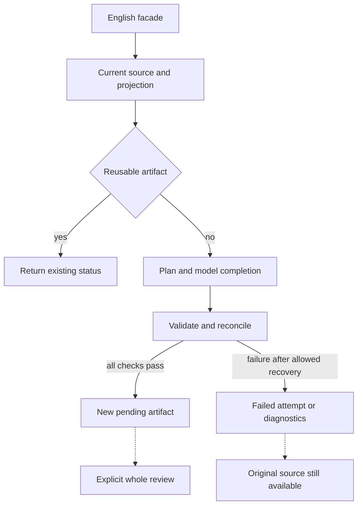

# Architecture understandability — DOC.3 worked P1.6 component profiles

**Date:** 2026-11-26. **Verified code revision:** `cebbf3750c426567257e25a2558a14e88835d427`. **Status:** completed supporting profile standard and bounded pilot, not full system inventory, not new design implementation. **Controls:** [Component profile standard](../COMPONENT_PROFILE_STANDARD.md), [DOC.2 map](2026-11-25_ARCHITECTURE_UNDERSTANDABILITY_DOC2_P16_RUNTIME_BASELINE.md), [runtime index](../CURRENT_RUNTIME_AND_VERSIONED_CODE.md), [E1 causal synthesis](2026-11-24_P16_EVOLUTION_E1_ROOT_CAUSE_INVESTIGATION.md), [E2.5 selected experimental scope](2026-11-25_P16_EVOLUTION_E2_ARCHITECTURE_DECISION.md#2026-11-26-continuation--e25-bounded-experimental-design-selection). Code paths below relative to src/jobhunter. S static, O retained observation, X offline replay/test, I illustration, P proposal; status C/T/K/R/H/D per standard. No new live model calls, private text or DB mutation. Each profile is responsibility-oriented, not a duplicate of the full map.

## P16 English analysis

**ID:** P16-EN. **Status:** C public English v30/v5, T earlier inherited methods, K exact accepted compatible v20/v21/v23/v28/v5. **Owner role:** P1.6 semantic engineer; reviewer checks downstream/authority.

| Field | Worked profile |
| --- | --- |
| Purpose / non-goals | Interpret a current job's English projection into purpose, duties and qualifications; preserve source evidence and review status. Not candidate matching, accepted facts by generation, or original-language exact child alignment. |
| Entry boundary (S) | CLI entrypoint._run_job_analysis or browser _analysis_service -> analysis_current.JobAnalysisService.analyze_english_job/run_english -> analysis_runtime_v30.build_v30_analysis_service. Actual service entry resolved to V21.analyze_english_job wrapping V20. Do not choose owner by newest filename. |
| Inputs / outputs | Source job ID, latest parsed source detail version, current configured v2 English projection, model/prompt/schema. Output AnalysisJobResult with exact reusable or newly pending artifact/attempt, or failure; batch separates completed/reused/failures. English evidence derived from projection fields. |
| Deterministic | Source/projection currentness and reuse, evidence catalog, structured metadata materialization, requirement/duty planning, partition scope, representation validation, filtering/merge, persistence. Current board tags materialized required/high is a known defect, not policy. |
| Model | Scoped structured interpretation via local LM Studio (configured E4B baseline), Instructor JSON_SCHEMA. First partition duties, requirements split by existing plan, inherited prompt/schema constraints. Model's output and confidence not semantic review. |
| Dependencies (S) | TranslationService.current_artifact; TranslationStore.latest_source_version; AnalysisStore.find_artifact; V16 -> V15 complete_structured recovery; V27/V25/V23/V21 -> V20 _run_once; V30 _complete_partition -> v24 wrapper -> v20 completion; v30 inherited response/requirement validators; V28 _persist_analysis. See DOC.2 table for exact owners. |
| Persistence / side effects | Read source and translation; may initialize stores, call local model runtime/management, write job_analysis_artifacts, job_analysis_attempts and bounded failure diagnostics; English artifact references translation ID. Public mutating CLI can synchronize corpus; no promise of read-only or global atomicity. Raw source untouched by semantic generation. |
| Lifecycle / failures | Missing source/projection blocks, no automatic translation repair. Exact reuse (pending/current or accepted compatible where allowed) is not fresh inference. New valid output pending. Unrecovered partition or merged validation failure -> failed attempt/diagnostics where reached, no persisted partial merged artifact; earlier raw partition may be unavailable. V15/V16 conditional nested recovery and per-partition reask; not a global hard deadline. New candidate can become stale by source/translation change. |
| Authority / consumers | Pending display/reuse does not satisfy accepted-only consumer rules; explicit review separate (profile P16-REVIEW). No automatic acceptance from validation. |
| Tests / evidence | tests/test_analysis_current.py, test_analysis_runtime.py, test_analysis_v16_candidate.py, test_analysis_v20_candidate.py, test_analysis_v30_prior_experience.py, test_analysis_v30_currentness.py. DOC.2 receipt includes resolved owners and offline nested recovery, E1.4/5 six retained failures and 15 counterfactuals; X not fresh inference. |
| Limits / decisions | E1 RC01–05/08/12: alternative/degree normalization, motivation, false duty ownership, prompt complexity, nested retries, board authority, partial failure. Proposed A1/A2 are D/P; no route switched. Recheck facade, effective inherited owners, prompt/schema/evidence and review/consumer contracts if changing this component. |

### Concrete walkthrough (I, backed by S/X)

Solid = direct execution sequence at component granularity; dashed = separate authority/data dependency, **not** automatic review or fallback call. Imagine a source stating "Build APIs in Python or Go" and "strong interest in learning." The system selects exact v2 projection, builds requirement/duty references, sends scoped context and validates outputs. A wrong degree/OR normalization can reject otherwise meaningful content (X E1 replays demonstrate mechanisms; this sentence is invented for learning, not a real source). If a later partition fails, current architecture does not persist earlier candidate fragments as partial results. Original evidence can remain accessible separately. Even successful validation only yields pending/new or reused status, not independent semantic correctness. This demonstrates why A2 is proposed, not that it already solves the problem.

Learning checkpoints: inspect analysis_current.py for mode dispatch; compare V16.complete_structured and V15.complete_structured, then V30._complete_partition and actual response model; find where AnalysisStore records pending; inspect currentness test before claiming downstream readiness. Distinguish four possible reached plan invocations in offline control from actual historical physical HTTP attempts (not fully established).

## P16 source brief

**ID:** P16-BRIEF. **Status:** R opt-in user-accessible source-only candidate path, not model semantic authority. **Owner role:** source evidence/presentation engineer.

| Field | Worked profile |
| --- | --- |
| Purpose / non-goals | Make original evidence quickly inspectable even without translation/analysis; not exhaustive semantic understanding or confirmed employer labels. |
| Entry boundary (S) | app_entrypoint.main -> source_brief_cli.main -> source_brief(database_path, source_job_id, all_evidence, preview_per_group). CLI jobs source-brief, early exit before export. |
| Inputs / outputs | Latest version for Jobinja job must have parse_status parsed; stored raw evidence path/content SHA, fields and semantic SHA. Output jobhunter-source-brief-opt-in-candidate-v1 with B2v7 role contract, evidence groups, exact anchor IDs/text, visible/drilldown counts, separate bounded source metadata, unreviewed alternative count and explicit candidate-only flags. |
| Responsibilities / dependencies | Deterministic SQLite query (mode=ro from first operation), raw HTML SHA verification, TranslationSourceVersion data object, interpret_original_source_candidate_v7 -> exact DOM source grouping and anchors; groups selected for display. No model, no translation prerequisite. B2 classifications are heuristic candidate labels. |
| Persistence / side effects | Read-only DB URI, read raw file; no initialization through writable TranslationStore; no model/source requests, export or accepted artifact writes. Output may contain private employer text locally; do not publish as safe evidence receipt. |
| Lifecycle / failures | Invalid job ID/preview limit, missing currently parsed version or missing/tampered raw HTML fails closed; no stale prior source substitution. Preview omits additional display items explicitly; --all exposes extracted inventory, not exhaustive meaning. |
| Authority / consumers | Exact source text evidence only, role/strength labels unreviewed. Not accepted P1.6, Capability/Work/Registry/Market semantic input. No explicit work items != no real duties. |
| Tests / evidence | tests/test_source_brief_cli.py, test_source_span_identity.py, test_p16_stage_b1_contract_design.py; DOC.2/E1.9 O: 82 extracted/35 visible/47 additional across three Nov23 cases, not recall or user utility. |
| Limits / decisions | B2 heading, modality and alternative topology limits RC06–09; preserve uncertain context and original text. Separate from B4 model fallback. Recheck raw identity, readonly/early-exit and source classification on change. |

Learning checkpoint: compare source_brief_cli.source_brief with TranslationService.current_artifact and English facade. This route can provide source visibility without a successful model call; exact anchor verification is not a guarantee of correct semantic role. A source-only result is useful to inspect, not a successful model interpretation.

## P16 review and consumers

**ID:** P16-REVIEW. **Status:** C current review/store/consumer gate, K accepted historical compatibility. **Owner role:** semantic authority/storage engineer and downstream contract owners.

| Field | Worked profile |
| --- | --- |
| Purpose / non-goals | Distinguish candidate, accepted, rejected and current-compatible semantics; protect dependencies and durable downstream records. Not a semantic oracle or automatic approval. |
| Entry boundary (S) | English review CLI entrypoint._review_job_analysis / browser review-analysis -> AnalysisStore.review_current; optional AnalysisItemReviewStore.begin/review_item/review_gap/complete. Consumers enter through current services, e.g. CapabilityIntelligenceServiceV8._current_dependencies inherited in v9. |
| Inputs / outputs | Exact source/translation/model/prompt/schema/analysis identity, review decision and reason; item session/events where used. AnalysisArtifact/AnalysisReviewResult and durable status; downstream requires accepted/current dependencies. |
| Responsibilities / dependencies | Store selectors find_artifact/latest_current/list_current, review_current and SQL item-review trigger. Deterministic association/currentness/transition enforcement, human/authorized semantic review separate; no LLM acceptance certification. Accepted v30 compatibility can use older accepted v5 prompt/model under exact dependency conditions; not older pending. |
| Persistence / side effects | Item review append-only events and session completion; whole acceptance/rejection separately stored. Rejection archives/clears attempt FK/deletes or retains rejected row where pending snapshot FK requires, durable accepted Capability or Market dependencies can block. No retroactive v9 relabel. |
| Lifecycle / failures | Pending exact artifact may display/reuse but not accepted consumers; started incomplete item-review session blocks whole acceptance, completing session alone does not accept. Legacy no-session route exists. Changed source/projection derives stale currentness exclusion, not history deletion. Invalid/rejected/stale dependency blocks consumer. |
| Authority / consumers | Capability accepted English current + translation v2 identity; Work _current_p16, Registry current mapping/translation, Market accepted-only semantic selection; source-level membership independent. Browser original v9 ready-label gap (static) is not original semantic approval; new v9 pending, historical accepted preserved. |
| Tests / evidence | tests/test_analysis_item_review.py, test_analysis_semantic_review.py, test_analysis_v30_currentness.py, test_capability_v9_boundary.py. E1.9 and DOC.2 authority audit, retained original-v9 defect, guarded pending change. |
| Limits / decisions | No accepted authority for B1/B2/B3/B4 or proposed A1/A2 partial; candidate review distinct from whole promotion. V9 historical audit open. B6 requires explicit owner approval and tested compatibility/migration/rollback, B5 not accepted. |

I: a valid newly pending English artifact may be visible while Capability refuses to proceed. Item-review completion is not whole acceptance; after explicit acceptance only exact matching current dependencies permit downstream use. If translation revision changes, prior artifact remains historical and selectors must not use it as current. Inspect AnalysisStore.find_artifact and CapabilityIntelligenceServiceV8._current_dependencies to see why an exact matching artifact may still fail acceptance. Do not bypass this fence to improve downstream availability.

## Verification and scope

Verified current source identity against DOC.2 static receipt, curated effective owners and profile symbols; prior E2.5 CI 45859825925 passed. [Safe verification receipt](2026-11-26_doc3_profiles/SAFE_DOC3_PROFILE_VERIFICATION.json) records the actual checks and focused regressions. Matching inspected files reuses prior observed/replayed evidence, not a new live trace. Three profiles are a worked pilot, not all components documented or all transitive paths analyzed. The Mermaid diagram is reviewed as source, no rendering check asserted. Current facts, retained evidence, illustrative trace and proposed alternatives explicitly separated. No production change, inference, source acquisition, model qualification or new authority. DOC.4 is next: evaluate bounded code-derived inspection against the existing verified map and standard; DOC.7 and DOC.5 then E2.6 before E3. DOC.6 remains broader incremental coverage.
