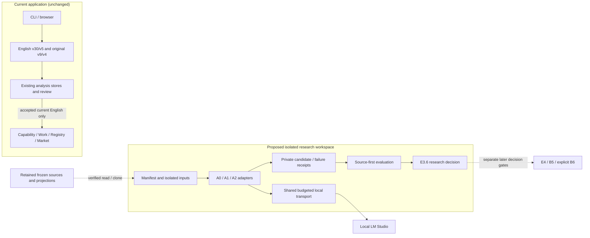
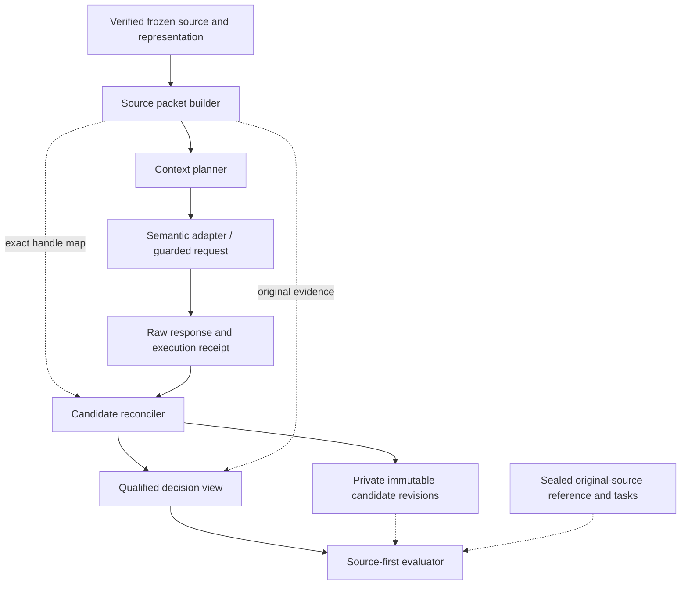
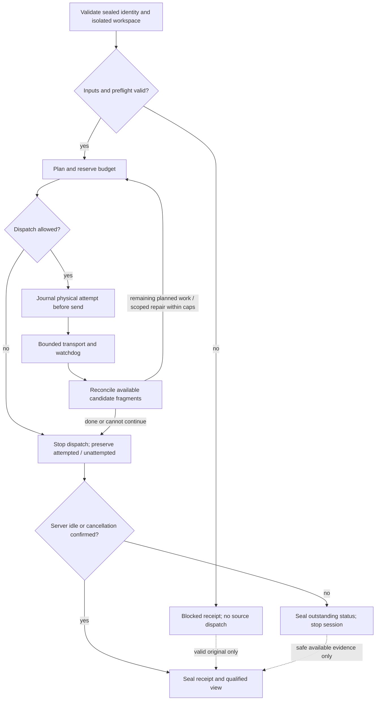

# Architecture understandability — DOC.5 selected experimental P1.6 design

**Status:** D/P — selected design, not implemented, not production-current or measured superior. **Verified baseline:** `6f2214d9d0cd538c43c18c016d62847f415cd162` (main); prior [CI 45873047605](https://github.com/motafegh/jobhunter/actions/runs/45873047605) passed. Source tree unchanged since E2.3 base `e015d4d6839f85bd0dc62e32698f4abfdc30a00c`. Current behavior is documented in [DOC.2](2026-11-25_ARCHITECTURE_UNDERSTANDABILITY_DOC2_P16_RUNTIME_BASELINE.md) and [DOC.3](2026-11-26_ARCHITECTURE_UNDERSTANDABILITY_DOC3_COMPONENT_PROFILES.md); [DOC.7](2026-11-26_ARCHITECTURE_UNDERSTANDABILITY_DOC7_ORIENTATION_CURRENTNESS.md) controls proportional orientation/currentness.

**Purpose:** implementation-facing view of decisions already selected in [E2.2–E2.5](2026-11-25_P16_EVOLUTION_E2_ARCHITECTURE_DECISION.md), not a second contract or roadmap. The [selection](2026-11-26_p16_e2/EXPERIMENT_SELECTION.json), [protocol](2026-11-26_p16_e2/EXPERIMENT_PROTOCOL_DRAFT.json), [rubric](2026-11-26_p16_e2/EVALUATION_RUBRIC_DRAFT.json) and governing Stage B plan prevail. Interface names below are logical responsibilities; E3 implementation will seal exact modules, schemas and signatures before real probes. DOC.5 does not authorize execution; E2.6 freezes requirements. No new model calls, acquisition, migration, or public entrypoint.

## 1. System boundary and comparison

Solid arrows depict logical processing or direct boundary calls as labeled, not measured call edges. Dashed arrows denote data/decision dependencies. There is intentionally no candidate-to-production data edge. No new service/DB/public routing; retain local modular monolith. Any eventual promotion needs E4/B5 and explicit B6/E5 decision.

| Arm | Actual implementation to preserve or proposed change | Control / comparison |
| --- | --- | --- |
| A0 | Current English v30/v5 service, actual inherited V15/V16 recovery, planner, model response, normalization, validation and persistence; run fresh in isolated clone. | Existing frozen v2 projection and fixed source/model/settings; same physical guard as other arms, no repair of baseline semantics or historical analysis reuse. |
| A1 | Distinct isolated v30-shaped repair family: R1 compound alternative and depth, R2 motivation, R3 false duty boundary, R4 board authority. | Same representation/model/source as A0; only selected repair changes, preserve raw and normalized results. Offline isolated repair controls before combined arm. |
| A2 | New composition-based candidate interpretation, minimal model contract, system-owned references/state, independent partial fragments. | L0 initially matched to A0/A1; L2 and L3 only selected matched subsets, not a full factorial experiment. |

A0 and A1 can return a v30-shaped payload but that does not establish accepted v5 compatibility. Do not wrap A0 in A2 partial behavior for the primary arm. A0 failed whole generation remains failed; retained raw partition evidence, when available, is diagnostic only. Source-only view is a separate comparator across arms. A1 cannot silently broaden into A2: if faithful repair cannot fit the old shape, preserve limitation and explicitly report blocked/partial. No universal model router, mandatory critic, graph/RAG/agent/training framework or new translation model in this run. A1 isolates the bounded demonstrated defects; A2 tests broader context and delivery hypotheses. The incumbent/no-change decision remains possible.

## 2. A1 seam map (S current owners, P repair)

Current locations below verified in E2.5 and unchanged at DOC.5; implementation details are not yet proven.

| Repair | Active seam | Proposed handling / stop condition |
| --- | --- | --- |
| R1 | inference/instructor_lm_studio_v23.py preserve_source_alternatives / _source_alternative_concept; v21 _canonicalize_scoped_leading_depth; v20 _validate_depth_fields_v20 | Keep scoped child/parent concept and original qualifier; no copied parent as child or erased explicit degree. Preserve unresolved meaning if shape inadequate. |
| R2 | v21 canonicalization, v20 _has_accepted_depth / _validate_depth_fields_v20 | Preserve motivation language, don't manufacture proficiency from adjective; allow unknown structured depth without loss of explicit meaning. |
| R3 | evidence_refs_v21._candidate_duty_sections / _duty_units / build_responsibility_coverage_plan_v21; V21CandidateAnalysisProvider._responsibility_coverage_plan | Scope explicit skills/qualification transition correctly; ambiguous headings remain unresolved; real missing-duty control must still fail. |
| R4 | analysis_runtime_v20._v20_deterministic_structured_skills / _run_once | Board tag observation separate from employer obligation, no automatic required/high; do not hide the board evidence or change true prose requirements. |

Use explicit isolated provider/response/dependency injection; if a test-only substitution is needed, process-isolated and allowlisted with A0 unchanged checks. No production global patch or new v31 route. First use six retained responses/15 counterfactuals from E1 and R4 additional controls; record individual offline effects, combined live arm only estimates repair-family effect. Exact adapter/prompt diffs frozen before model use; no per-ad or post-result changes.

## 3. Proposed A2 component profiles

Logical sequence, proposed; all model dispatches pass the shared guard. The evaluator's answer key is not included in any model packet. Candidate renderer reads the reconciled state, not raw model authority.

| Component / owner role | Interface (logical, not frozen code API) | Responsibilities, effects and tests |
| --- | --- | --- |
| Source packet builder / evidence engineer | verified source version + original fields/HTML + exact v2 dependency + L0/L2/L3 -> packet with ordered units and reference map | Verify original hashes/anchors/board pointers, preserve non-list text and shared context, distinct original/derived refs, deterministic ordering. Read frozen input only. Test invalid/stale/foreign hashes, repeated text positions, Unicode offsets and uncovered text. |
| Context planner and semantic adapter / model engineer | packet + verified tokenizer/template/context/model settings -> scoped requests + raw responses/attempt outcomes | Whole context where it fits, otherwise meaningful contiguous groups with neighboring/shared context, no blind truncation/category-only split; record not planned/attempted, actual context and reservation. All retries through guard, no separate critic. Test empty/oversize, missing tokenizer, overlap and refusal. |
| Candidate reconciler / contract engineer | exact packet + response + attempt receipt -> immutable claims/relations/association and coverage ledger | Resolve local refs, reject malformed/unknown/foreign associations, preserve original semantic wording and safe representation normalization, independently track review/coverage. Quarantine dependent claims, retain safe unrelated units; bounded targeted repair within guard. No lexical authority promotion. Test malformed refs, duplicates, ambiguous groups and stale dependency. |
| Partial decision view / presentation engineer | candidate revisions + per-unit scope, relation and assessment status + verified original -> labeled whole/partial/source-only/withheld view | Read-only private renderer. Original drilldown without translation/inference, no invented absence or eligibility. Unreviewed != supported; hide dependent summaries when group unresolved. Test independent safe fragments, source-only and unresolved eligibility. |
| AI Lab run/receipt / infrastructure engineer | sealed cell/model/source/config + isolated workspace -> durable predispatch journal, run and control receipts, raw private artifacts | Own path isolation, physical counters, deadline, watchdog, local endpoint, cleanup, identities, restore only experiment-owned state. Test nested retries, ninth refusal, crash, timeout, redirect/URL denial, uninstrumented path and protected state. |
| Source-first evaluator / semantic review | sealed source-only reference/tasks + raw/delivered claims/receipt -> adjudications, strict scores and paired report | E2.4 denominators, claim/coverage/relations/translation/utility separately, raw vs displayed, failed/unattempted, reviewer exposure. No model self-approval, no weighted score. Test arithmetic, N/A, empty outputs, unknown usage, critical errors and paired missing data. |

Reuse existing source_span_identity binder/verifier, B1 board pointer and structural relation principles, exact_dom_groups in B2v4 when verified, B3 alignment principles (only actual source/target matches), B4v6 drilldown and source-brief original fallback, B5 transport ideas and E1 replay evidence. Do not reuse B2 category/strength labels as truth or B1 single-category rule as mandatory ontology. No copied source classifier as semantic arbiter. No A2 versioned inheritance chain by default.

## 4. Language and interfaces

| Arm | Model-facing input | System evidence association |
| --- | --- | --- |
| L0 | Same frozen English v2 projection and board fields as baseline; no original Persian passed to model. | Exact derived field reference and verified original field association only unless exact native identity or separate verified alignment exists. Do not claim original child alignment from v2 text. Original available to reviewer/fallback outside model. |
| L2 | Exact original description and metadata; no translated aid. | Exact original source anchors/board pointers; no translation prerequisite for original source access. |
| L3 | Original plus separately labeled full frozen v2 field-only aid when it fits the selected context strategy. | Distinct original and derived reference maps, no fabricated alignment. Contradiction/unresolved aid reported; original controls review. No silent truncation or fresh translation. |

L1 specialized/contextual translation, retrieval and other new models are deferred to separate registered research. A0/A1 only L0. Native-description identity not whole-ad language identity; translated metadata still distinct. Inference request receives source text as data, not instructions. Do not add retrieved external data or arbitrary tools.

The compact A2 response is a statements array (empty possible, not evidence of absence) with **four required fields per statement**: ref (request-local), meaning (natural phrasing with material qualifiers), evidence (nonempty allowed handles for source-linked claims), basis (explicit/inferred/unresolved proposal). Roles (overlap allowed), strength, depth/experience, relations and open_questions optional, only when useful. See [fictional examples](2026-11-26_p16_e2/SEMANTIC_CONTRACT_EXAMPLES.json) and E2.2 §§11–15. No required confidence/rationale/hash/coverage/acceptance field; no new strict taxonomy. A model can propose a duty-implied capability, never fabricate employer-stated professional experience. Distinguish board observation from prose even when both mention same skill. Unknown != optional. Keep exact quotes when scope cannot be resolved.

| System-owned record | Identity / lifecycle |
| --- | --- |
| Run/cell manifest | Experiment + cell/attempt identity, sealed input/version/hash, actual model bytes/config/template/backend, code/prompt/schema/runner, planned requests, language strategy and schedule, exact dependencies. |
| Source packet and request | Exact original/derived scope, ordered units/short handles, source/field/offset/hash or board pointer, packet/request digest, selected context budget. Local aliases only within packet/request, no text-only identity. |
| Dispatch journal | Durable ordinal/reservation/time before physical send, result/usage if reported, outstanding/timeout/cancel state; crash retains attempted vs unresolved. No best-of-N. |
| Candidate claim revision | System-assigned immutable ID and normalized content digest, original raw lineage, scoped references, basis/optional dimensions, separate relation digest/dependencies (avoid cyclic hashes); corrections append successors. |
| Assessment/review | Exact claim/group/source/target revision/digest, dimension, reviewer class/exposure, disposition, reason and predecessor; raw model claims unreviewed until assessed. |
| View and evaluation receipt | Known planned/attempted/linked/unresolved scope, relation consistency, execution/association/semantic/delivery/authority axes, original drilldown and private scoring; no new accepted authority. |

Keep records in private ignored experiment directory (`data/local-acceptance/p16-evolution-e3/<experiment-id>/`), immutable published JSON/JSONL revisions plus append-only journal; atomically publish final receipts, no overwriting retained input/raw result. No new production table, corpus sync/export or public route. Exact final serializer/schema and ID conventions to seal with executable implementation. Do not make optional semantic fields mandatory for persistence.

## 5. Execution, partial failure and authority

Proposed A2/lab state flow, not A0's inherited retry algorithm. An integrity/authority/privacy breach stops affected experiment/session immediately; quarantine and reconcile protected state, no unsafe view. A critical displayed semantic error blocks retain for the arm; only isolated predefined diagnostics may continue safely under protocol. No next cell without confirmed server idle/cancellation; client timeout alone does not prove cancellation. A stopped/failed execution must remain stopped/failed even if a safe partial view exists. Any repair dispatch reenters common guard; at most one targeted recovery per materially recoverable unit/group, no wholesale retry or best-of-N. A0/A1 inherited retry paths must also pass guard, without changing A0 semantics.

| State axis | Independent system meaning |
| --- | --- |
| Execution | planned/not attempted/blocked/completed/failed/budget stopped/timeout; receipt, not truth |
| Association | verified exact/verified field-only/unresolved/invalid; not linguistic entailment |
| Semantic assessment | unreviewed/supported/partial/contradicted/unsupported/unresolved; attributed review, not automatic approval |
| Coverage | planned/attempted/linked/excluded with reason/unresolved and separately reviewed material meaning |
| Relation consistency | resolved candidate/unresolved/invalid; structural consistency separate from semantic assessment |
| Delivery | source-only/qualified partial/whole candidate/withheld; scope explicit, not accepted status |
| Authority | candidate-only; no current accepted consumer path |

| Condition | Required result |
| --- | --- |
| Valid source but no model result | Source-only view; not semantic success. |
| Invalid source identity or wrong dependency | Block/quarantine affected evidence; no current or guessed quote. |
| Exact reference but unreviewed interpretation | Clearly labeled candidate proposal, not supported fact. |
| Bad handle in one claim | Quarantine affected claim and dependent relations; safe unrelated source/claims remain available if their own dependencies valid. |
| Missing or ambiguous alternative leaf | Preserve intact group and uncertainty; suppress dependent global mandatory/eligibility summary, no flattening; unrelated safe claims remain. |
| Budget/time failure after some useful output | Preserve raw receipt and available safe fragments; explicit failed/not-attempted units; no complete or absence claim. |
| Source or required translation version changes | Stale candidate not reused as current; historical view only if allowed. |
| All planned processing complete | Whole candidate only if no known material unresolved delivery dependency for declared scope; not exhaustive understanding. |
| All local claims reviewed | Still candidate-only; no Capability/Work/Registry/Market or public corpus authority. |

D/P worked trace (fictional source, [existing E2.2 fixture](2026-11-26_p16_e2/SEMANTIC_CONTRACT_EXAMPLES.json), not generated output or new gold labels):

1. Source says “Build APIs using Python or Go”, “Python is preferred”, “Strong interest in learning”, and “Degree or equivalent project experience” (see exact fixture wording and handles). Board may separately mention Python. Original references are established by source binder, not model offsets.
2. Model proposes s1 explicit duty using either tool and s2 inferred ability to build APIs. Same evidence handle g1 may support related claims; no fabricated professional experience, no global mandatory Python/Go. s4 preferred stays preferred even if board tag matches; s7 is motivation, not depth.
3. Model may represent degree and equivalent project experience as alternative candidates s5/s6, related through g4; group scope matters. If one reference is invalid or meaning unresolved, do not make both globally mandatory. Preserve the intact original and suppress dependent eligibility summary. An independent hybrid-arrangement statement s9 may remain inspectable if it was actually processed and its dependency is valid.
4. If later groups were never attempted after budget stop, show original passages, mark unattempted scope, don't invent absence. If v2 alignment is only field-level in L0, don't imply exact Persian child evidence. This does not change model recall or turn source-only into model delivery.
5. Reviewer assesses supported meaning against original reference, not exact handle alone. Report raw errors, shown errors, material omissions and useful delivery separately per E2.4. Even reviewed candidates are never accepted v5 rows. Corrected claim gets successor revision; no historical overwrite.

## 6. AI Lab boundaries and execution sequence

The controlling protocol remains 47 maximum diagnostic cells (32 primary, 5 conditional interaction, 10 language), 9 comparative sources plus 3 offline-only compatibility cases; all exposed. M0 E4B, M1 MiMo 9B, M2 E2B only documented technical/rights preflight blocker before any diagnostic output. Both selected models require actual identity/rights/runtime feasibility. If no viable challenger, narrow by explicitly versioned pre-output decision, not hidden fallback or changed denominator. New model register separate; no download dependency.

| Guard | Required bound from E2.3 |
| --- | --- |
| Physical generation | 8 POSTs per diagnostic cell, all retries and recovery included; 376 diagnostic + 6 synthetic preflight maximum = 382 |
| Control HTTP | 16 per cell or preflight model; aggregate 800 |
| Time | 240s per cell including setup/receipt, 180s per preflight model; 4h total active; <=12 cells and <=60min per session |
| Fit / token reservation | context 16384 and output 8192 per diagnostic call; actual tokenizer/template fit verified before dispatch, preflight output 512; requested reservations not actual usage |
| Resource | free VRAM >=512MiB, Windows/WSL available RAM >=8GiB each, swap growth <=512MiB; observed memory sampling target <=1s where supported, OOM/thermal stops |
| Endpoint / isolation | explicit allowed loopback routes at port 18080; no redirects or ambient proxy; predispatch journal, parent watchdog, no uncontrolled client retries or hidden external dispatch |

All caps and actual stop semantics in protocol prevail; no change to E2.3. If guard instrumentation incomplete, block real probes. No new job/source requests, no fresh translation, no new B5 cohort. Per-run result includes missing usage as unknown, not zero; elapsed includes failed/setup/control costs. Preserve every planned/attempted/unattempted cell. Source-only reference/tasks and evaluation implementation sealed before diagnostic generation, separate reference from model packets and mask arm labels where feasible; review remains exposed. E2.4 absolute gates and benefit paths control, not a new weighted score.

| Milestone | Implementation-facing exit requirement |
| --- | --- |
| E2.6 | Reconcile governing/status docs and freeze selected requirements; DOC.5 is design only. |
| E3.1 | Isolated guard/runner first, then A0 unchanged, A1 offline repair and A2 compact contract/reconciliation; prove protected boundary and negative controls before real model probes. |
| E3.2 | L0/L2/L3 packet/association implementation and fidelity controls. |
| E3.3 | Partial view, dependency-safe fallback and contextual inference/authority tests. |
| E3.4 | Seal executable manifest, source-only references/tasks and scorer; qualify actual local model/runtime with bounded probes, then fixed schedule only if safe. |
| E3.5 | Source-first assessment, paired evaluation and offline compatibility/privacy regressions. |
| E3.6 | Retain/revise/reject/defer from evidence; no deployment decision implied. |

## 7. Compatibility, rollback and documentation currentness

A0 current source tree and public entrypoints remain unchanged; verify exact relevant files and dependencies at E3 seal. A1/A2 proposed distinct contract/version IDs in selection (p16-e3-a1-repair-v1, p16-e3-a2-semantic-v1, p16-e3-a2-context-v1, p16-e3-candidate-envelope-v1, p16-e3-lab-receipt-v1); no accepted v5/v4 identity assigned by shape alone. No candidate adapter into accepted consumers. Existing accepted-only compatibility v20/v21/v23/v28/v5 and v9 new-pending/history retained, no source/translation or accepted-row relabel. Isolated clones from verified frozen backups; refuse live paths and hidden automatic corpus exports. Directory-based alternate export is not sufficient alone: research path must not invoke export at all.

Rollback: stop dispatch, confirm idle/cancel, preserve journal/partial receipt and isolate failed state; restore only experiment-owned runtime state. Do not kill/reset user's server/workloads or delete historical evidence. Revert disconnected research commit normally if needed, not force-push. No production migration now. Later B6 requires explicit approval, faithful versioned durable contract or sidecar, exact dependency/currentness, backup/restore rehearsal, idempotent migration, review/accepted-only consumer checks and end-to-end rollback. No forced lossy conversion to v5. If incompatibility unresolved, retain research sidecar/no promotion.

After E3 implementation update proposed vs as-built status, verify actual entrypoints, owners, data/authority, failure/recovery and consumers via DOC.3/7; optional DOC.4 inspection supplements but does not prove runtime. Stamp revision/limits and link test/receipt evidence. No broad DOC.6 prerequisite. Before E5 promotion independently verify as-built and approved boundaries, update living maps only at evidence-supported gates.

## 8. Design verification and remaining uncertainty

[Safe verification receipt](2026-11-26_doc5_design/SAFE_DOC5_DESIGN_VERIFICATION.json) records unchanged design artifacts, exact schedule/limits/fixture consistency, current runtime fingerprint comparison, existing focused tests and protected state. Diagrams reviewed as proposed flow, rendering not tested. No implementation or new semantic test claims; E3 code/interface serialization, actual A1 injection viability, tokenizer/context fit, runtime/rights qualification, guard enforcement, source-first references and full evaluator remain to be established. No new production policy, scope expansion or winner selection. DOC.5 closes proposed architecture documentation only; E2.6 next.
