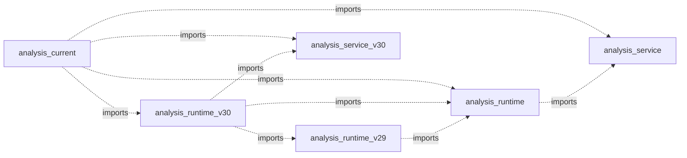

# P1.6 curated architecture inspection

Revision: `ab5dca798e60283eb32fed366fe516b7f833e557`
Inspected sources dirty: False

## Limits
- Curated scope, not transitive closure or a dynamic call graph.
- Imports and lexical calls do not establish actual execution or authority.
- Runtime introspection is optional, curated, and not a live inference trace.
- Schema metadata describes a supplied frozen snapshot, not current live state.
- No semantic correctness, completeness or promotion claim.

## Static source inventory

| File | Symbols | SHA-256 |
| --- | ---: | --- |
| `src/jobhunter/app_entrypoint.py` | 8 | `b5d8991519b2` |
| `src/jobhunter/entrypoint.py` | 24 | `b085ec26a8e8` |
| `src/jobhunter/analysis_current.py` | 10 | `38da2369c4bd` |
| `src/jobhunter/analysis_runtime.py` | 5 | `77cfe2c22395` |
| `src/jobhunter/analysis_service.py` | 27 | `d1f28ffda1d7` |
| `src/jobhunter/jobinja_detail_service.py` | 11 | `3a3a27acc434` |
| `src/jobhunter/translation_service.py` | 22 | `ae81cccd0610` |
| `src/jobhunter/translation_store.py` | 15 | `dc991ba0ed2e` |
| `src/jobhunter/translation/projection.py` | 10 | `e034cb2ac096` |
| `src/jobhunter/analysis_runtime_v20.py` | 19 | `18aadbe0654c` |
| `src/jobhunter/inference/lm_studio_runtime.py` | 4 | `bef19de7f8e2` |
| `src/jobhunter/inference/instructor_lm_studio_v24.py` | 1 | `8e10b89f2eaa` |
| `src/jobhunter/inference/instructor_lm_studio_v20.py` | 13 | `55eec7c0d4e2` |
| `src/jobhunter/inference/instructor_lm_studio_v23.py` | 9 | `e5863aa02998` |
| `src/jobhunter/analysis_runtime_v23.py` | 11 | `f67e574b4f54` |
| `src/jobhunter/analysis_persistence_v23.py` | 3 | `f60730484723` |
| `src/jobhunter/analysis_store.py` | 15 | `73e76a745452` |
| `src/jobhunter/analysis_failure_diagnostics.py` | 15 | `6db4a2be7506` |
| `src/jobhunter/analysis_item_review.py` | 17 | `882025a81f22` |
| `src/jobhunter/source_span_identity.py` | 7 | `356eb096f0b4` |
| `src/jobhunter/source_item_candidate_b2_v7_dom.py` | 3 | `29a6f60a2ac2` |
| `src/jobhunter/source_bound_translation_b3.py` | 15 | `e432cdb6dd51` |
| `src/jobhunter/source_job_understanding_b4.py` | 10 | `f19780e1c229` |
| `src/jobhunter/source_qualified_b4v5.py` | 8 | `1e614b969bc0` |
| `src/jobhunter/source_qualified_b4v6.py` | 9 | `1c01e2f33746` |
| `src/jobhunter/source_brief_cli.py` | 3 | `9013206b3213` |
| `src/jobhunter/capability_service_v8.py` | 13 | `486f2d5b8afd` |
| `src/jobhunter/work_intelligence_service.py` | 28 | `903376bf546c` |
| `src/jobhunter/canonical_registry_review.py` | 16 | `9fbbd327aac2` |
| `src/jobhunter/public_corpus.py` | 20 | `c082139cd0d4` |
| `src/jobhunter/web/app.py` | 24 | `2d6f625e42ba` |
| `src/jobhunter/analysis_runtime_v30.py` | 3 | `79cceb4b13b3` |
| `src/jobhunter/analysis_runtime_v29.py` | 3 | `d83d7323b947` |
| `src/jobhunter/analysis_runtime_v27.py` | 6 | `df24069ffb56` |
| `src/jobhunter/analysis_runtime_v26.py` | 5 | `095d0e6d6e74` |
| `src/jobhunter/analysis_runtime_v25.py` | 7 | `51281293ab1f` |
| `src/jobhunter/analysis_runtime_v21.py` | 9 | `fc08ddaf15b4` |
| `src/jobhunter/analysis_runtime_v16.py` | 5 | `68964da52184` |
| `src/jobhunter/analysis_runtime_v15.py` | 7 | `a0584a19a322` |
| `src/jobhunter/analysis_service_v30.py` | 1 | `45e26aea142c` |
| `src/jobhunter/analysis_service_v28.py` | 2 | `8229f899b0aa` |
| `src/jobhunter/analysis_service_v21.py` | 4 | `6214cfb3234e` |
| `src/jobhunter/analysis_service_v20.py` | 6 | `ced64a316200` |
| `src/jobhunter/inference/instructor_lm_studio_v30.py` | 3 | `c8bed42c7e67` |

## Selected direct imports (not calls)

## Resolved method owners

| Requested | Actual owner | File |
| --- | --- | --- |
| `JobAnalysisServiceV30._persist_analysis` | `JobAnalysisServiceV28._persist_analysis` | `src/jobhunter/analysis_service_v28.py:25` |
| `JobAnalysisServiceV30._record_failed_attempt` | `JobAnalysisServiceV21._record_failed_attempt` | `src/jobhunter/analysis_service_v21.py:86` |
| `JobAnalysisServiceV30.analyze_english_job` | `JobAnalysisServiceV21.analyze_english_job` | `src/jobhunter/analysis_service_v21.py:110` |
| `V30CandidateAnalysisProvider._complete_partition` | `V30CandidateAnalysisProvider._complete_partition` | `src/jobhunter/analysis_runtime_v30.py:19` |
| `V30CandidateAnalysisProvider._persistable_structured` | `V23CandidateAnalysisProvider._persistable_structured` | `src/jobhunter/analysis_runtime_v23.py:73` |
| `V30CandidateAnalysisProvider._requirement_coverage_plan` | `V26CandidateAnalysisProvider._requirement_coverage_plan` | `src/jobhunter/analysis_runtime_v26.py:21` |
| `V30CandidateAnalysisProvider._requirement_partitions` | `V25CandidateAnalysisProvider._requirement_partitions` | `src/jobhunter/analysis_runtime_v25.py:130` |
| `V30CandidateAnalysisProvider._responsibility_coverage_plan` | `V21CandidateAnalysisProvider._responsibility_coverage_plan` | `src/jobhunter/analysis_runtime_v21.py:107` |
| `V30CandidateAnalysisProvider._run_once` | `V27CandidateAnalysisProvider._run_once` | `src/jobhunter/analysis_runtime_v27.py:26` |
| `V30CandidateAnalysisProvider.complete_structured` | `V16CandidateAnalysisProvider.complete_structured` | `src/jobhunter/analysis_runtime_v16.py:62` |

## Schema summaries

- AnalysisRequirementV30: 8 fields; 13 model validators.
- JobAnalysisResponseV30: 4 fields; 4 model validators.

## Frozen schema dependencies

- job_detail_versions.job_posting_id -> job_postings.id
- job_translation_artifacts.job_detail_version_id -> job_detail_versions.id
- job_analysis_artifacts.translation_artifact_id -> job_translation_artifacts.id
- job_analysis_artifacts.job_detail_version_id -> job_detail_versions.id
- job_analysis_attempts.artifact_id -> job_analysis_artifacts.id
- job_analysis_attempts.job_detail_version_id -> job_detail_versions.id
- job_analysis_item_review_sessions: absent from snapshot.
- job_analysis_item_review_events: absent from snapshot.

Trigger names only; SQL semantics and selector logic require review.
